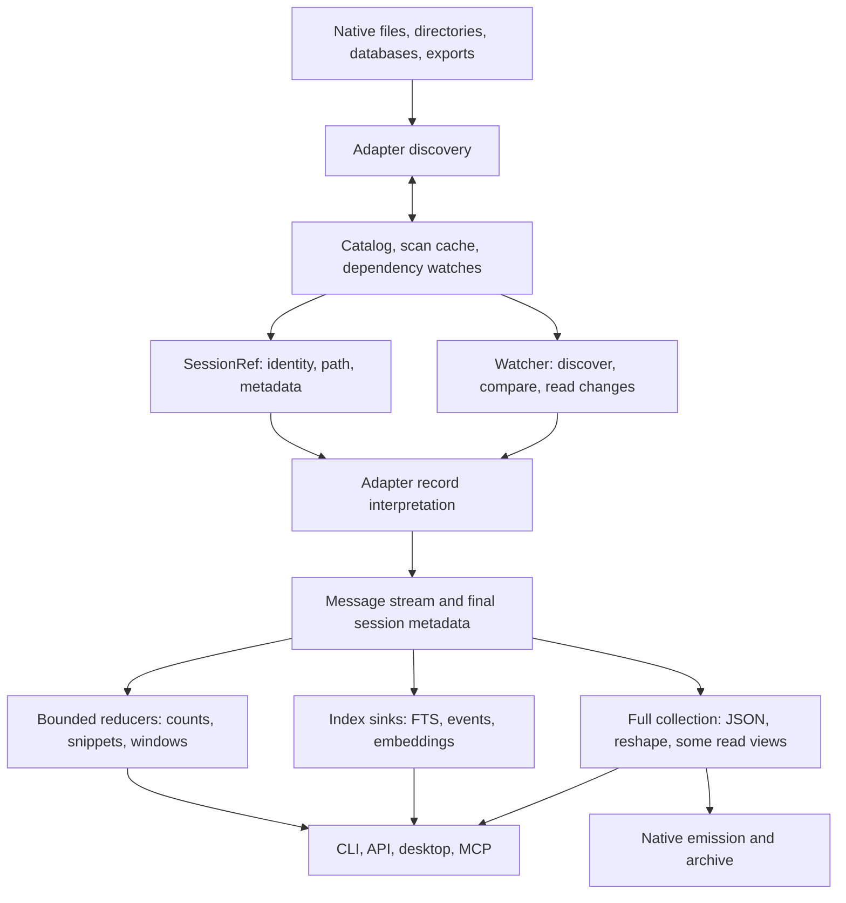

# Store performance: the system we are optimizing

Source audit: `c0f0044`, 2026-10-12; updated through the first pass and the ongoing `perf/excellence-pass`.
This is the working model and tracker for the performance pass. Measurements in `PERF.md` remain historical observations; their causal
explanations are not all supported by the implementation. Paths below are relative to `crates/`.

## What cv does

cv discovers sessions in heterogeneous stores, interprets their native histories into a common
message IR, and serves several different products from that IR: transcript reading, structured
facts, full-text/semantic search, live following, archives, datasets, and native session reshaping.
The task log is a separate event-sourced coordination store. Native CLI, HTTP, desktop and MCP
share much, but not all, of their read implementation. Browser upload is a separate, owned-memory
ingestion path for Claude, Codex and Gemini.

The key distinction is **source traversal, interpretation, payload decoding, retention, and
output**. Calling a method `stream` bounds none of those automatically. A reader can retain the
whole source before its first callback; a sink can collect everything; a bounded output chunker
can decode a whole field first. Each bound must hold across the composed path.

## Existing foundations to retain

- Discovery already parallelizes adapters and many per-file scans (`cv-core/src/lib.rs`).
  Warm ordinary listings use the catalog and scoped freshness probes; they need no body parse.
- The common API is `Adapter::stream` plus `MessageSink`. `parse` is collection over that API.
  `ParseOptions` separates full extras, format-complete carriers, lazy text spans and offsets.
- Claude/Codex have lazy source spans and resumable stream state. Codex has a useful direct path
  for giant tool outputs; most unchanged index jobs are skipped.
- FTS already combines text, event and affordance extraction in one pass, uses one writer,
  streams body documents through a bounded channel, and publishes resume marks after commit.
  Its scheduler already admits at most 2 GiB of estimated **source file bytes**.
- OpenCode, Goose and Hermes use per-session row iteration and the stores' existing indexes.
  Fixture query plans also support Devin's chain lookups and OpenClaw's event sequence query.
  Do not replace these with speculative PRAGMA tuning.
- Text `show --last N` already uses one lazy pass and a bounded deque. API message pages are
  lazy windows; event queries and `has:` counts have useful catalog fast paths.

## Reader inventory

| Store / format | Current traversal and retained state | Main unresolved cost |
|---|---|---|
| Claude JSONL | Parallel metadata discovery; mmap typed borrowed conversational records including rich reads; checkpoints | Structured arguments/details and uncommon fallback records remain owned; portable transport retains one line |
| Codex JSONL | mmap line scan and bounded event-authority prepass; giant output spans through shared dispatch; checkpoints | Repeated JSON scans; buffered/zstd input still retains the largest raw line |
| Codex legacy JSON / zstd | Separate whole-document/decompression paths | No general incremental marks; audit heap and semantic parity separately |
| Gemini legacy JSON | mmap, validated raw records, lazy text spans; metadata discovery | Full modes, composite tool results, thoughts and rich extras still own payloads |
| Gemini JSONL | Native mmap replay retains order + raw body ranges; buffered fallback without mmap | Per-record navigation; `$set`/rewind changes old logical messages; non-mmap history remains owned |
| Qwen modern JSONL | Line stream, call/spawn state; keeps reading after sink stops for metadata | Discovery counts without collecting; direct project JSONL resumes finalized records; record text remains owned |
| Kimi | Context stream + pending usage message, rotated prefix dedup | Wire sidecar uses raw ranges and lazy output spans; structural lookup state and mutable trailing usage remain |
| Kimi Code | One LLM step buffered; source-projected inventory; sidecar output references | Step and structured carriers can be large; mutable state/wire semantics |
| Grok | History stream + pending reasoning; metadata-projected discovery and sidecars | One history record and retained tool metadata; enrichment can revise old messages |
| Cline/Roo legacy | mmap raw history items, one record at a time | Full discovery/UI sidecar trees; no lazy text |
| Cline SDK | Native source mapping, raw records, shared Anthropic block dispatch | Portable cold source buffer; rich structured fields remain owned |
| Continue | mmap raw history items; tool-answer dedup | Metadata-only discovery now skips bodies; stream records and mutable snapshots remain |
| OpenCode files | Ordered message descriptors, parts per message | Reads message metadata twice; dependency set includes parts |
| OpenCode SQLite | Indexed rows / parts per session | Discovery count scans; WAL and per-session invalidation |
| Cursor SQLite | Indexed composer key range; prepared bubble lookups | Composed sessions/blobs; global/workspace dependencies |
| Devin SQLite | Session forest, node metadata and selected chain, then rows | Structural prepass over all branches; bodies already streamed |
| Hermes SQLite | Indexed message rows + generation dedup/trailing user texts | Pathological trailing prompts; shared DB invalidation |
| Goose SQLite | Indexed message rows | Preserve efficient query shape; measure before changing |
| OpenClaw JSONL / SQLite | SQLite row cursors, compact tree navigation and selected payload replay | Tree metadata grows with events; selected row blobs remain owned; extra validation costs CPU |
| Zed SQLite | Metadata-only ordered rows and incremental blobs under one snapshot; stream decodes once into owned spill, then validated message replay | Decoder/one message/known metadata; decoded file pages and temporary I/O; WITHOUT ROWID fallback retains one native cell |
| LM Studio | Raw-turn mmap stream | Metadata-only discovery skips body trees; escaped scratch and first-title candidate remain owned |
| ChatGPT / Claude account exports | Bounded metadata cache and source ranges; selected-conversation replay | Cold portable source buffer, branch descriptors, joined text and tool argument Values |
| OpenSession | Native raw document validation and per-message IR projection | Portable cold source buffer; authoritative rich IR fields remain owned |

Registry: `cv-core/src/harness/mod.rs`; implementations under `cv-core/src/harness/`.
Directory entry sizes and whole database sizes are **not** per-session transcript byte counts.
Compressed, encoded, scanned, decoded and emitted bytes must be labeled separately.

## Consumer inventory

| Operation | Actual work | Optimization boundary |
|---|---|---|
| Warm ls/stats | Catalog probe, metadata rows, sort/filter | Preserve cheap path; measure discovery separately |
| Full discovery | Scans + cache persistence + catalog replacement/watch construction | Metadata reducers instead of collect-to-count; dependency-aware caching |
| Text windows / last N | Lazy range or deque, selected messages materialized | Already useful bounds; giant selected output is still output-sized |
| JSON show / MCP show | Lazy full-extras stream into selected window; EOF metadata retained | Selected output and demanded structured extras; selected-message serialization for byte budgets |
| Affordance view | Lazy full-extras stream into classified rows; bounded text summaries | Rich extras, side stores and result rows; escaped validation still traverses the whole field |
| Doctor | Lazy-extra stream; resolved text lengths and JSON writer counts | Attribution state, adapter rich/fallback parsing and structured arguments |
| Query text predicate | Exact index-only matching IDs; cheap tri-state evaluation before parse | Mixed predicates still parse when cheap facts cannot decide |
| Other rich predicates | Predicate-sized streamed tool/model facts and shared source probes | Distinct unresolved relative paths retained until final cwd; compaction uses its existing separate boundary |
| FTS | Chunked text, bounded event spool, counts, checkpoint state; one catalog connection per sweep | Inline payloads and queued bytes remain; each consumer still commits independently |
| Semantic indexing | Second discovery, full rebuild of capped session heads | Reuse discovery and unchanged vectors; only after measuring importance |
| API pagination | Each page starts source traversal at zero; head reads whole source | Verified anchors or cache; head need not block first page rendering |
| Watch | Discovery, full parse/count of changed session; old prefix parse on first append | Reuse safe stable cursors; logical edits must invalidate old output |
| Archive | Whole parse/serialize/compare even unchanged; watch reparses again | Skip unchanged dependencies; catalog cleanup scans now grow geometrically |
| Dataset | One session's lazy message vector, writer resolves output | Escaped chunk bound; streaming filters where semantics allow |
| Pack/tools/token stats | Tool histograms fold bounded per-message event scratch; pack excerpts use a ring | Stats usage aggregation and repeated passes; preserve duplicate precedence and float addition order |
| Reshape/emit | Full IR or raw records, often several owned copies and verification rereads | Full output is required; simultaneous full copies generally are not |
| Task coordination | Replay full append-only task log under CAS for writes | Separate workload; snapshot/tail only if measured task volume warrants it |

Key sources: `cv/src/cmd/view.rs`, `cv-core/src/{api,affordance,watch,lazy,stream}.rs`,
`cv-search/src/{fts,semantic}.rs`, `cv/src/cmd/{query,archive,pack,compose}.rs`.

## Correctness boundaries before reuse

1. Physical append does not imply logical append. Gemini replacement/rewind and OpenClaw leaf
   changes can replace an old visible suffix; Kimi usage, Kimi Code unfinished steps and Grok
   reasoning can revise the last pending message. Checkpoint only finalized output/state.
2. Identity includes dependencies: SQLite WAL, directory children, side metadata, rotation
   manifests and sidecar output. Existing freshness policies disagree about these dependencies.
   Catalog DB watches include WAL appearance, modification and disappearance. Counts, events and
   each search index now keep separate canonical dependency metadata baselines, tied to the primary
   tuple. SQL output and stamps publish atomically; FTS invalidates its old baseline before changes
   and publishes a revalidated baseline after commit. Operation-local probes share file stats.
   Known adapter-local sidecars, directory members and WAL files are covered. Consumers capture
   conditional Claude fork siblings and resolved external output paths before reading them, including
   absent files. Complete read sets survive prefix checkpoints and are revalidated at publication.
   Version-1 dependency baselines reread once through normal refresh without an index rebuild.
3. Current resume marks sample the first 4 KiB and the 4 KiB preceding the mark. This is not a
   proof that the entire prefix is unchanged. FTS now requires growth before using a mark, so
   same-size rewrites take a whole pass; inode replacement also rejects reuse. A rewrite followed by
   growth can still escape the samples, and a primary rewrite restoring size/mtime can evade freshness.
   Unconditional detection of arbitrary prefix edits requires reading that prefix or a trusted
   writer/filesystem change signal; do not promise both zero prefix reads and such detection.
4. Lazy/full equivalence must compare **resolved content** and metadata. The existing stream dump
   serializes span descriptors, not their resolved text. Span layout changes are not output changes.
5. Existing format bugs must be isolated and tested as correctness changes. Fixed separately:
   Codex's giant-output shortcut dropped metadata preserved by its ordinary branch; Gemini's native
   wrapper omitted metadata fields and rejected escaped borrowed strings.
6. Exact final metadata can require EOF, even when a window needs only early messages. Separate
   payload retention from metadata traversal rather than silently returning incomplete metadata.

## Engineering direction

Optimize the composition, in this order:

1. **Consumer demand:** stop collecting payloads that a view discards; separate index matches from
   snippet generation. Use existing sinks and APIs rather than another command family.
2. **Payload lifetime:** genuinely bounded decoding for escaped spans, typed borrowed hot records,
   metadata-only discovery, raw source ranges for replay bodies. Preserve full/complete modes.
3. **Source/dependency identity:** consolidate invalidation and make format-specific stable append
   boundaries explicit before adding more resume implementations.
4. **Repeated work:** share passes, archive references, parsed metadata and verified positions where
   lifetime/invalidation makes reuse sound. Do not create a new persistent index without evidence.
5. **Concurrency:** once per-operation working sets are known, charge actual conservative working
   cost; bound in-flight payloads and writer queues. Parallelize independent work without multiplying
   unbounded allocations. File-backed resident pages and private heap need different interpretation.

No promised multiplier applies to every path. Exact first-run counts over an unindexed fleet
require reading their records unless the harness supplies authoritative metadata. A 300 ms listing
budget cannot justify pretending exact counts can be recovered without those reads.

## Measurement and active work

Every change needs a narrow behavioral counterexample or measured cost, followed by composed-path
verification. The initial suite will distinguish direct adapter discard/count, discovery, derived
views, windows, full output, incremental index/watch, and writer costs. Measure tiny records, giant
escaped/unescaped text, tool arguments, many records, replay controls and database WAL changes.

Record wall/CPU, decoded or traversed bytes, messages, peak live allocations, RSS and (on macOS)
footprint. Allocation instrumentation and output hashing are separate runs from throughput timing.
Use explicit-root adapters and frozen scratch sources; never mutate the real stores. Cold/warm
means which cache is cold, not an unsupported claim that the OS page cache was evicted.

Historical baseline confirmation: a release direct lazy count on the frozen 313.8 MB Gemini
recording emitted 199 messages at best-of-three 0.944 s (332 MB/s). The process also performed
three whole-file read baselines and reached 1.77 GB RSS / 1.45 GB footprint; those process peaks
are **not isolated adapter heap**.

The isolated `store_probe` baseline attributes Gemini's direct lazy count to 841,082,713 bytes
of peak live Rust allocations (847 MB process footprint). The corresponding Codex read has
25.7 MB live Rust allocations and 47.5 MB footprint despite 761 MB RSS: most resident pages are
file-backed. These measurements distinguish private allocation from mapped input.

The probe separates direct adapter operations from production affordance reads. Its window
operation demonstrates retention shape;
production JSON show additionally counts, serializes selected messages for budgets and handles
continuation. The probe window is not an end-to-end show benchmark. Separate actual CLI tests
compare full JSON output with the lazy-extra window implementation, including EOF metadata. Hash runs resolve spans and canonicalize
message and metadata maps; they are separate from timing and allocation runs. The heap feature
counts requested Rust allocations, excluding SQLite/native allocation and allocator fragmentation.

Completed Cursor discovery query check: with 20,000 unrelated bubble rows and three composers,
SQLite VM steps fell from 80,043 to 52 and full-scan steps to zero. The binary prefix range keeps
the former row order and has a fallback for tables without rowids.

The frozen fleet comparison covers 5,960 references (5,959 primary paths, 95.92 GB) in three
modes: 17,880 baseline/candidate pairs. Claude and Gemini match in every mode; Codex bulk/full
match, and its 955 changed lazy results exactly match the baseline ordinary bulk parser. These
are corrected giant-path metadata omissions, not unexplained content drift. A 43-reference
complete-mode subset also matches. The frozen 35,116 source/companion files remained unchanged;
live edits occurring after the freeze are excluded from the comparison.

The giant Codex gate found a hidden full-Value allocation in event-authority detection before the
mapped stream. Detection now projects only discriminants from strictly validated raw records and
reuses the mapping. Tool-only histories therefore stay bounded even when no natural-language
record allows an early exit. Buffered/zstd traversal still retains a largest-line buffer.

Event publication now spills ordered rows above a 256 KiB charged-memory budget to an owned
private temporary file, then reads that file once inside the existing SQL transaction. Corrupt,
missing or extra rows roll back both output and its dependency baseline. Failed publication clears
the resume mark and is reported by indexing; successful independent FTS/count work remains. An
FTS-only pass retains event checkpoint state without extracting rows, preserving later append reuse.

| Isolated publication measurement | Previous path | Candidate |
|---|---:|---:|
| 20,000 event rows: peak live Rust allocation | 7,211,499 B | 358,005 B |
| 200,000 event rows: peak live Rust allocation | 58,878,796 B | 358,007 B |
| 200,000 event rows: clean median wall time | 1.224 s | 1.207 s |
| 1,000 sessions, 16 rows + counts each: clean median wall time | 2.865 s | 0.368 s |
| Same 1,000-session writer stage: user + system CPU | 2.33 s | 0.31 s |

The event probe uses valid Claude JSONL with small tool inputs and distinct targets, including SQL
publication. Spooling writes and reads 2,417,780 B for 20,000 rows and 24,577,780 B for 200,000 rows,
once in each direction. The largest decoded record/target is still a separate bound. Native SQLite
allocation and mapped input are excluded from Rust heap instrumentation.

The `cv-core` example `catalog_writer_probe legacy|writer SESSIONS SOURCE` isolates publication
from parsing and Tantivy. With fresh scratch catalogs, three clean runs per mode produced identical
16,000 event rows, 1,000 count rows, 2,000 baselines and a 2,052,096 B catalog. Reusing one connection
amortizes schema initialization, prepared statements and close/checkpoint work; it preserves separate
per-consumer transactions and never holds a write lock across source reads. Native peak footprint
rose from 3.75 MB to 5.36 MB in this probe because the connection/page cache lives longer. These
stage timings do not claim the same multiplier for full indexing: a later fleet sample was waiting
on Tantivy merges after parsing had finished.

A giant `ToolUse.input` exposed another composed bound: compact JSON was serialized into a whole
String, copied into the chunk buffer, then copied into a single oversized Tantivy document. FTS
now streams Value's same compact serialization into UTF-8-safe documents capped at twice
`CHUNK_BYTES` (8 MiB in production). Canonical bytes, source insertion order and previews are
preserved. Giant-argument document boundaries change, so term conjunctions still obey the existing
per-document search semantics; this unreleased index version already requires a first-run rebuild.

The ignored `fts::tests::tool_input_fts_demand_probe` accepts frozen scratch
`CV_FTS_INPUT_PROBE`/`CV_FTS_INPUT_BYTES`, emits and drops real documents from `index_session`, and
verifies the concatenated canonical body hash plus event/count publication. It excludes Tantivy
tokenization, writer queues, commits and merging. With 100 MB of plain input, the old maximum body
document was 100,000,092 B; the candidate stays at the test configuration's 4,096 B cap. Process
footprint fell from 503,857,920 B to 203,571,752 B; RSS fell from 614,481,920 B to 314,343,424 B.
These debug-stage process measurements include mapped/native memory. Owned JSON input and the
tee clone remain proportional to input size; this is not a universal index heap bound.

The `check-heap-budget.py --only events` gate covers ordered extraction through SQL
publication at 20,000/200,000 fixed-size records, compares every persisted row with the retained
collector, and verifies source stamps, spool I/O and normal cleanup. Live Rust peaks are
352,006/352,009 B versus 7,073,127/57,619,016 B for the collector. Its fixed 1 MiB ceiling and
256 KiB growth allowance exclude giant individual inputs and native SQLite memory. Since
`100509c`, `.github/workflows/ci.yml` invokes it separately alongside the other heap
campaigns; it is still a separately selected driver campaign rather than part of the default
stores/chunks invocation.

Zed's incremental two-pass reader at `100509c` established bounded native memory but cost
2.2–2.6× the original reader's clean streaming CPU on 64 MiB low-compressibility histories.
Profiles attributed most execution to repeated zstd decoding and JSON parsing, with SQLite
around 2% of sampled execution. The decoded-spill follow-up (`d0093be`, integrated as `5ae0eda`)
preserves full validation before callbacks, authoritative duplicate-last message selection and
the same SQLite snapshot, while decompressing only once. Discovery retains its existing one-pass
reader.

Three rotated clean subprocess triples measured original / two-pass / spill CPU medians of
0.408 / 1.047 / 0.382 s plain and 0.552 / 1.191 / 0.639 s escaped. Wall medians were
0.418 / 1.062 / 0.397 s and 0.559 / 1.195 / 0.652 s. These are synthetic 64 MiB discard operations
under shared load 34–38, with uncontrolled OS cache, separate from allocator and hash runs.
Escaped CPU remains about 16% above the original; the large intermediate regression is removed.

At 16/64 MiB, requested Rust peak stays flat at about 6.67 MB; native footprint is 14.5 → 14.5 MB
plain and 14.1 → 15.2 MB escaped. RSS grows 38.1 → 88.5 MB / 38.8 → 93.4 MB because decoded
file pages are mapped. Each operation writes the full decoded source once: 16.8 → 67.2 MB plain
or 17.8 → 71.4 MB escaped, then scans it for validation and replay. Physical I/O depends on OS
cache. Owned temporary directories are empty after measured exits; Unix files are unlinked
while owned descriptors remain live. All four fixtures match exact preserved-order resolved
message and metadata digests, with 128/512 callbacks. The source-sized native-cell fallback and
largest demanded record remain separate limits. Detailed measurement definitions are in
`PERF.md`; these results do not claim combined final gates or whole-fleet throughput.

Tracker (keep unfinished work visible; measurements determine later ordering):

- [x] Source map: readers, consumers, caches, index, follow/archive, write paths and gates.
- [x] Correct the handoff's assumptions about existing streaming, parallelism and admission.
- [x] Independent allocation/throughput/equivalence probes and initial valid scale fixtures.
- [x] Streaming affordance and full-fidelity JSON-window consumers.
- [x] Index-only text matching and deferred snippets.
- [x] Bounded escaped-string chunk decoding, with and without mmap; serde windows replace the slower initial decoder.
- [x] Process-isolated heap gates for growing histories and giant Claude/Codex/Gemini fields, plus escaped span decoding; negative baseline proof.
- [ ] Extend scale fixtures and heap gates to the remaining store formats.
- [x] Gemini metadata discovery, strict raw validation, lazy text and mmap replay payload ranges.
- [x] Claude typed borrowed hot records and mmap lazy lines; Codex giant-path metadata parity.
- [x] Claude metadata discovery and fork-head projections, including giant first records.
- [x] Claude conversational lazy-extra projections and bounded notification classification; raw serialized metadata order checked.
- [ ] Structured arguments/details and uncommon Claude fallback record allocations.
- [x] Per-consumer SQLite/WAL/known-sidecar freshness; atomic SQL publication; scan interpretation migration; inode resume guard.
- [x] Consumer-recorded dependency read sets for conditional fork inference and adopted external outputs.
- [x] Continue and LM Studio metadata-only discovery, including explicit-root isolation.
- [x] Native SDK, exports and OpenSession source-backed readers; bounded export metadata cache.
- [ ] Portable cold document buffers, composite payloads and Continue/LM Studio selected records.
- [x] OpenClaw SQLite row/tree replay and registry filtering without whole body collections.
- [x] Kimi wire output ranges and Zed per-message blob replay.
- [x] Grok metadata/sidecar projection, Kimi Code inventory projection and Zed incremental SQLite blobs.
- [ ] Kimi Code logical-step and selected structured payload retention; preserve necessary Devin forest navigation state.
- [x] Native Qwen finalized-record checkpoints with composed count/event/FTS parity; replay formats decline reuse.
- [ ] Other format-safe continuation; repeated watcher tails and archive rereads.
- [x] Bound event extraction/publication retention and reuse the serial catalog writer connection; preserve rollback and append coverage.
- [ ] Index admission and queued payload bytes; assess transaction batching with write-lock contention measurements and final Tantivy merge/query costs.
- [x] Stream predicate-sized rich query facts; cross-harness oracle and shared source probes.
- [x] Stream tool histograms and enforce semantic body/label caps, including tool input serialization.
- [ ] API pagination, stats aggregation and semantic rebuilds: prioritize by measurements.
- [x] Single-pass selected escaped materialization and decoded lengths; rollback preserves malformed raw fallback.
- [x] Frozen Claude/Codex/Gemini fleet parity: 5,960 references in lazy/bulk/full modes; representative complete-mode checks.
- [x] First implementation integrated; complete CI gates and final detector fidelity checks passed. Remaining workloads stay listed above.

Validation of the implementation through `17a9cd1`: 910 workspace tests, the release corpus parse
budget, live-heap gates in both configurations, fmt/clippy, workspace/no-default/wasm builds,
package verification, manual build/names, dist plan, five desktop tests, nine corpus-tool tests and
55 web selftests passed. Final detector checks add 43 lazy sessions, 30 Codex bulk/full reads and
78 synthetic before/after pairs, all exact. These do not claim a new full-fleet index timing or
universal heap bounds for the unfinished paths.

The full gate roster is `.github/workflows/ci.yml`, including release parse budget, manual build,
search without default features, dist plan, wasm-pack, the separate desktop workspace and web
selftest. `PERF-HANDOFF.md`'s inline gate list omits several of these.

## Structured tool arguments: migrated consumers, activated Claude producer

The motivating counterexample remains a producer control: a 25/100 MB owned ToolUse input costs
25/100 MB even with a discard sink. `Block::ToolUse.input` now uses the complete owned/source
`Json` abstraction instead of requiring a Value. Doctor, events/affordances, query/tool reducers,
search body generation, rendering, mutation and their callers have migrated to explicit fallible
demands. Typed field views, canonical length, bounded prefixes and canonical writers avoid whole
input materialization when that is not requested. Selected full output and mutation explicitly
resolve the complete value.

Direct native `Json::source` probes include construction and strict validation, then length or
streamed canonical output. Plain 25/100 MB inputs use 1,908 B peak Rust allocation above baseline
for length; escaped 16/64 MiB sources use 230,532 B, flat at both sizes. Separate writer/hash runs
use 1,893 B / 230,517 B respectively and match independent Python canonical lengths and hashes.
These establish the primitive's bounded payload working set, not adapter or end-to-end index
bounds. The positioned-range portable bridge (`3c89ac5`) has now passed the same direct
construction/length/writer campaign: peak above-baseline Rust heap is 328,535 B for plain
25/100 MB length probes and 295,761 B for escaped 16/64 MiB probes, flat across each pair.
Writer hashes and 28 bounded-prefix oracles match the independent expected output; retaining a
64 KiB prefix peaks at 394,214 B plain / 361,440 B escaped. This establishes portable live-heap
bounds for the primitive too. Cumulative allocation traffic still grows with escaped payload
size. Five alternating allocator-instrumented release pairs also expose a material cold
portable CPU cost: for the plain 100 MB range, median user CPU rises from 0.0387 s in the old
resident backend to 0.8116 s for length / 0.8260 s for write; for the escaped 64 MiB range,
0.4030 / 0.3914 s rises to 1.5815 / 1.5728 s. These include strict constructor validation,
exclude hashing, and compare the old resident foundation with the positioned-range bridge.
They are instrumented primitive-stage measurements, not clean adapter throughput. Hot validated
ranges bypass that admission work; cold portable reader optimization remains separate.

Native Claude producer activation is integrated. Arguments with at most 4,096 encoded bytes
remain owned; larger inputs use source ranges in lazy and lazy-extra modes. Full/bulk/complete
and arbitrary byte helpers retain their owned behavior. Composed giant-input allocator and
resolved-output checks are underway; their final source-identity repetition is still needed
before extending the primitive evidence above to end-to-end consumers. Other native producers
remain separate work.

Its wire contract stays an actual JSON value. Owned/full/deserialized input remains supported;
selected output and mutation can explicitly materialize. Bounded consumers request typed fields,
canonical length or canonical text chunks. Canonical means serde_json Value serialization with
preserve_order: first key insertion position, last duplicate value, original array order and
normalized scalar formatting. Neither sorted keys nor raw minification is equivalent. Missing or
changed source is an error, distinct from a missing key; it must prevent freshness publication.
`Adapter::try_stream`, fallible callback sinks and fallible consumer finalizers now carry source
and extraction errors through publication boundaries. Failed event passes cannot become valid
after their error is drained; query errors cannot become negative matches. No null placeholders,
partial Values or second parallel message protocol.

The shared source walker reuses document navigation and bounded string decoding. Immediate
object key/range state may grow with structural complexity; arrays should stream. Source-buffer
limits in portable adapters and full selected output remain separate. Producers only opt in after
doctor, events, query, search, rendering and mutable consumers have explicit demands and pass
raw serialized output, classifier, token-count and search-body oracles. This is a deliberate Rust
API evolution, not an IR JSON schema change.
