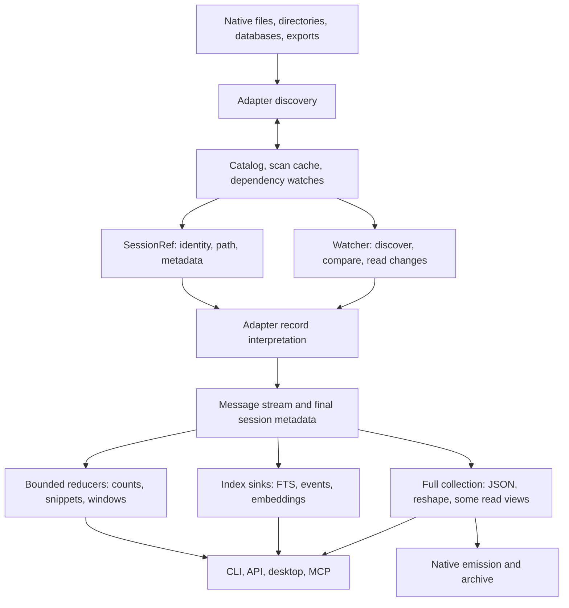

# Store performance: the system we are optimizing

Source audit: `c0f0044`, 2026-10-12; updated through the first pass and the ongoing `perf/excellence-pass`.
This is the working model and tracker for the performance pass. Measurements in `PERF.md` remain historical observations; their causal
explanations are not all supported by the implementation. Paths below are relative to `crates/`.

## Current priorities: whole operations (2026-10-12, user steering)

Ember asked us to zoom out: giant-payload heap has dominated the investigation for too long.
Performance means useful output delivered quickly with reasonable total machine work, disk usage,
and implementation complexity. A bounded parser is one component, not the product scorecard.
Finish coherent in-flight fixes; pause speculative adapter expansion and further emitter rewrites
until the operation measurements justify them. Qwen has no local data, so its synthetic carrier
work is explicitly deferred. This changes priority, not the correctness or fidelity requirements.

| User operation | What we know | Next question / action |
|---|---|---|
| List / find a session | Known-ID lookup bypasses fleet discovery. Warm listing uses cached metadata and verifies all captured primary identities. Catalog setup is now shared within each listing/discovery operation; verified warm listing initializes one connection instead of three. Cold discovery still derives counts from content. | Matched eight-session whole-CLI controls show 34.03% fewer warm-list instructions and 13.59% fewer cold-list instructions, with identical output; see the [comparison artifact](../../tools/profiling/results/catalog-reader-comparison-arm64.json). This isolates setup work and does not rank the real fleet. Preserve freshness and exact counts. |
| Filter the fleet | All 6,714 common count maps match the earlier control; the current frozen query completes all 6,883 refs. Limited JSON selection stops at the required ranked prefix. Counted facts now use atomic per-candidate count/provenance lookups; metadata/index decisions can avoid the lookup entirely. | Full filtering and exact totals retain batch loading. One candidate decodes one cached row with 8 or 1,024 unrelated records; inventory enumeration and ranking still scale with fleet size. Required source errors remain fatal. |
| Read / navigate | API has verified bounded continuations; CLI requires final EOF metadata. Generated MCP stages CLI output in bounded memory and forwards continuation hints. Browser first pages now render without awaiting EOF metadata; deferred-fetch checks preserve paging and navigation. Sidecar retrieval retains checked descriptors and owns only requested content or demanded diagnostics. | Preserve exact CLI semantics and bounded transport. CLI frames serialize once and batch writes. Sidecar scans still validate every row and detect duplicate IDs; output size remains demand-dependent. Persistent MCP read state remains separate. |
| Refresh / search | Production sweep tests now assert zero callbacks/document submissions/writer opens when unchanged. Resumed appends deliver fewer callbacks and body bytes than whole rebuilds, with exact search/event/count parity. CLI `index` still enumerates the fleet; unchanged publication now avoids session/watch/primary/scan-cache row mutations. | Matched eight-session unchanged-index controls show 14.98% fewer instructions after catalog reuse, with identical output. Inspect logical index mutations, publication and compaction separately. Current tests cover successful sweeps, not every possible merge or failure path. |
| Transform / export | Verified Codex port retains checked source-backed bodies. Splice retains selected guarded messages. Distill shares one prepared tail, skips unused findings products, materializes only the selected --upto prefix, and stages borrowed sidecars. Pack shares excerpt/event traversal when events are stale. | Hold further Claude emitter work. Full-source distill analysis still owns its input and demanded elisions. Prune/archive/dataset can scan or stage whole output; archive replacement necessarily writes a complete new artifact. |

### Measurement correction: count the work (2026-10-12)

Shared machines are too noisy for small wall-clock differences to steer this pass. The timings
elsewhere in this tracker are historical observations, not rankings or regression gates. Pause new timing
campaigns, including concurrent index/read sampling. Keep cold/warm/one-change **application state**
labels, but optimize repeatable work on identical inputs and verify identical useful results:

- Instructions executed by an optimized binary with debug information, using Cachegrind on Linux.
  Pin compiler, features, architecture, workload, catalog state and worker count. Repeat an identical
  control to establish actual reproducibility; randomized hashing, paths and scheduling can still
  vary the work. Keep setup/output hashing separate when attributing operation costs.
- Candidate bodies opened, parser callbacks, bytes scanned/decoded/copied, and complete traversals.
  Count at existing boundaries as needed; file size and callback count alone do not measure I/O.
- SQLite statements/VM steps and logical index additions/deletions, where instrumentation is
  available. Unchanged refresh should avoid parsing and writer startup; an append should reuse
  verified history. Segment layout and merge scheduling are separate from logical work totals.
- Allocation requests and cumulative requested bytes, retained heap, staged/output bytes and spool
  lifetime. Existing heap probes exclude native allocations and file-backed mappings; concurrent
  peaks and physical disk allocation are not strictly deterministic.

Instruction count is a cost model, not a latency guarantee. Cachegrind's simplified cache simulation
does not describe Apple Silicon caches; instruction-only profiles are the initial target. Its
[manual](https://valgrind.org/docs/manual/cg-manual.html) explains these limits. ARM64 Linux is
[supported](https://valgrind.org/info/platforms.html), ARM64 Darwin is not. The executable Linux
route is now in [`tools/profiling/README.md`](../../tools/profiling/README.md): a default-feature,
optimized Rust 1.99.0 `store_probe` with debug information, isolated in a capped ARM64 container.
Two fixed-worker Claude count controls returned 1,871,091 and 1,870,995 instructions (0.0051%
variation), with identical count output and unchanged hot parser function counts. This establishes
a usable comparison method, not a performance improvement or a whole-IR fidelity proof. The
fixture, binary, environment and attribution are recorded alongside the runner; no new CI gate yet.
Do not build a general telemetry framework or replace existing production paths with benchmark-only
implementations. Elapsed/CPU times may remain coarse observations, never evidence by themselves of
a small improvement. Avoid claiming one process's byte permits bound total machine memory.

Use existing benchmark/probe machinery and a small representative workload set. The selected-payload
matrix tests exact output and allocation ceilings; it does not measure responsiveness, warm reuse,
C allocations or disk cost. Finish the targeted Codex/Gemini counterexamples already underway,
then hold matrix expansion. New implementations must remove repeated traversal or ownership through
shared mechanisms where possible; review maintenance cost alongside measured runtime benefit.

## What cv does

cv discovers sessions in heterogeneous stores, interprets their native histories into a common
message IR, and serves several different products from that IR: transcript reading, structured
facts, full-text/semantic search, live following, archives, datasets, and native session reshaping.
The task log is a separate event-sourced coordination store. Native CLI, HTTP, desktop and MCP
share much, but not all, of their read implementation. Browser upload is a separate, owned-memory
ingestion path for Claude, Codex and Gemini.

The key distinction is **source traversal, interpretation, payload decoding, retention, and
output**. Calling a method `stream` bounds none of those automatically. A reader can retain the
whole source before its first callback; a sink can collect everything; a bounded output chunker
can decode a whole field first. Each bound must hold across the composed path.

## Existing foundations to retain

- Discovery already parallelizes adapters and many per-file scans (`cv-core/src/lib.rs`).
  Warm ordinary listings use the catalog and scoped freshness probes; they need no body parse.
- The common API is `Adapter::stream` plus `MessageSink`. `parse` is collection over that API.
  `ParseOptions` separates full extras, format-complete carriers, lazy text spans and offsets.
- Claude/Codex have lazy source spans and resumable stream state. Codex has a useful direct path
  for giant tool outputs; most unchanged index jobs are skipped.
- FTS already combines text, event and affordance extraction in one pass, uses one writer,
  streams body documents through a bounded channel, and publishes resume marks after commit.
  Its scheduler already admits at most 2 GiB of estimated **source file bytes**.
- OpenCode, Goose and Hermes use per-session row iteration and the stores' existing indexes.
  Fixture query plans also support Devin's chain lookups and OpenClaw's event sequence query.
  Do not replace these with speculative PRAGMA tuning.
- Text `show --last N` already uses one lazy pass and a bounded deque. API message pages are
  lazy windows; event queries and `has:` counts have useful catalog fast paths.

## Reader inventory

| Store / format | Current traversal and retained state | Main unresolved cost |
|---|---|---|
| Claude JSONL | Typed borrowed mmap records and positioned portable projections; lazy text/arguments, Facts metadata, checkpoints and projected discovery/fork heads | Full details and uncommon fallback records remain owned; native/portable CPU convergence is measured separately |
| Codex JSONL | mmap or positioned buffered scan; bounded authority prepass; selected prompt/reply/reasoning/arguments/result ranges and checkpoints | Native giant escaped-body CPU regression; duplicate acceptance and mapping scans under investigation; full/unknown metadata remains owned |
| Codex legacy JSON / zstd | Compressed modern JSONL decodes once into a shared private arena; legacy JSON remains separate | Legacy whole-document path; decoded disk extent is input-sized; no general compressed incremental marks |
| Gemini legacy JSON | Checked selected string/canonical/composite results and formatted thoughts; native mmap or portable range projections | Full/complete modes and rich display extras still own required payloads |
| Gemini JSONL | Native mmap and portable checked-range replay retain compact order/keys; selected composite bodies use one session arena | Must scan complete history for replacements/rewinds; required metadata and rich display extras remain owned |
| Qwen modern JSONL | Line stream, call/spawn state; keeps reading after sink stops for metadata | Discovery counts without collecting; direct project JSONL resumes finalized records; record text remains owned |
| Kimi | Context stream + pending usage message, rotated prefix dedup | Wire sidecar uses raw ranges and lazy output spans; structural lookup state and mutable trailing usage remain |
| Kimi Code | Mutable finalized-step metadata with checked source-backed text/arguments/results; shared positioned framing and composite-result arena | Discovery wire Values; call/step metadata and selected owned fields; arena disk grows with flattened output |
| Grok | History stream + pending reasoning; metadata-projected discovery and sidecars | One history record and retained tool metadata; enrichment can revise old messages |
| Cline/Roo legacy | Shared selected-record source views, lazy text/arguments and bounded workspace extraction | Rich metadata, encoded arguments and selected composite output remain |
| Cline SDK | Shared source views, raw records and Anthropic block dispatch; large arguments use Json ranges | Selected rich fields and compatibility edge cases; giant full-output parity remains separate |
| Continue | Native/positioned typed header and selected-record source views; lazy payloads, checked encoded arguments and tool-answer dedup | Joined selected text, answer-ID state, rich metadata and mutable snapshots remain |
| OpenCode files | Ordered message descriptors, selected headers/parts and shared payload arena; deduplicated source inventory released before publication | Necessary file inventory grows with part count; native and portable late-query miss gates now pass |
| OpenCode SQLite | Indexed rows and source-selected parts; strict readable-role discovery counts; guarded original DB/WAL/journal dependencies | Encoded input CPU regression remains; full modes and structural metadata stay owned |
| Cursor SQLite | CLI/ACP reachable-message replay and IDE composer projections; selected strings, Lexical rich text and structured results share private backing | Encoded rich-text CPU cost, owned identifiers/full metadata, WITHOUT ROWID fallback |
| Devin SQLite | Compact structural forest projection, then selected full metadata per emitted row | Necessary navigation state grows with nodes; strict metadata projection has a measured CPU cost |
| Hermes SQLite | Indexed rows; exact prompt suppression uses one borrowed-key admission per candidate and bounded spill | Flat retained prompt heap; prompt-only CPU still about 50% above original unbounded Vec |
| Goose SQLite / legacy | Indexed selected rows with guarded backing and typed Facts; legacy discovery streams header/count projections | Full metadata and legacy message streaming remain owned; selected decoding CPU differs by shape |
| OpenClaw JSONL / SQLite | SQLite row cursors, compact tree navigation and selected payload replay | Tree metadata grows with events; selected row blobs remain owned; extra validation costs CPU |
| Zed SQLite | Metadata-only ordered rows and incremental blobs under one snapshot; stream decodes once into owned spill, then validated message replay | Decoder/one message/known metadata; decoded file pages and temporary I/O; WITHOUT ROWID fallback retains one native cell |
| LM Studio | Schema-selected document/turn views, selected lazy text spans and incremental variants; mapped or positioned sources | Bounded discovery title prefixes; Harmony decoding and arbitrary demanded output/metadata remain owned |
| ChatGPT / Claude account exports | Bounded metadata cache and positioned source views; selected-conversation replay | Branch descriptors, joined text, selected owned output and sender/empty-archive compatibility edges |
| OpenSession | Shared source validation/views and per-message IR projection | Selected authoritative rich fields remain owned; giant serialization proof separate from count/discovery |

Registry: `cv-core/src/harness/mod.rs`; implementations under `cv-core/src/harness/`.
Directory entry sizes and whole database sizes are **not** per-session transcript byte counts.
Compressed, encoded, scanned, decoded and emitted bytes must be labeled separately.

## Consumer inventory

| Operation | Actual work | Optimization boundary |
|---|---|---|
| Warm ls/stats | Catalog probe, metadata rows, sort/filter | Preserve cheap path; measure discovery separately |
| Full discovery | Scans + cache persistence + catalog replacement/watch construction | Metadata reducers instead of collect-to-count; dependency-aware caching |
| Text windows / last N | Lazy range or deque, selected messages materialized | Already useful bounds; giant selected output is still output-sized |
| JSON show / MCP show | CLI show/export stages resolved frames and envelopes in bounded spill storage; EOF metadata retained. MCP stages selected windows | CLI Last retains lazy tail descriptors; owned adapter extras and redaction trees remain; MCP client payload size and subprocess startup |
| Affordance view | Facts projection into classified rows; checked bounded text summaries | Unprojected adapters retain rich extras; side stores and result rows; escaped validation still traverses the whole field |
| Doctor | Facts projection; checked text lengths and JSON writer counts | Attribution state, unsupported adapter rich/fallback parsing and demanded structured arguments |
| Query text predicate | Exact index-only matching IDs; cheap tri-state evaluation before parse | Mixed predicates still parse when cheap facts cannot decide |
| Other rich predicates | Predicate-sized streamed tool/model facts and shared source probes | Distinct unresolved relative paths retained until final cwd; compaction uses its existing separate boundary |
| FTS | Chunked text, bounded event spool and byte-capacity permits held through Tantivy document consumption; counts/checkpoints and one catalog connection per sweep | Writer arenas coexist with admitted documents; giant escaped-body composition proof pending |
| Semantic indexing | Shares discovery inventory; source/model identity enables unchanged-vector reuse and deferred model load; atomic streamed save | Fallible lazy text projections and final end-to-end cost proof; vector store still grows with session count |
| API pagination / HTTP windows | Verified page checkpoints and head metadata cache; selected HTTP JSON stages bounded frames through shared window selection | Desktop Value responses, full-session routes, browser JSON parsing and demanded metadata remain owned |
| Watch | Verified checkpoints and bounded EOF metadata reused across tail polls | Strict source identity and dependencies; replay-only formats retain fallback parsing |
| Archive | Verified suffix read; bounded message spool and guarded canonical prefix copy; checked streaming payload output | Complete replacement artifact still writes O(output bytes); metadata width remains owned |
| Dataset | Streamed selection and bounded output staging; late predicates retain source descriptors in private spools | Bounded slice decoding reduces matched-query spool CPU; demanded owned producer fields remain |
| Pack/tools/token stats | Tool histograms fold per-message event scratch; pack excerpts use a ring; ordered usage rows reuse a bounded dependency-validated cache | Cold ledger publication, exact dedup I/O and model roster growth; tiny native sources bypass caching |
| Reshape/emit | Bounded shared JSONL stage; native Codex ports retain checked lazy bodies; verification reduces compact facts | Message roster/selected metadata, complete carriers, Claude record rewrites and other emitters/materializing thinking transforms |
| Distill/findings | Shared analysis demand and one prepared tail; findings omit unused output products; --upto loads selected messages; borrowed sidecars use bounded staging | Full-source loader without --upto, demanded facts/timeline text and owned elisions remain; staged sidecar bytes scale with output |
| Prune/revive | Compact selection facts and source positions; transcript/sidecar staging with sequential record rewrites | Giant changed records remain owned; additional scans/staging currently increase CPU |
| MCP observe | Retained-message watch callbacks and checked capped searchable prefixes | Other full producer modes, owned metadata and uncapped MCP show windows remain separate |
| Task coordination | Replay full append-only task log under CAS for writes | Separate workload; snapshot/tail only if measured task volume warrants it |

Key sources: `cv/src/cmd/view.rs`, `cv-core/src/{api,affordance,watch,lazy,stream}.rs`,
`cv-search/src/{fts,semantic}.rs`, `cv/src/cmd/{query,archive,pack,compose}.rs`.

## Correctness boundaries before reuse

1. Physical append does not imply logical append. Gemini replacement/rewind and OpenClaw leaf
   changes can replace an old visible suffix; Kimi usage, Kimi Code unfinished steps and Grok
   reasoning can revise the last pending message. Checkpoint only finalized output/state.
2. Identity includes dependencies: SQLite WAL, directory children, side metadata, rotation
   manifests and sidecar output. Existing freshness policies disagree about these dependencies.
   Catalog DB watches include WAL appearance, modification and disappearance. Counts, events and
   each search index now keep separate canonical dependency metadata baselines, tied to the primary
   tuple. SQL output and stamps publish atomically; FTS invalidates its old baseline before changes
   and publishes a revalidated baseline after commit. Operation-local probes share file stats.
   Known adapter-local sidecars, directory members and WAL files are covered. Consumers capture
   conditional Claude fork siblings and resolved external output paths before reading them, including
   absent files. Complete read sets survive prefix checkpoints and are revalidated at publication.
   Version-1 dependency baselines reread once through normal refresh without an index rebuild.
3. Current resume marks sample the first 4 KiB and the 4 KiB preceding the mark. This is not a
   proof that the entire prefix is unchanged. FTS now requires growth before using a mark, so
   same-size rewrites take a whole pass; inode replacement also rejects reuse. A rewrite followed by
   growth can still escape the samples, and a primary rewrite restoring size/mtime can evade freshness.
   Unconditional detection of arbitrary prefix edits requires reading that prefix or a trusted
   writer/filesystem change signal; do not promise both zero prefix reads and such detection.
4. Lazy/full equivalence must compare **resolved content** and metadata. The existing stream dump
   serializes span descriptors, not their resolved text. Span layout changes are not output changes.
5. Existing format bugs must be isolated and tested as correctness changes. Fixed separately:
   Codex's giant-output shortcut dropped metadata preserved by its ordinary branch; Gemini's native
   wrapper omitted metadata fields and rejected escaped borrowed strings.
6. Exact final metadata can require EOF, even when a window needs only early messages. Separate
   payload retention from metadata traversal rather than silently returning incomplete metadata.

## Engineering direction

Optimize the composition, in this order:

1. **Consumer demand:** stop collecting payloads that a view discards; separate index matches from
   snippet generation. Use existing sinks and APIs rather than another command family.
2. **Payload lifetime:** genuinely bounded decoding for escaped spans, typed borrowed hot records,
   metadata-only discovery, raw source ranges for replay bodies. Preserve full/complete modes.
3. **Source/dependency identity:** consolidate invalidation and make format-specific stable append
   boundaries explicit before adding more resume implementations.
4. **Repeated work:** share passes, archive references, parsed metadata and verified positions where
   lifetime/invalidation makes reuse sound. Do not create a new persistent index without evidence.
5. **Concurrency:** once per-operation working sets are known, charge actual conservative working
   cost; bound in-flight payloads and writer queues. Parallelize independent work without multiplying
   unbounded allocations. File-backed resident pages and private heap need different interpretation.

No promised multiplier applies to every path. Exact first-run counts over an unindexed fleet
require reading their records unless the harness supplies authoritative metadata. A 300 ms listing
budget cannot justify pretending exact counts can be recovered without those reads.

## Measurement and active work

Every change needs a narrow behavioral counterexample or measured cost, followed by composed-path
verification. The initial suite will distinguish direct adapter discard/count, discovery, derived
views, windows, full output, incremental index/watch, and writer costs. Measure tiny records, giant
escaped/unescaped text, tool arguments, many records, replay controls and database WAL changes.

For new comparisons, record instructions, decoded or traversed bytes, messages, allocation requests,
peak live allocations and staged bytes. Keep output hashing outside measured work. Historical
wall/CPU, RSS and macOS footprint observations below explain earlier investigations; they do not
override the work-counting method above. Use explicit-root adapters and frozen scratch sources;
never mutate the real stores. Cold/warm identifies application state, not an unsupported claim
that the OS page cache was evicted.

Historical baseline confirmation: a release direct lazy count on the frozen 313.8 MB Gemini
recording emitted 199 messages at best-of-three 0.944 s (332 MB/s). The process also performed
three whole-file read baselines and reached 1.77 GB RSS / 1.45 GB footprint; those process peaks
are **not isolated adapter heap**.

The isolated `store_probe` baseline attributes Gemini's direct lazy count to 841,082,713 bytes
of peak live Rust allocations (847 MB process footprint). The corresponding Codex read has
25.7 MB live Rust allocations and 47.5 MB footprint despite 761 MB RSS: most resident pages are
file-backed. These measurements distinguish private allocation from mapped input.

The probe separates direct adapter operations from production affordance reads. Its window
operation demonstrates retention shape;
production JSON show additionally counts, serializes selected messages for budgets and handles
continuation. The probe window is not an end-to-end show benchmark. Separate actual CLI tests
compare full JSON output with the lazy-extra window implementation, including EOF metadata. Hash runs resolve spans and canonicalize
message and metadata maps; they are separate from timing and allocation runs. The heap feature
counts requested Rust allocations, excluding SQLite/native allocation and allocator fragmentation.

Completed Cursor discovery query check: with 20,000 unrelated bubble rows and three composers,
SQLite VM steps fell from 80,043 to 52 and full-scan steps to zero. The binary prefix range keeps
the former row order and has a fallback for tables without rowids.

The frozen fleet comparison covers 5,960 references (5,959 primary paths, 95.92 GB) in three
modes: 17,880 baseline/candidate pairs. Claude and Gemini match in every mode; Codex bulk/full
match, and its 955 changed lazy results exactly match the baseline ordinary bulk parser. These
are corrected giant-path metadata omissions, not unexplained content drift. A 43-reference
complete-mode subset also matches. The frozen 35,116 source/companion files remained unchanged;
live edits occurring after the freeze are excluded from the comparison.

The giant Codex gate found a hidden full-Value allocation in event-authority detection before the
mapped stream. Detection now projects only discriminants from strictly validated raw records and
reuses the mapping. Tool-only histories therefore stay bounded even when no natural-language
record allows an early exit. Positioned buffered/zstd replay now removes the largest-line buffer for selected known payloads;
owned fallback shapes remain explicit in the Codex section below.

Event publication now spills ordered rows above a 256 KiB charged-memory budget to an owned
private temporary file, then reads that file once inside the existing SQL transaction. Corrupt,
missing or extra rows roll back both output and its dependency baseline. Failed publication clears
the resume mark and is reported by indexing; successful independent FTS/count work remains. An
FTS-only pass retains event checkpoint state without extracting rows, preserving later append reuse.

| Isolated publication measurement | Previous path | Candidate |
|---|---:|---:|
| 20,000 event rows: peak live Rust allocation | 7,211,499 B | 358,005 B |
| 200,000 event rows: peak live Rust allocation | 58,878,796 B | 358,007 B |
| 200,000 event rows: clean median wall time | 1.224 s | 1.207 s |
| 1,000 sessions, 16 rows + counts each: clean median wall time | 2.865 s | 0.368 s |
| Same 1,000-session writer stage: user + system CPU | 2.33 s | 0.31 s |

The event probe uses valid Claude JSONL with small tool inputs and distinct targets, including SQL
publication. Spooling writes and reads 2,417,780 B for 20,000 rows and 24,577,780 B for 200,000 rows,
once in each direction. The largest decoded record/target is still a separate bound. Native SQLite
allocation and mapped input are excluded from Rust heap instrumentation.

The `cv-core` example `catalog_writer_probe legacy|writer SESSIONS SOURCE` isolates publication
from parsing and Tantivy. With fresh scratch catalogs, three clean runs per mode produced identical
16,000 event rows, 1,000 count rows, 2,000 baselines and a 2,052,096 B catalog. Reusing one connection
amortizes schema initialization, prepared statements and close/checkpoint work; it preserves separate
per-consumer transactions and never holds a write lock across source reads. Native peak footprint
rose from 3.75 MB to 5.36 MB in this probe because the connection/page cache lives longer. These
stage timings do not claim the same multiplier for full indexing: a later fleet sample was waiting
on Tantivy merges after parsing had finished.

A giant `ToolUse.input` exposed another composed bound: compact JSON was serialized into a whole
String, copied into the chunk buffer, then copied into a single oversized Tantivy document. FTS
now streams Value's same compact serialization into UTF-8-safe documents capped at twice
`CHUNK_BYTES` (8 MiB in production). Canonical bytes, source insertion order and previews are
preserved. Giant-argument document boundaries change, so term conjunctions still obey the existing
per-document search semantics; this unreleased index version already requires a first-run rebuild.

The ignored `fts::tests::tool_input_fts_demand_probe` accepts frozen scratch
`CV_FTS_INPUT_PROBE`/`CV_FTS_INPUT_BYTES`, emits and drops real documents from `index_session`, and
verifies the concatenated canonical body hash plus event/count publication. It excludes Tantivy
tokenization, writer queues, commits and merging. With 100 MB of plain input, the old maximum body
document was 100,000,092 B; the candidate stays at the test configuration's 4,096 B cap. Process
footprint fell from 503,857,920 B to 203,571,752 B; RSS fell from 614,481,920 B to 314,343,424 B.
These debug-stage process measurements include mapped/native memory. Owned JSON input and the
tee clone remain proportional to input size; this is not a universal index heap bound.

The `check-heap-budget.py --only events` gate covers ordered extraction through SQL
publication at 20,000/200,000 fixed-size records, compares every persisted row with the retained
collector, and verifies source stamps, spool I/O and normal cleanup. Live Rust peaks are
352,006/352,009 B versus 7,073,127/57,619,016 B for the collector. Its fixed 1 MiB ceiling and
256 KiB growth allowance exclude giant individual inputs and native SQLite memory. Since
`100509c`, `.github/workflows/ci.yml` invokes it separately alongside the other heap
campaigns; it is still a separately selected driver campaign rather than part of the default
stores/chunks invocation.

Zed's incremental two-pass reader at `100509c` established bounded native memory but cost
2.2–2.6× the original reader's clean streaming CPU on 64 MiB low-compressibility histories.
Profiles attributed most execution to repeated zstd decoding and JSON parsing, with SQLite
around 2% of sampled execution. The decoded-spill follow-up (`d0093be`, integrated as `5ae0eda`)
preserves full validation before callbacks, authoritative duplicate-last message selection and
the same SQLite snapshot, while decompressing only once. Discovery retains its existing one-pass
reader.

Three rotated clean subprocess triples measured original / two-pass / spill CPU medians of
0.408 / 1.047 / 0.382 s plain and 0.552 / 1.191 / 0.639 s escaped. Wall medians were
0.418 / 1.062 / 0.397 s and 0.559 / 1.195 / 0.652 s. These are synthetic 64 MiB discard operations
under shared load 34–38, with uncontrolled OS cache, separate from allocator and hash runs.
Escaped CPU remains about 16% above the original; the large intermediate regression is removed.

At 16/64 MiB, requested Rust peak stays flat at about 6.67 MB; native footprint is 14.5 → 14.5 MB
plain and 14.1 → 15.2 MB escaped. RSS grows 38.1 → 88.5 MB / 38.8 → 93.4 MB because decoded
file pages are mapped. Each operation writes the full decoded source once: 16.8 → 67.2 MB plain
or 17.8 → 71.4 MB escaped, then scans it for validation and replay. Physical I/O depends on OS
cache. Owned temporary directories are empty after measured exits; Unix files are unlinked
while owned descriptors remain live. All four fixtures match exact preserved-order resolved
message and metadata digests, with 128/512 callbacks. The source-sized native-cell fallback and
largest demanded record remain separate limits. Detailed measurement definitions are in
`PERF.md`; these results do not claim combined final gates or whole-fleet throughput.

The production FTS sweep now keeps byte-capacity permits through Tantivy document consumption
(`c804b19`, integrated as `762ebda`), instead of releasing them on queue receipt. A debug
allocator-instrumented mixed sweep uses four 100 MB decoded plain Claude arguments, 32 small
sessions, actual 4 MiB chunks and a 64 MiB reservation budget. Peak requested Rust heap above
baseline is 228,994,263 B versus 861,238,323 B in an otherwise identical unbounded control;
peak charged document capacity is 65,786,618 B versus 800,037,416 B. Writer arenas and extraction
state coexist with those reservations, so this is not a 64 MiB total-process bound. The single
samples exclude mmap, C/SQLite, stacks and allocator overhead; they make no throughput claim.
Scoped fatal-writer, waiter wakeup, drop/commit release and unchanged-sweep checks pass. A
separate composed sweep now verifies four 25/100 MB plain/escaped fixtures, each exposed as four
logical giant sessions plus 32 small sessions (144 logical sessions total). Independent canonical
body bytes/hashes, per-session search hits, events/count freshness, actual tokenization, commit
and compact, and a strict unchanged second sweep all match; source hashes are unchanged. The
production chunk setting is 4 MiB with an 8 MiB body buffer cap, while the largest charged
compact document is approximately 16 MiB: 4 MiB is not an actual document capacity bound. In
plain25/escaped25/plain100/escaped100 order, peak additional live Rust heap is
201.76/163.03/218.39/162.87 MiB and charged queue capacity is 63.69/48.00/62.74/48.00 MiB,
all below the 64 MiB admission budget. These separate samples include debug instrumentation and
body hashing; they establish composition and allocation behavior, not CPU or wall throughput.

Focused SQLite scale evidence removes payload retention without promising constant navigation
state. Devin's compact forest projection reduces requested Rust heap from 8.22/32.52 MB to
0.269/0.313 MB on 8/32 MB metadata fixtures. At 100 MB/1 GB with 800/8,000 nodes, it uses
0.379/2.293 MB: retained structural rows legitimately grow. Hermes prompt-only trailing rows
fall from 8.13/32.14 MB to a flat 1.258 MB through exact spill keys. At 1 GB, native process
footprints are 8.67 MB Devin / 8.45 MB Hermes; all callbacks and scratch-file cleanup match.
Twenty-four separate lazy/complete preserved-order hash processes across six 1/8/32 MB fixtures
match the old readers. The initial Hermes SQL spill writes approximately 1 GB of key data plus
B-tree overhead at that scale; physical disk I/O was not measured. Its clean 32 MB paired median
CPU rises about 4.9× (user 0.0256 → 0.0535 s; system 0.0181 → 0.161 s), so the shared portable
exact-set replacement remains active. Devin's subsequent single-pass projection (`f825ff6`)
reduces its initial CPU regression to about 1.25× on the same 32 MB control: user 0.01194 →
0.01644 s, system 0.01176 → 0.01312 s; paired wall 0.02760 → 0.03236 s under uncontrolled load.
Cursor inline composer Values and OpenCode many-part logical messages remain unbounded cases.

Cold portable document sources now use the shared positioned view rather than a whole encoded
source buffer. On the frozen 16/64 MiB plain/escaped count/discovery fixtures, all 32 cases retain
exact expected message/session counts. Peak live requested Rust heap, **including stage baseline**,
is flat across source sizes:

| Portable format | Count plain / escaped (B) | Discovery plain / escaped (B) |
|---|---:|---:|
| Cline SDK | 264,030 / 329,552 | 264,772 / 330,289 |
| OpenSession | 263,604 / 329,127 | 263,760 / 329,282 |
| ChatGPT export | 329,317 / 394,847 | 329,484 / 395,013 |
| Claude export | 329,311 / 394,841 | 329,477 / 395,006 |

These are no-mmap allocation probes through the document source activation; they exclude C,
allocator overhead and process footprint and make no timing claim. Small raw serialization
oracles pass in both configurations; giant full-output/hash composition and the Claude sender
count/empty-archive error corrections remain separate pending checks.

Token statistics have a separate retention counterexample. On 16k/64k native usage calls,
current aggregation peaks at 6,743,774/26,955,998 B for duplicated Claude response blocks and
2,654,678/10,557,782 B for unkeyed Codex calls. Counts, totals and duplicates match expectations;
these allocator measurements make no CPU claim. The ordered usage spool/shared portable exact set is integrated (`0016240` + `6a496d3`).
The four fixtures now peak at 816,122 B Claude / 244,348 B Codex with exact report parity;
completed batches are limited by configured worker count and dedup keys spill. An independent
old-compute oracle checks raw report and float bits with duplicate IDs, different/late models,
failed sources and Rayon 1/2/4 workers. Final CPU evidence is pending the 64 KiB key append cache;
output model-row cardinality, worker allowances and the largest individual key/model remain
legitimate memory terms.

Semantic reuse (`630b361`, integrated as `29af9c0`) shares the discovery inventory and stores
per-row source/dependency snapshots with vectors, plus a global projection version and resolved
model artifact identity. Unchanged sweeps avoid adapter parsing, model load and saving; vectors
compact in place and atomic buffered output avoids a second serialized vector buffer. Legacy
rows rebuild once. Ten scoped refresh/store/model tests and eight corpus tests pass without
network/model downloads; there is no semantic throughput or RSS proof. Exact discovery-reference
hints and query projection checks are a follow-up (`daa0183`); fallible lazy Text projection
remains active so failed text reads cannot silently embed empty strings.

API continuation/head changes (`0769d1a` + `cb844b4`) reduce callback work on the controlled
20,000-message fixture: 100 successive pages of 200 messages emit 20,099 callbacks instead of
1,010,099; five head requests emit 20,000 instead of 100,000. This is a callback-work result,
not a wall-time or whole-source-byte bound.

Watch/archive reuse (`e120208`, `8cc975f`, `432a3bd`, `b211452`) shares the existing adapter
checkpoints, before-read snapshots and dynamic read sets. Strict size+mtime equality additionally
requires the captured primary identity/ctime; growth uses the existing inode and sampled-byte
immutable-prefix contract. Replacement, truncation, dependency changes, interpretation-version
changes and missing guards decline reuse. A timestamp-restored edit followed by growth remains
outside the sampled append contract. Whole fallback preserves full messages and EOF metadata.

Optional checkpoint state is capped at 64 KiB, EOF metadata at 16 KiB; oversized state degrades
to replay. Version-1 cursor positions remain unchanged, with at most eight 64 KiB optional reader
states per issued cursor. A verified unchanged pending poll can intentionally stop after its
selected messages while using prior complete metadata/counts. Demanded polling errors propagate
through `try_poll_bounded`; the legacy bool poll remains best effort and leaves failures retryable.

Archive source state lives separately under `archive-source/`, capped at 1 MiB. Reuse also checks
the archived artifact's size/mtime/inode/ctime on Unix, or a streamed content hash elsewhere, so
user modification/deletion forces repair. Append replaces the suffix after `checkpoint.messages`,
including Codex's held EOF assistant whose usage may arrive later. `cv watch` observes references
directly and lets the archive perform its sole consumer read. Private owned temporary files and
bounded file comparison replace whole serialized JSON/comparison buffers; failed catalog
publication does not advance the source stamp and retry repairs missing catalog output.

The focused 8,192-message Claude fixture plus four messages interprets 699 messages / 243,650
logical primary suffix bytes instead of 8,196 / 2,865,380 on append. Four cold unchanged archive
polls interpret zero messages, reading a roughly 2 KB state file plus metadata probes on Unix. A
one-message pending poll interprets two callbacks rather than the whole 8,192-message source,
with exact EOF metadata/count. Bounded archive history (`7f40ac6`) spools serialized messages in
shared private storage (1 MiB memory cap), then copies the guarded canonical stable prefix without
loading or parsing the prior archive. The same append copies 3,446,394 stable JSON bytes, spools
286,289 suffix message bytes and writes 3,767,141 final JSON bytes. These are logical byte costs;
large spools spill to temporary storage and physical I/O depends on the OS cache. Complete output
still requires O(archive bytes) publication, preserving the existing atomic replacement contract. Full serialized output matches the original parser for Claude/Codex
fixtures, native/legacy Qwen and Gemini/OpenClaw/LM Studio/Cline/Roo cases. Narrow tests cover
cursor partial consumption, held EOF usage, artifact repair, source invalidation and publication
failure/retry. The later current-source oracle establishes exact materialized Claude parity with
existing `lazy_extra`; watch now uses that mode to avoid owning discarded giant arguments. The
prior assertion that full extras required another mode was unproven and is corrected here.

Lane-summary projection (`5ffbd10`) has eight scoped tests; it skips irrelevant bodies.

LM Studio selected-record projection replaces the document's turn descriptor vector and each
whole-turn Value with fixed schema rosters and chronological source cursors. The original derived
envelope rules remain: duplicate known keys and wrong typed fields reject, positional struct arrays
work, and each raw turn resets its Value scalar/depth budget before invalid turns are skipped.
Unselected versions and internal steps are validated without owning their payloads; complete-mode
variants are emitted individually. Ordinary lazy text/thinking stays in spans; Harmony keeps its
existing owned decoder. Exact raw-order message and metadata hashes match the old native parser
for sample, Harmony and a 16 MiB escaped fixture in lazy/full/complete modes.

The diagnostic heap builds (debug candidate; no timing claim) discard two callbacks from generated
16/64 MiB escaped bodies. Native peak requested Rust heap above setup falls from
25,168,379/100,665,851 bytes to 197,997/197,997; positioned readers use 393,852/393,852.
A tiny selected version beside one 16/64 MiB escaped unused version takes 2,003/2,003 native bytes
versus the old 33,556,049/134,219,345. These bounds exclude demanded owned output, Harmony decoding,
source mappings and native allocations. Eighteen scoped LM Studio tests cover both configurations,
including envelope rejection, variant output, escaped spans, decoder-boundary markers and mutation.

The isolated opt-in archive probe (`79a1e8d`, feature `probe-heap`) records only the requested Rust
heap during the operation, excluding fixture generation and report serialization. On controlled
20,002 / 200,002-message Claude histories, full archive peak falls from 32.5 / 306.3 MB to
1,125,572 / 1,125,584 bytes. Verified append peaks are 352,466 / 216,630 bytes versus the prior
28.3 / 250.3 MB; suffix callbacks are 1,030 / 69, stable-prefix copy is 5.23 / 55.56 MB and final
artifact write is 5.52 / 55.58 MB. Cold unchanged polls use about 12.7 KB peak with zero callbacks,
spool bytes or prefix/output writes. Debug elapsed full operations are 0.52 / 5.08 s and appends
0.034 / 0.033 s; these controlled values are not fleet throughput claims.

Checked complete-message JSON output (`3a9b15c`, consuming `1e96a86` and `58f42dd`) eliminates
selected payload materialization as well. Real Claude Edit argument fixtures of 25 / 100 MB archive
at 200,762 / 200,770 bytes peak versus the original 58.3 / 233.3 MB. Complete pretty archive hashes
match the saved original full-parse output. Watch with no selected messages drops the same inputs
at 15,376 / 15,385 bytes. Nine archive tests cover derived serializer field/indentation parity,
Unicode and escaped frame delimiters, relocated prefix ranges, first-empty-user labels, held EOF
usage and failed source/catalog publication. Failed demanded source reads leave the artifact,
catalog and source stamp unchanged. Artifact identity is checked before and after prefix copying;
missing legacy prefix ranges degrade to a whole checked read. Owned metadata width and producers
which still emit owned selected payloads remain separate limits. First-user label extraction also
scans that user's text to preserve the existing whitespace/label semantics.

Tracker (keep unfinished work visible; measurements determine later ordering):

- [x] Source map: readers, consumers, caches, index, follow/archive, write paths and gates.
- [x] Correct the handoff's assumptions about existing streaming, parallelism and admission.
- [x] Independent allocation/throughput/equivalence probes and initial valid scale fixtures.
- [x] Streaming affordance and full-fidelity JSON-window consumers.
- [x] Index-only text matching and deferred snippets.
- [x] Bounded escaped-string chunk decoding, with and without mmap; serde windows replace the slower initial decoder.
- [x] Process-isolated heap gates for growing histories and giant Claude/Codex/Gemini fields, plus escaped span decoding; negative baseline proof.
- [x] Native selected-payload gates for Kimi Code, OpenCode files/v1/v2, Cursor CLI/IDE and Goose, with independent full-output oracles and FD64.
- [x] Portable selected-payload gates for the same seven formats: 224 checks retain native bounds and independent full-output/dataset oracles.
- [x] Additional Codex response/event text, reasoning and encoded-argument gates; Gemini legacy/JSONL composite results and formatted thoughts, native and portable, with exact full-output oracles and unchanged heap limits.
- [ ] Remaining store-format coverage: prioritize demonstrated whole-operation regressions rather than expanding the selected-payload matrix by default.
- [x] Gemini metadata discovery, strict raw validation, lazy text and mmap replay payload ranges.
- [x] Claude typed borrowed hot records and mmap lazy lines; Codex giant-path metadata parity.
- [x] Claude metadata discovery and fork-head projections, including giant first records.
- [x] Claude conversational lazy-extra projections and bounded notification classification; raw serialized metadata order checked.
- [x] Fallible Json demands across consumers and native Claude large lazy argument activation; giant composed allocation/parity proof.
- [x] Structured inputs retain checked Json sources across shared Anthropic/native SDK/export/OpenSession producers, Kimi Code, OpenCode, Goose, Gemini, Codex and Continue, including supported JSON-encoded arguments.
- [ ] Demanded owned details and uncommon producer fallbacks: identify concrete remaining shapes and consumer contracts before making broader bounded-memory claims.
- [x] Per-consumer SQLite/WAL/known-sidecar freshness; atomic SQL publication; scan interpretation migration; inode resume guard.
- [x] Consumer-recorded dependency read sets for conditional fork inference and adopted external outputs.
- [x] Continue and LM Studio metadata-only discovery, including explicit-root isolation.
- [x] Native SDK, exports and OpenSession source-backed readers; bounded export metadata cache.
- [x] Shared positioned portable document views: 32 frozen count/discovery scale cases retain flat live Rust heap.
- [x] LM Studio selected records and variants use schema projections in native/portable readers; lazy ordinary text and thinking retain source spans.
- [x] Continue selected-record projections with native/portable typed acceptance and source-mutation checks.
- [x] Supported native/portable encoded arguments and selected composite payloads have checked-source retention and independent resolved/full-output compatibility controls.
- [ ] Giant serialization and compatibility coverage outside the represented producer shapes, including demanded rich metadata and explicit legacy fallbacks.
- [x] OpenClaw SQLite row/tree replay and registry filtering without whole body collections.
- [x] Kimi wire output ranges and Zed per-message blob replay.
- [x] Grok metadata/sidecar projection, Kimi Code inventory projection and Zed incremental SQLite blobs.
- [x] Devin compact forest metadata and Hermes exact-key prompt spill, with measured native/Rust bounds and output parity.
- [x] Hermes exact-set CPU/heap controls and corpus parity; remaining prompt-only CPU tradeoff recorded.
- [x] Kimi Code logical-step/selected payload retention, with native/portable resolved parity, late-query CPU controls and bounded deferred handles.
- [x] Cursor CLI selected text and arguments, strict fused portable validation, and shared reducer facts.
- [x] Cursor IDE selected strings, rich text and structured results with exact owned-output controls.
- [x] OpenCode file-store late predicates pass unchanged heap gates after source inventory path/lifetime reductions.
- [ ] Cursor/OpenCode selected-path CPU convergence beyond the measured direct-result and generated-length improvements.
- [x] Native Qwen finalized-record checkpoints with composed count/event/FTS parity; replay formats decline reuse.
- [x] Verified watcher/archive continuation, unchanged artifact skips, bounded pending polls and single consumer reads.
- [x] Bounded archive history/prefix/output retention with exact pretty JSON and explicit staged I/O.
- [x] Audit append checkpoints across every store: six append-safe producers support native/portable resume; mutable histories explicitly decline.
- [x] Bound event extraction/publication retention and reuse the serial catalog writer connection; preserve rollback and append coverage.
- [x] Byte-capacity document admission held through Tantivy consumption, including release/error behavior and mixed-sweep negative control.
- [x] Composed giant plain/escaped canonical index-body parity and live-heap proof at production chunk settings.
- [x] Search activation for retained text and original dependency guards; checked labels and semantic cache invalidation.
- [x] Audit transaction batching and avoid Tantivy writer startup for unchanged refreshes; retain pending compaction.
- [ ] Large-fleet final Tantivy merge/query measurements beyond the isolated warm-refresh controls.
- [x] Stream predicate-sized rich query facts; cross-harness oracle and shared source probes.
- [x] Stream tool histograms and enforce semantic body/label caps, including tool input serialization.
- [x] Bounded verified API page continuations and head metadata cache, including external dependencies and oversized-state fallback.
- [x] Lane summaries project relevant messages without resolving unrelated bodies.
- [x] Ordered usage staging/shared exact dedup and semantic source/model reuse implementations; scoped ordering/identity oracles.
- [x] Checked lazy Text demands in JSON output, archive and search; failures propagate before publication.
- [x] Dataset filter/output staging preserves late selection and byte fidelity with bounded history retention.
- [x] Matched-query dataset spool CPU: bounded slice decoding preserves exact output and flat heap.
- [x] Ordered usage-row reuse: clean large/tiny CPU controls, exact totals and bounded warm heap.
- [x] Final Hermes cached-spill CPU: one borrowed insertion avoids duplicate hashing/copies; bounded-memory tradeoff remains.
- [x] Actual-model semantic refresh, unchanged reuse, source/model invalidation and clean-build ranking oracle.
- [x] Matched release controls for streamed native escaped output; adaptive validation and canonical short-escape bypass preserve exact output.
- [x] Portable/zstd Codex selected payload retention with matched clean release CPU and exact output controls.
- [x] Shared reducer metadata demand; Claude/Cursor CLI facts preserve doctor, compaction and affordance outputs.
- [ ] Remaining portable cold-admission costs and composed adapter CPU, including escaped doctor and metadata traversal.
- [x] Guard cold SQLite snapshots with operation-scoped byte-budgeted reuse and original DB/WAL/journal dependencies.
- [x] Goose legacy discovery uses bounded strict header/count projections; whole-history rewrites deliberately decline resume.
- [x] Catalog freshness for every primary, including quiet sessions and same-size replacements; guarded scanner cache publication.
- [x] Frozen-fleet query reduction: successful full/unchanged/append paths, exact common counts and bounded parallel batches; timings exclude discovery.
- [x] Limited CLI JSON listings rank first and stop fact reduction after exact top-K selection; text listings retain full filtering and exact totals.
- [ ] Whole-operation limited-listing costs: discovery, text-index set preparation and rank metadata precede selected fact reduction.
- [x] Generic generated MCP tools stage child stdout/stderr in bounded storage and stream response envelopes; continuation hints, errors and command semantics remain exact.
- [ ] MCP whole-operation costs: subprocess startup, complete child/client payloads and spool I/O; persistent read-state reuse remains separate.
- [x] Bounded retained MCP observation and staged HTTP selected-window payloads; owned-route/browser limits recorded.
- [x] Native JSONL record/output staging for append-only emitters.
- [x] Native Codex emission uses original guarded lazy sources and incremental whole-report fidelity verification; actual port controls improve memory and CPU.
- [ ] Claude output record rewrite retention and other emitter/non-native-thinking materialization.
- [x] Prune compact decision facts, staged history/sidecars and sequential usage repair.
- [x] Prune source-selected large-record decisions, shared source restamping, source-backed payload mutation and parent reroot, with exact duplicate-field and native/portable compatibility controls.
- [ ] Prune owned fallbacks: thinking, declassification, usage corrections, malformed giant records and large selected tool-input metadata.
- [ ] Prune whole-operation CPU convergence: source validation/canonicalization and staged copying retain historical throughput tradeoffs; use work counts for further comparisons.
- [x] Stream whole CLI JSON show/export through bounded staging; source-backed selected payloads avoid whole output copies.
- [x] Exact session-ranked search limits and pre-limit CLI/HTTP filters, including tied scores and current metadata.
- [x] Measure exact search collector stored-document costs; project stored IDs without decoding unrelated metadata, preserving existing indexes.
- [x] Single-pass selected escaped materialization and decoded lengths; rollback preserves malformed raw fallback.
- [x] Frozen Claude/Codex/Gemini fleet parity: 5,960 references in lazy/bulk/full modes; representative complete-mode checks.
- [x] First implementation integrated; complete CI gates and final detector fidelity checks passed. Remaining workloads stay listed above.

Validation of the implementation through `17a9cd1`: 910 workspace tests, the release corpus parse
budget, live-heap gates in both configurations, fmt/clippy, workspace/no-default/wasm builds,
package verification, manual build/names, dist plan, five desktop tests, nine corpus-tool tests and
55 web selftests passed. Final detector checks add 43 lazy sessions, 30 Codex bulk/full reads and
78 synthetic before/after pairs, all exact. These do not claim a new full-fleet index timing or
universal heap bounds for the unfinished paths.

The full gate roster is `.github/workflows/ci.yml`, including release parse budget, manual build,
search without default features, dist plan, wasm-pack, the separate desktop workspace and web
selftest. `PERF-HANDOFF.md`'s inline gate list omits several of these.

Post-reboot integration adds the completed source projections, checked search reads, bounded archive
writer and positional exact-set I/O. Focused native checks pass for IR JSON output (6), Continue
(16), exact-set spill (5), usage statistics (7) and Claude subagents (2). These are composition
checks, not a second full-repository gate run or a release.

The isolated usage gate now covers both mapped and buffered readers at 16,000/64,000 calls.
Requested Rust heap is flat at 881,993 bytes for native Claude and 244,509 for native Codex;
portable values are 862,007 and 235,180. Independent provider totals, duplicate counts, model
buckets and temporary-file cleanup pass in all eight cases. These fixtures hold the model roster
and per-record metadata small; they do not bound arbitrary output cardinality or native memory.
The diagnostic binaries use the development profile; no throughput inference follows from these
allocation measurements. Earlier seconds-scale escaped-output probe reports had an unspecified
build profile and are superseded by the matched release comparison below.

The production semantic projection check passes at 100 MB decoded payload: arguments, plain text
and escaped text use 136,982 / 134,813 / 163,539 bytes of additional requested Rust heap. The
escaped source occupies 600 MB. The test executes the native adapter, body/label projection and
atomic vector save with a fake embedder; unchanged refresh rejects any parse, embed or save call.
It excludes real model allocations and model throughput. CI runs this isolated check and the
native/portable usage-history gate explicitly.

## Structured tool arguments: migrated consumers, activated Claude producer

The motivating counterexample remains a producer control: a 25/100 MB owned ToolUse input costs
25/100 MB even with a discard sink. `Block::ToolUse.input` now uses the complete owned/source
`Json` abstraction instead of requiring a Value. Doctor, events/affordances, query/tool reducers,
search body generation, rendering, mutation and their callers have migrated to explicit fallible
demands. Typed field views, canonical length, bounded prefixes and canonical writers avoid whole
input materialization when that is not requested. Selected full output and mutation explicitly
resolve the complete value.

Direct native `Json::source` probes include construction and strict validation, then length or
streamed canonical output. Plain 25/100 MB inputs use 1,908 B peak Rust allocation above baseline
for length; escaped 16/64 MiB sources use 230,532 B, flat at both sizes. Separate writer/hash runs
use 1,893 B / 230,517 B respectively and match independent Python canonical lengths and hashes.
These establish the primitive's bounded payload working set, not adapter or end-to-end index
bounds. The positioned-range portable bridge (`3c89ac5`) has now passed the same direct
construction/length/writer campaign: peak above-baseline Rust heap is 328,535 B for plain
25/100 MB length probes and 295,761 B for escaped 16/64 MiB probes, flat across each pair.
Writer hashes and 28 bounded-prefix oracles match the independent expected output; retaining a
64 KiB prefix peaks at 394,214 B plain / 361,440 B escaped. This establishes portable live-heap
bounds for the primitive too. Cumulative allocation traffic still grows with escaped payload
size. Five alternating allocator-instrumented release pairs also expose a material cold
portable CPU cost: for the plain 100 MB range, median user CPU rises from 0.0387 s in the old
resident backend to 0.8116 s for length / 0.8260 s for write; for the escaped 64 MiB range,
0.4030 / 0.3914 s rises to 1.5815 / 1.5728 s. These include strict constructor validation,
exclude hashing, and compare the old resident foundation with the positioned-range bridge.
They are instrumented primitive-stage measurements, not clean adapter throughput. Hot validated
ranges bypass that admission work. This first bridge cost is intermediate: the subsequent grammar
follow-up (`1e6c2db`, integrated as `3703fdd`) changes five paired instrumented plain 100 MB
length/write user medians from 0.9701/0.9519 s to 0.1353/0.1377 s in its own same-run control,
about seven times lower. Escaped 64 MiB medians improve from 1.7839/1.8261 s to 1.5699/1.5613 s.
Maximum retained-prefix heap remains 394,214 B and 36 output/prefix checks match. Cold admission
is still above the earlier resident control; escaped cursor optimization and composed portable
reader proof remain active. These controls share allocator instrumentation, not clean throughput.

Native Claude producer activation is integrated. Arguments with at most 4,096 encoded bytes
remain owned; larger inputs use source ranges in lazy and lazy-extra modes. Full/bulk/complete
and arbitrary byte helpers retain their owned behavior. The composed native activation campaign,
repeated after source-identity follow-up `35bc1f5`, checks 25/100 MB decoded arguments in plain and escape-expanded sources. Peak above-baseline
live requested Rust heap is 1,654–1,660 B for discard/count, 3,508–3,511 B for collect,
4,118–4,151 B for events and 3,561–3,600 B for affordance reads. Doctor peaks at 5,518 B plain
and 171,521–171,523 B escaped; the final 100 MB repetition confirms discard, doctor and events.
Old rich discard grows with the owned value: 25/100 MB plain and 58.6/234.2 MB escaped. All
36 initial and 12 final fidelity comparisons match: resolved messages and metadata, count and
affordance output, doctor JSON and joined event SQL rows against full-owned output. A frozen
189.76 MB session with 20,483 messages also matches its old lazy-extra/full hashes, and all five
sources remain unchanged. These counters exclude mmap pages, C/SQLite allocations, allocator
overhead, stacks and process RSS/footprint; there is no timing, portable-adapter or FTS queue
bound claim. Full demanded arguments remain output-sized. Other native producers remain separate
work.

Separate clean release native CPU trials compare the owned producer and optimized source
producer with the same diagnostic revision: three alternating pairs per case, no allocator or
hashing. For 100 MB plain arguments, median user+system CPU falls from 0.083553 to 0.056104 s
for discard (33%) and 0.137284 to 0.079401 s for doctor (42%). For 600 MB physically encoded /
100 MB decoded escape-expanded arguments, discard falls from 3.768304 to 2.761361 s (27%),
while doctor rises from 3.754226 to 3.917641 s (4.35%, slower in all three pairs). Outputs match
in all trials. Ambient load rises from 85 to 134, so these paired CPU observations establish
the remaining doctor tradeoff without a wall-time budget or whole-fleet throughput claim.

Its wire contract stays an actual JSON value. Owned/full/deserialized input remains supported;
selected output and mutation can explicitly materialize. Bounded consumers request typed fields,
canonical length or canonical text chunks. Canonical means serde_json Value serialization with
preserve_order: first key insertion position, last duplicate value, original array order and
normalized scalar formatting. Neither sorted keys nor raw minification is equivalent. Missing or
changed source is an error, distinct from a missing key; it must prevent freshness publication.
`Adapter::try_stream`, fallible callback sinks and fallible consumer finalizers now carry source
and extraction errors through publication boundaries. Failed event passes cannot become valid
after their error is drained; query errors cannot become negative matches. No null placeholders,
partial Values or second parallel message protocol.

The shared source walker reuses document navigation and bounded string decoding. Immediate
object key/range state may grow with structural complexity; arrays should stream. Source-buffer
limits in portable adapters and full selected output remain separate. Producers only opt in after
doctor, events, query, search, rendering and mutable consumers have explicit demands and pass
raw serialized output, classifier, token-count and search-body oracles. This is a deliberate Rust
API evolution, not an IR JSON schema change.

CLI JSON composition now shares archive's serde-derived Session envelope and pretty frame injection.
The normal show/export path serializes lazy selected messages directly into bounded private staging;
compact budget counts use a counting writer, and no output reaches stdout until source traversal,
EOF metadata and final envelope serialization succeed. Last windows retain only their lazy IR tail
and resolve it after EOF. Shared counted-stream classifiers can still demand source fields outside
the selected output window. Adapters that already own
large messages/extras and cross-field redaction still impose their existing retention costs.

The isolated `staged_json_selected_payload_heap` gate (`cv` binary tests, `probe-heap`, ignored,
`--test-threads=1`) emits 60,001,189 bytes from four selected 15 MB source-backed escaped
argument messages with budgeting enabled. Staged composition and sink copy peak at 1,378,749
requested live Rust bytes above baseline; the old selected-tree + pretty String path peaks at
111,114,689 bytes. Source generation precedes allocation measurement; file-backed pages and
allocator/native overhead are excluded. Exact output bytes are covered separately by old
materialized oracles for plain and OpenSession documents, windows, budgets and late EOF metadata.

Post-reboot matched release measurements (optimization level 3, thin LTO) separate output-demand
CPU from construction/validation, hashing and heap instrumentation. On 32 MiB encoded argument
bodies, three alternating runs reduce median CPU from 0.252 to 0.00798 s for newline escapes,
0.280 to 0.100 s for quotes, and 0.281 to 0.0114 s for backslashes. Unicode escapes stay near
parity (0.0750 versus 0.0766 s). Checked text writing improves 7–13% on the corresponding
short-escape cases. Ten large output groups match baseline and materialized hashes and lengths;
native and portable 16/64 MiB heap controls stay flat. These are primitive output-demand costs,
not whole-adapter or whole-fleet throughput.

Dataset deferred-record replay now parses ordinary records from a bounded 64 KiB slice, retaining
a buffered fallback for oversized records. The matched 48,000-record, 45.9 MB source experiment
reduces matched-query CPU from 0.775718 to 0.333713 s (57%); rejected-query CPU stays near parity
(0.183512/0.184421 s). Output is exactly 40,968,015 bytes with unchanged SHA-256. At 12,000 and
48,000 records, matched-query peak Rust heap stays 1,249,147 bytes, rejected-query 380,636 bytes.
This measures spool decoding; decoded-argument lifetime is addressed by the shared arena below.

LM Studio discovery now uses the same checked source document views as its selected reader.
The portable whole-file read previously retained 16.8/67.1 MB for 16/64 MiB named plain sessions;
it now retains about 263 KB for plain and 329 KB for escaped sessions. Continue and LM Studio
count/discovery pass 32 native/portable plain/escaped scale cases with four fixed records,
a 2 MiB absolute cap and 256 KiB growth allowance. CI runs this selected-docs gate. Nineteen
LM Studio tests pass in each configuration, including whole-Value metadata oracles, malformed
unknown fields, duplicate keys, Unicode title prefixes and empty array text parts. Harmony,
arbitrarily large metadata and full demanded output are separate. Clean discovery CPU controls and the remaining portable regression are recorded below.

The integrated CLI JSON heap gate also passes after the decoder changes: 60,001,189 emitted
bytes (including the final newline) use 1,057,238 bytes of peak requested Rust heap, versus 111,114,689 for the materialized
control. The diagnostic reports the materialized control length without that final newline. Independent
exact-window oracles cover output fidelity.

Cursor's installed IDE uses numeric modes; the adapter now preserves both the interpreted name
and original value, including unknown enums. A genuine newer CLI capture exposed a separate
blobs/meta store. Native CLI/ACP support and a scrubbed 2026.10.01-e373342 capture are integrated.
This is distinct from the IDE SQLite path; the capture contains 10 messages, 5 logical turns and
three linked tool call/result pairs. Archive/ACP/lineage edge cases have separate synthetic tests.
Optional ACP metadata and DB/WAL changes participate in discovery and consumer freshness; the
reader records conditional sidecar reads before opening them. All 24 Cursor tests pass on the
integrated source. Selected message scalar retention remains an active performance target.
### Encoded argument backing (2026-10-12, intermediate)

Continue's lazy producer now decodes JSON-encoded argument strings above 4 KiB into private
ByteSource backing and strictly validates the decoded object/array independently. Partial,
invalid and scalar arguments retain their original string; blank arguments remain `{}`. Child
ranges and dataset transport retain backing ownership and the original captured transcript
identity. Demands check original provenance before and after callbacks, including failing callbacks.
Private backing is separately identity checked, mode 0600, closed between demands, and removed
when its last owner drops; ordinary ByteStage spills remain unlinked.

Native allocation runs at 16/64 MiB plain arguments show discard and doctor fixed at 198,854
additional requested bytes; staged ChatML output stays 2,298,501 bytes. Three thousand 8 KiB
arguments pass immediate no-query dataset rendering with FD limit 64: 1,307,768 bytes peak versus 5,214,256
for collection, with identical 24,804,015 output bytes/SHA256. Source/decoded registry metadata
and file count still grow per argument: this intermediate implementation does not bound arbitrary
history retention. A shared decoded arena per captured original source is the next implementation
step. These are debug allocation measurements, not clean throughput claims. Evidence is private
under `/Users/ember/dev/cv-worktrees/encoded-arguments-evidence`.

### Shared encoded argument arena (2026-10-12)

The intermediate per-argument backing above is superseded: every original JsonSource capture now
owns one lazy, private unlinked append arena. Published ranges never change; failed appends leave
unreachable bytes rather than truncating accepted prefixes. All descriptors share arena ownership
and original provenance, and the transport registry retains one backing entry per capture. The
append callback exposes only Write, not seeking/truncation. Unix spills remain mode 0600 and
unlinked, eliminating the intermediate named-file crash residue and per-argument descriptor/file
count. Metadata identity comparisons ignore the operation-local arena state.

The actual deferred dataset path is selected with `--query model:present`; only the final assistant
turn declares that model. With 3,000/12,000 fixed 8 KiB encoded arguments and FD limit 64, the
per-argument backing retains 2,609,127/6,840,335 additional requested bytes; the shared arena retains
1,199,521/1,199,533 bytes. Both publish exactly 24,804,015/99,216,015 ChatML bytes with matching
SHA256. This comparison uses the same frozen inputs, query and assertions that a record was
written. The earlier no-query measurements exercise immediate rendering, not deferred registry
retention. A `msgs>=1` exploratory miss used the probe's default zero SessionRef count and is not
an accepted-output oracle.

The arena contains 24,618,000/98,472,000 decoded bytes for these workloads, plus one FD and a
constant number of source/backing descriptors. Disk still grows with decoded arguments, including
unreachable failed append ranges; there is no persistent cache. Continue's separate answered-tool
ID set and canonical object-width bookkeeping are independent retention limits. Full owned modes
retain their established behavior. Native plain 16/64 MiB doctor stays 199,078 requested bytes;
this is a debug allocation bound, not a clean CPU speedup. Scoped native/portable regressions cover
strict Value acceptance, scalar/partial/blank fallback, duplicate keys, normalization, ownership
across later appends/transport, original mutation during a failing callback, failed append prefix
preservation, and minimum-message staging before/after its flush threshold.

Portable actual deferred late-model-query scale matches the native output exactly: 3,000/12,000
arguments retain 1,354,839/1,354,851 requested bytes under FD limit 64. Portable plain 16/64 MiB
discard stays 395,305 bytes. Native/portable 16 MiB plain and escaped complete-message and
metadata digests match the established owned bulk parser. The portable accepted-output probes
use the same late-model inputs/query as the native arena probes; generic serialization/hash
oracles deliberately materialize values and are separate from allocation runs.

CI now runs `check-heap-budget.py --only encoded-arguments`: independently generated Continue
sessions place the queried model only on the final turn. At 3,000/12,000 calls, composed deferred
export retains 1,199,885/1,199,888 native and 1,355,203/1,355,206 portable Rust bytes. Both outputs
match independent incremental Python ChatML hashes and lengths (24,804,015/99,216,015 bytes).
The gate caps heap at 2 MiB with 256 KiB growth allowance; generation is outside the measured
child. These debug allocation probes make no throughput claim. Root composition checks also
pass 29 JSON/transport/output tests, 14 dataset tests and the native core library lint gate.

Exact FTS session ranking now projects the first stored field (ID) through Tantivy's document
reader, falling back to the full document when field order differs. Body text was already not
stored: an indexed 8 MiB body occupies only 22 stored bytes in the control. On an optimized
200-query run over 32,000 matching chunks/500 sessions, user CPU falls from 7.01 to 3.23 seconds;
retired instructions fall from 85.68 to 39.62 billion. Candidate scores/IDs/chunk addresses match
on every query. Both warm runs report zero block-input operations and the same process footprint;
this demonstrates reduced decoding CPU, not reduced disk I/O, heap or whole-fleet latency. No
schema migration is needed. Scoped composition tests cover unusual stored field ordering and
bounded winners; lane tests also cover filters, ties, deletions, membership and snippets.

LM Studio's title follow-up stops decoded-prefix work only after whole source validation, keeps
source identity checks after intentional stops, and avoids a redundant UTF-8 pass for existing
Rust strings. Forty-eight baseline/candidate native/portable SessionRef hash/length results match
an independent oracle. In three alternating clean release pairs at 64 MiB, native first-user
plain discovery improves 0.036374 to 0.026149 seconds; escaped stays near parity
(0.184956/0.191024). Named native scans incur about 7/23 ms extra CPU (plain/escaped).
The initial portable bounded reader regressed 4–6 times against the old whole-file scanner.
The composed follow-up now fuses strict Value string validation with source admission and reuses
a bounded cache of 1,024 long-string endpoints in positioned views. At 64 MiB, named escaped
discovery falls 0.869 to 0.261 seconds, first-user 1.196 to 0.260, unused-body 1.069 to 0.262
(70–78% less CPU). Against the old whole-file scanner, final escaped cases still cost 28–40%
more CPU (about 56–73 ms); plain cases add about 4–16 ms. The four-record 16/64 MiB
controls retain exactly 263,147 bytes plain and 263,144 escaped in both sizes, with constant
allocation count and traffic. Twelve independent metadata oracles and composed eight range /
31 JSON and transport tests pass. This is a measured memory/CPU tradeoff, not a universal speed
claim. CPU runs exclude allocation instrumentation and hashing; other agent work remained active
on the host.

Integrated Cursor composition also passes the six corpus gates (golden summaries, doctor, query
facts and secret/path checks), four offline scrub-codec tests and the explicit-root probe build.

Warm token statistics now replay versioned ordered usage projections after complete source and
conditional-dependency validation. Rows retain response identity, parent precedence, EOF fallback
model and original cost bits; the fold still follows original source order. Corrupt rows discard
the entire partial fold and restart from sources. SQLite chunks are capped at 64 KiB, source
payload at 16 MiB, total logical payload at 256 MiB and retained source count at 65,536. These
are payload budgets, not total SQLite/WAL disk bounds. Atomic source savepoints batch commits
every 64 sources or 16 MiB; worker-chunk read snapshots release WAL pins. Indexed eviction and
transactional budget counters avoid a growing full-cache scan per source.

In three alternating clean release controls, 64,000 rows improve from 0.267836 to 0.126928
seconds CPU warm (52.6% less); first publication costs 0.327402 seconds (22.2% more). A
7,000-small-file control exposed counterproductive caching, so native Claude/Codex files below
64 KiB bypass lookup and publication: final warm CPU is 1.003214 versus 0.991521 seconds full
parse (1.2% difference), cold 1.131421. Both compare exact JSON totals. Separate instrumented
32,000/64,000-row runs retain exactly 843,101 bytes of peak Rust heap above baseline. Eleven
native and seven portable scoped tests cover ordering, dependency changes, corruption and budgets.
These are synthetic controlled workloads; real-fleet token-stat latency remains unmeasured.

The actual semantic model was exercised offline against ten frozen sessions (65,211,860 source
bytes) with a 30,920,629-byte model copied into isolated scratch storage. Release refresh took
277 ms initially; 100 unchanged calls had median 0.779 ms / p95 0.969 ms and performed zero
adapter reads, model loads or index saves. One changed source metadata tuple cost 21.9 ms; one
changed demanded body 24.1 ms; query 14.8 ms. Only the changed body's vector changes. Model and
projection identity changes rebuild all ten entries. Incremental and clean builds agree exactly
on vectors, score bits, ranked identities, snippets and metadata. The oracle exposed tie ordering
that depended on vector row position; ties now use session ID then harness so refreshing one
source cannot reorder equal scores or change the cutoff. Twelve focused semantic tests pass.
This is a warm-OS-cache local fixture, not a fleet latency or scaling claim. Production unchanged
model freshness checks use metadata identities, not repeated model-weight hashing.

Commit-evidence extraction for blame/rewind now scans decoded result chunks with a fixed
64-byte hex-token prefix and one match bit per requested SHA. It no longer resolves a whole
git-command result. Whole-output token-oracle tests include long runs, uppercase, UTF-8
delimiters and chunk splits; unavailable lazy results propagate errors. Thirteen focused rewind
tests pass. This bounds result-scanning scratch; remembered git command IDs and requested
SHA/evidence lists still scale with their actual input and output cardinality.

Hermes replay dedup now admits each candidate with one exact-set insertion and borrows keys
after spill. It avoids duplicate whole-key hashing and cloning without changing the original
assistant-reset/dedup rules. Three alternating release pairs at 32/100 MiB reduce current
CPU 0.053993/0.154679 to 0.042026/0.119800 seconds (22–23%). Against the original
unbounded Vec, prompt-only CPU remains about 50% higher: distinct prefixes let old equality
checks return early, whereas spill hashes and writes complete keys. The ordinary alternating
control remains near parity; no extra tier was added for an unmeasured benefit. Matched
8/32/100 MiB peak Rust heap falls from 8,529,633/33,703,523/105,029,733 bytes to
1,319,868/1,319,870/1,319,872 bytes, with no retained scratch at stage end. Five synthetic
lazy/complete cases and 32 corpus sessions preserve message order, resolved bytes, metadata and
discovery filters. Six exact-set tests include borrowed-key lifetime and collision/spill behavior.
Shared retained text backing (2026-10-12): `Text::Source` stores a checked JSON-string range
and a decoded prefix skip. It uses the existing original-source capture and append arena,
including captured DB/WAL/optional-sidecar ReadSet guards. `source_text()` explicitly chooses
that actual source; ordinary `text(true)` still supplies legacy file spans unless private backing
is present. Checked chunks, decoded byte length, and decoded prefixes keep bounded scratch and
check provenance after callback failure. Generic serde and explicit full materialization preserve
the external string schema and intentionally allocate the demanded body.

The private deferred dataset codec replaces source text with typed registry slots, retaining the
source/range/decoded skip without serializing payloads. Native and portable scoped tests pass for
1,000 escaped-Unicode text rows with exactly one original-source owner and one arena owner,
exact ChatML and Message JSON bytes versus owned text, producer-owner drops, and original mutation
failure. A synthetic adapter with a final assistant model fact exercises actual `model:present`
deferred replay and minimum-message staging, including misses. These are composition tests;
producer-specific compressed/SQLite heap bounds and CLI Session framing remain integration work.
Affordance source-text demands (2026-10-12): checked text reductions now feed record markers,
permission-denial details, and row summaries through the existing Result-returning `of_session`,
streamed `read`, and `Counter::note` call graphs. Marker reducers can stop after deciding, but
captured-source failure takes precedence over their internal stop signal. Full summaries scan
complete decoded text to preserve late wrappers and whitespace-tail semantics. Metadata-only
counts do not demand summary bodies. Scoped native/portable oracles compare existing inline and
Span semantics (including malformed escaped-body raw fallback), retained-backed text rows/counts,
mutation errors, and unchanged counts when a demanded classification fails. This closes swallowed
read errors; it is not a new allocation-performance claim.
### Portable Codex positioned records and retained text

Modern file-backed buffered replay frames JSONL with shared `store::jsonl::ranges`: positioned
64 KiB reads produce raw ranges, preserve Unicode trim/partial EOF and expose consumed checkpoint
offsets. Producers still choose strict versus tolerant acceptance and own source identity. Plain
Codex reads use their verified original capture; zstd decodes once into one private arena per
source. Both authority and replay scans stay within that initial decoded extent, even if later
argument decoding appends to the arena. Selected tool-output strings and authoritative assistant
events retain checked `SourceText`; decoded error-prefix removal uses the shared prefix API.
Known metadata rosters and the existing dispatcher preserve inheritance, usage attachment and
EOF facts. Strict range validation uses the fused portable Value scan; lean fallback separately
keeps its established ignored-field policy. Full/complete modes still own their demanded text.

Generated escaped tool outputs repeat the three bytes `x`, backslash and `n` to
12,583,179/50,331,915 raw source bytes,
followed by late model/cwd metadata. Actual no-mmap `store_probe discard codex portable INPUT --mode lazy`
peak requested heap above baseline is flat at **373,643 bytes** plain and **6,317,736 bytes** zstd (fixed decoder
workspace). The old 50 MB buffered producer retains **133,963,819/138,175,555 bytes** respectively.
The final plain probes make 277 allocations/1,694,769 cumulative requested bytes at both sizes;
zstd makes 897/2,625 allocations and requests 9,941,951/10,213,823 cumulative bytes. The 50 MB
assistant-event control, including held usage, retains 328,485 bytes plain/6,317,631 zstd.
Debug wall observations improve from 4.085/5.643 s old plain/zstd to 3.383/3.772 s; these are not
release CPU gates. The intermediate syntax-then-acceptance implementation regressed to 13.494 s,
so the fused shared validator is required for the composed result, not an optional follow-up.

Scoped native/portable old-buffered-parser oracles cover all five modes, committed Codex corpus,
duplicate keys, giant escaped error markers, long Unicode boundary whitespace, corrupt raw UTF-8,
invalid surrogates, structured fallback, event authority, inherited history, partial EOF and late
metadata/usage. Retained plain/zstd text rejects original-source changes after return or inside a
stopping callback; full-mode text stays owned. Shared framing has its own buffered-line oracle.

Limits: function-call arguments, generic non-string outputs/unknown complete records and
body-dependent user classification still use reader-based owned projections; demanded large
IDs/timestamps may also remain owned.
The generic arbitrary-reader `stream_jsonl` and prefix-count helper retain their older line scratch.
Plain discovery keeps its existing 8 MiB full-file cap and 1 MiB head/tail sampling. Compressed
discovery reuses positioned known-record metadata without retaining giant tool/assistant bodies.
The private decoded arena uses disk proportional to decoded source size; it is not a persistent
cache or a claim of bounded disk/RSS.

Compaction summary demands (2026-10-12): `summary_text` consumes checked chunks into the requested
full output string. Summary size is unrestricted; retaining summaries grows with their output,
not a promised few-KB bound. Count-only scans do not demand those bodies. `CompactionSink` retains
summary errors across legacy `Flow::Stop` and rejects partial results on finish; streamed `detect`
and in-session detection propagate failures. The public Rust `into_boundaries` and
`detect_in_session` returns are now Result; doctor and materialized test callers are migrated,
while CLI/HTTP `detect` remains fallible with its existing signature. Scoped native/portable
oracles cover full inline/escaped-Span/retained-Source summaries, multiline concatenation,
whitespace-only omission, source mutation/missing files, stopped sinks, and count-only no-demand.
Clean matched release controls (`0a0379b4` shared-source baseline versus `ccb92b61` adapter change)
use Rust 1.99.0, release opt-level 3/thin LTO, without `probe-heap`. Three alternating process
pairs after excluded warm runs give median user+system CPU old→new: tool plain **0.25→0.22 s**,
tool zstd **0.33→0.30 s**, assistant plain **0.26→0.21 s**, assistant zstd **0.33→0.30 s**.
Median maximum RSS is respectively 146,014,208→8,470,528; 150,470,656→16,433,152;
143,917,056→7,995,392; 152,616,960→16,449,536 bytes. Zstd physical inputs are 4,813/4,834 bytes,
representing 50,331,915/50,331,972 decoded bytes; the private decoded disk extent remains linear.
The ordinary native control (200,000 small records, 26,289,038 bytes) keeps median CPU **0.30 s**
both sides, with median RSS 33,636,352→33,685,504 bytes. Separate preserved-order materialized
message and final metadata SHA-256 oracles match exactly in all five cases.
Full per-pair process timings, build hashes and output digests are retained in
[CODEX-POSITIONED-RELEASE-CONTROLS.json](CODEX-POSITIONED-RELEASE-CONTROLS.json). These are scoped
controls of the stated input shapes, not a claim that the documented owned fallbacks are bounded.

### Demand-specific metadata and checked consumers

`ParseOptions::facts()` requests the shared reducer metadata contract while retaining lazy text and
usage identity. Doctor, affordance reads and compaction detection now use it. Claude and Cursor CLI
project those facts before unrelated rich sidecars are allocated; other adapters conservatively
keep their existing full metadata until individually projected. Full/complete wire output is
unchanged. Lane summaries use the narrower existing usage-identity request, preserve response
deduplication and propagate assistant-report read errors.

On Claude synthetic input containing two independently enlarged sidecars (each 16/64 MiB; source
roughly 32/128 MiB), doctor facts retain **5,622 requested Rust heap bytes** at both sizes, versus
33,559,369/134,222,665 bytes for rich metadata. Cursor CLI's 16/64 MiB escaped-result fixture retains
**380,059 bytes** at both sizes instead of approximately 67.3/268.6 MB. Both reports match the rich
reference exactly. These are allocation controls, not CPU benchmarks or process-RSS bounds.
Claude corpus reducers (25 transcripts), malformed/duplicate/type controls, Cursor CLI reducer
parity, streamed compaction metadata and full requested summaries pass scoped tests. The doctor
heap gate uses the production facts request and compares its complete report with a separate
full-mode reference. Demanded unusual bodies, attachment snapshots and unsupported format metadata
remain explicit allocation boundaries.

Consumer composition now preserves retained text through archive framing, commit-evidence scans,
FTS and semantic extraction, and deferred dataset transport. Watch/search merge each original
captured read set, including absent sidecars; a later source or dependency change fails unread
demands instead of silently yielding empty text. Archive frame bytes and first-user labels match
owned text, and source-backed subagent launch receipts use checked bounded marker scans.
Compaction keeps full requested summaries (which may be large) and propagates read failures;
count-only passes do not read summary bodies. These checks concern output fidelity and source
identity, not a universal bound on requested output size.

### Kimi Code finalized-step payloads (2026-10-12)

`e757cc0`, integrated as `5145f1a2`, retains lazy text/thinking, tool arguments and string results
through checked source descriptors bound to the actual wire file. Shared positioned JSONL framing
removes the largest-line allocation floor; header peeks select metadata. Composite result parts
flatten into one append arena per captured source, preserving text/newline/image-placeholder
semantics and `output_path` details without one file handle per step. The mutable assistant step,
results-before-`step.end` ordering, late usage and immutable checkpoint boundaries remain intact.
Full/complete reads retain their original inline dispatcher.

Generated controls use one step with 2 MiB text and eight 2 MiB argument/result pairs, or 32 steps
with 512 KiB text, argument and result fields. Allocation numbers are debug requested Rust heap
above baseline, excluding native allocations/mapped pages; CPU is clean release user+system time,
median of three alternating baseline/candidate pairs with one Rayon worker. Dataset reads use the
actual matching `model:kimi-test` filter through deferred production output.

| Case / operation | Previous peak heap → candidate (B) | Previous CPU → candidate (s) |
|---|---:|---:|
| Single step / discard | 41,861,522 → 87,595 | 0.020444 → 0.017466 |
| Single step / doctor | 41,861,522 → 153,131 | 0.025866 → 0.023919 |
| Single step / matched dataset | 41,930,495 → 3,361,456 | 0.411633 → 0.200384 |
| 32 steps / discard | 3,135,486 → 77,687 | 0.023851 → 0.029845 |
| 32 steps / doctor | 3,139,416 → 147,153 | 0.028525 → 0.043366 |
| 32 steps / matched dataset | 3,344,904 → 2,272,189 | 0.590074 → 0.302649 |

Matched dataset CPU falls 51.3%/48.7%. Smaller-step discard/doctor instead cost 25.1%/52.0% more
(about 6/15 ms), so source validation has a measured throughput tradeoff. All operation details
match. Dataset bytes and SHA-256 match the original producer in both cases and in the composed
3,000/12,000-step controls:

| Matched dataset case | Output bytes | Baseline and candidate SHA-256 |
|---|---:|---|
| Single step | 35,652,643 | `fd0a1316057c49ae9e5af41db47e149661240d03f3f1ee3b96e7fd13db03f42e` |
| 32 steps | 50,336,569 | `9f10dd12556edb4e29dbcb48915e2c634ffa1231dd089d56f35dc15f29e34976` |
| 3,000 composite-result steps | 15,192,053 | `418cf8987ddcccfb1a95686b1cb6d1c5c33a9da3aef8cf64ecb4ef21b276275e` |
| 12,000 composite-result steps | 60,768,053 | `99c1f5158799d4d4cc04cf239ef8a4733ea74e59694c4198670964ac5ac30123` |

Both composite-result late queries succeed under `ulimit -n 64`; requested peak heap stays at
1,339,273/1,339,409 B. Twelve native and twelve portable adapter tests cover committed corpus
resolved output, full/complete fidelity, checkpoint/suffix oracles, partial EOF/invalid UTF-8,
large escaped payloads, composite coercion, output paths and changed-source failures.

This bounds selected payload retention, not every Kimi allocation. Discovery wire scans still
construct Values; call-name/step metadata tracks actual records. Image URLs, encrypted blobs and
selected Value facts remain owned. Full/complete modes demand owned output; the shared temporary
arena uses disk proportional to flattened composite output through the operation. No constant
whole-adapter heap, disk or RSS bound is claimed.

Private evidence: `/Users/ember/dev/cv-worktrees/resume-kimi-evidence/summary.json`,
`clean-cpu.json`, `before-heap.json`, `after-heap.json`, `composite-ulimit64-heap.json` and
`composite-ulimit64-fidelity.json`; `clean_bench.py` retains the clean comparison driver.

Shared append buffering (2026-10-12): a 64 KiB BufWriter now batches writes before the independent
copying arena writer. Successful and failed producer output flushes before the append returns;
failed ranges remain unreachable and never truncate published prefixes. Large BufWriter bypass
writes still traverse the owned-copy guard. Active transport scratch is bounded by a 64 KiB buffer
plus at most 64 KiB copying scratch; neither survives the append.

Matched native debug control uses the actual JsonView canonical writer on an array of 200,000
integers, alternating three runs of the safe unbuffered writer and buffered writer in one binary.
All outputs match exactly (1,288,891 bytes). Unbuffered times are 1.454593/1.332232/1.388012 s;
buffered 0.166260/0.158701/0.146978 s (median 8.75x). This measures scalar-heavy syscall
amortization, not a producer-wide release CPU or heap claim. The private probe source and control
results are in `encoded-arguments-evidence/append-buffer-{control-probe.rs,canonical-control.json}`.
### Capped MCP observation retains selected payloads

`observe_stream` requests the retained-message watcher interface; existing owned polling keeps
its contract. The watcher captures original and auxiliary dependencies, and checks them after
the callback before accepting a cursor. Shared `projection::searchable_prefix` reads exact
decoded prefixes through checked text chunks and canonical JSON prefixes, retaining a UTF-8
truncation witness. The existing byte cap, ellipsis, labels, ordering and cursor JSON are unchanged;
blocks after an established prefix are not demanded. Giant text and argument complete responses
match an independent pre-change owned observer byte for byte.

Actual native Claude producer→watch selection→observe→response requested heap controls at
16/64 MiB: text **50,484,114/201,384,207→226,316/226,316 bytes**; arguments
**50,389,632/201,384,573→78,204/78,203 bytes**. These are requested Rust allocations above the
pre-operation baseline, not mmap/C heap or RSS. Clean release opt-level 3/thin LTO without the
counting allocator runs 2,000 fresh tiny-message observers per process. Three alternating pairs
give user+system CPU old `[0.72,0.79,0.72]` versus new `[0.74,0.74,0.76]` seconds: medians
0.72→0.74 s (about 10 μs per observation), including the required post-callback freshness check.
The retained watcher currently uses lazy-extra producers for Claude/Codex; other providers
retain their existing full-mode producer contract, and demanded metadata/extra may remain owned.
Per-pair CPU/RSS and the allocation control recipe are recorded in
[MCP-OBSERVE-PREFIX-CONTROLS.json](MCP-OBSERVE-PREFIX-CONTROLS.json).

Trusted generated-string publication (2026-10-12): shared `store::text::Builder` now publishes its
successfully completed quoted JSON string through a specifically named internal cached-view
helper, retaining range bounds, original provenance, and backing ownership. This avoids a second
whole-string syntax/escape scan; it is not a skip-validation API for arbitrary decoded JSON or
external ranges. Small strings still decode through the checked normal path. Builder string views
use the strict canonical string writer; scoped native/portable tests verify lone high/low
surrogates from syntax-only views fail before publication, producer/writer failures propagate,
published prefixes remain valid, and full composed text matches the existing codec. Producer-wide
CPU measurements remain the consuming adapter lanes' work.
### Cursor selected SQLite paths (2026-10-12)

Cursor CLI/ACP and modern IDE partial reads now retain selected strings and arguments in one
shared private arena per accepted SQLite snapshot. DB/WAL and optional ACP metadata provenance
are checked before and after callbacks and on deferred demands. Full, lazy-extra and complete
reads preserve the owned fidelity path; Facts supplies doctor metadata without unused provider
payloads. Finalized dataset bytes remain the accepted snapshot after a later source change.

CLI synthetic native-shaped text/arguments/result/unused controls at 16/64 MiB preserve all 24
count/detail/output-length/SHA oracles. Native requested heap stays flat: discard 139–140 KB,
dataset text 3.482 MB, arguments 2.435 MB, result 1.626 MB, unused 207 KB; result/unused discovery
1.1865 MB. Explicit SQLite portable controls stay flat: discard 399 KB, dataset text 1.647 MB,
arguments 1.714 MB, result 1.691 MB, unused 467 KB, discovery 1.1865 MB. CLI Facts doctor result
uses 380,059 bytes at both sizes, versus 67,256,296/268,582,888 for the old lazy-extra demand;
the complete doctor report matches exactly. Native mapped-page RSS grows 88→315 MB while
footprint stays about 5–7 MB; portable result RSS stays about 12–15 MB. Requested Rust heap,
footprint and resident pages are distinct measurements.

Modern IDE header and inline conversations use the same selected reader for ordinary lazy and
Facts reads. String-result 16/64 MiB controls preserve doctor, affordance, message/session and
direct/deferred-filter dataset output. Requested heap stays flat: discard 139,536 bytes,
dataset 1,495,945 bytes, doctor 250,352 bytes, versus old discard/doctor 100,801,607/402,791,495
and dataset 100,867,519/402,857,407. Native doctor RSS grows 62.03→213.16 MB; footprint stays
5.54→5.70 MB. RichText lexical decoding and non-string serialized results remain owned floors:
Facts heap 33,564,407/134,227,703 and 50,341,034/201,335,978 bytes respectively. Names, IDs,
signatures and SQLite WITHOUT ROWID fallback are separate retained-field limits.

Clean single-run native CLI 64 MiB text discard falls .415→.042 s, arguments .436→.042 s,
result 2.008→.687 s and unused .657→.227 s. IDE result doctor 16/64 MiB changes
.1995/1.1431→.2318/1.0131 s; richText .0951/.5654→.1644/.6225 s and non-string results
.336/1.8956→.3532/1.4281 s. These scoped controls do not establish a general CPU speedup.

The installed Cursor 3.18.25 store was surveyed read-only: 320 composers and 13,106 bubbles;
164 header-array composers, 140 inline arrays, 82 modelConfig objects and one subagentInfo
object. Actual bubble shapes include string richText/rawArgs/params/results and numeric modes.
This shape-only metadata survey is not harness-written corpus. The genuine newer CLI corpus
remains a separate native capture. Synthetic scale fixtures are not relabeled as captures.

Evidence lives in the count-authority-resumed scratch home: cursor-cli-performance.md,
cursor-cli-doctor-facts-reports.json, cursor-ide-performance.md, cursor-ide-lazy-{baseline,selected}-reports.json,
cursor-ide-doctor-{baseline,facts}-reports.json, cursor-ide-doctor-{baseline,facts}-clean-reports.json,
cursor-ide-facts-native-memory.json and cursor-ide-installed-shape.json. Generators and manifests
are adjacent; committed corpus versions were not regenerated. The remaining structured IDE
floors above are active work, not covered by the string-result boundedness claim.

## Native JSONL export staging (Codex, 2026-10-12)

The shared writer now serializes compact records directly into an operation-owned byte stage:
1 MiB in memory, then a private spill, with 64 KiB serialization and 256 KiB publication buffers.
Codex, Grok, OpenClaw and Qwen release each append-only output record immediately. Codex text
records borrow their strings; Qwen writes fork metadata during first-record construction.
Claude's later record rewrites still retain its Value history. Serialization completes before
opening the destination; publication retains the existing inode, permissions, hard links and
symlink following. Publication I/O errors can leave partial output, matching the earlier writer.

A deterministic synthetic Codex export compares clean release child-process user+system CPU
with three alternating pairs, separately from debug requested Rust allocations measured after
constructing the retained input IR. Payloads contain quotes, backslashes, newlines and Unicode.

| Source shape | Exact output bytes | Export heap before → after | CPU median before → after |
|---|---:|---:|---:|
| 128 × 256 KiB text messages | 100,695,160 | 168,704,658 → 1,118,658 B | 0.171658 → 0.191652 s (+11.6%) |
| One 32 MiB text message | 100,663,924 | 234,890,337 → 1,118,658 B | 0.185966 → 0.181290 s (approximately unchanged) |

After-stage heap is also 1,118,658 B at 32 messages, establishing flat scratch as history and a
single selected text body grow. Exact before/after SHA-256 values are
`50c79139013fd016eb1a703c9565b323aaadde918a372588dcb3c6b85051e8cd` and
`522e2d19fa015b581cddb2fe694c0557eb9b83df8bfcc24af7d8daef9a53d6c5`, respectively.
Native scoped round trips cover Codex, Grok and OpenClaw; native/portable shared tests cover
spilled bytes, failed serialization, link/mode preservation, borrowed text twins and Qwen's
first-record fork/empty-session shapes. The probe is `examples/emit_probe.rs`.

This original staging control measures plain emission, not end-to-end port or verified emission.
The input Session remains retained. At that checkpoint, lazy sources traversed a materialization
clone and `emit_report` retained the full reparsed target; the follow-through below removes those
copies from the measured native Codex port path. Structured record-local Values can still be payload-sized. Spill disk and write
traffic scale with output bytes; there is no constant total disk, RSS or whole-port heap claim.
Evidence is in `resume-emit-evidence/{summary,final-clean-cpu,after-heap}.json` under the durable
worktree evidence directory; baseline is `621b5977`, implementation `74ab96ec` (integrated `971d8e76`).
Cursor structured IDE followup (`1b23670`) removes the selected lexical richText and non-string
result floors above by sharing bounded generated text construction. Object and JSON-encoded
Lexical documents keep the existing recursive text/paragraph order; canonical JSON results keep
the owned reader's ordering/escaping. Full/lazy-extra/complete fidelity paths are unchanged.
Eighteen synthetic 16/64 MiB controls cover encoded richText, inline richText and inline structured
results across discard, Facts doctor and dataset. All counts, doctor reports, output lengths and
SHA-256 values match the prior reader. Native additional requested heap stays flat: encoded
richText discard/doctor 253,997 bytes, dataset 1,495,881; inline richText discard 249,390,
doctor 249,716, dataset 1,496,093; inline structured results discard/doctor 271,948,
dataset 1,502,083. These use the shared builder before its trusted-generated publication followup;
clean CPU evidence remains separate. Structural key/navigation state and owned identifier fields
are still not universal bounds. Evidence: cursor-ide-structured-{baseline,after}-reports.json,
cursor_ide_structured_scale.py and cursor-ide-structured-scale/manifest.json in the lane scratch
home; these controls are synthetic, not new genuine corpus captures.
### HTTP selected-window response staging

HTTP message windows use `api::route_staged`; the desktop/library `route_json` contract remains
compatible. Both destinations share the same WindowSink selection, metadata envelope and verified
continuation cache. Selected messages serialize through checked IR writers into a bounded ByteStage
with one reusable 64 KiB buffered writer per window. Shared serde Formatter injection replaces only the envelope's empty
root messages array with completed compact frames; response schema/order comes from the same
envelope as Value output. HTTP preserves JSON content type, CORS and known response length, and
reads completed private bytes through tiny_http. Original/auxiliary Text and Json read capture is
shared with watch via `source::record_message_reads`; staged routes verify freshness after the
window and again after envelope staging. Source failures occur before HTTP publication.

Actual native Claude producer→API lookup/window→staging→tiny_http `Response::raw_print` allocation
controls to a discard writer, 16/64 MiB selected escaped payloads: text peak above baseline
**50,451,882/201,347,394→1,513,280/1,513,280 bytes**; tool arguments
**50,352,868/201,347,809→1,062,343/1,062,343 bytes**. This is requested Rust heap with the counting
allocator, not mmap/C heap or RSS. It includes completed response serialization and HTTP body
emission rather than an isolated message serializer. An independent Value-route oracle checks
byte-identical external JSON for selected giant escaped strings/arguments, empty/bounded/resumed/
open-ended windows, extra mode and invalid bounds. The shared frame helper checks nested arrays
and rejects absent/nonempty replacement fields; uncached mutation fails before publication.

Limits: whole-session/other HTTP routes and desktop Value responses retain existing owned
contracts; bounded selected output still depends on the producer's lazy payload capability, and
demanded oversized metadata/extra remain owned. Staging consumes disk proportional to serialized
output and reads the frames once more to construct the final response; no release CPU speedup is
claimed by this allocation control. Browser JSON parsing still owns the requested response.
### Prune staged history (2026-10-12, intermediate)

`prune_session` captures/checks its source, frames positioned JSONL ranges, and retains compact
selection facts plus tool-input source positions. The sequential rewrite owns one record Value,
stages transcript/sidecar bytes in the shared spill-backed `ByteStage`, and releases each record's
sidecar entries immediately. Revival retains facts/marker flags, computes the same span evidence,
then sequentially rewrites only over-reporting usage. No whole input String, all-record payload
Value roster, output String roster/join, complete sidecar tree/body, or second all-payload revival
roster remains. Per-record buffers reserve their captured length rather than geometrically growing.

The isolated scratch `prune_probe` compares old/new native transcript bytes, sidecar bytes and all
result/revive fields. Controls include keep-last, explicit range, window, synthetic/sidechain rows,
compaction boundaries, singleton titles, usage iterations, thinking, declassification, CRLF,
malformed rows, trailing whitespace, dry-run and resource copying. Existing filtered prune tests
plus compact/full-Value evidence parity and failed-sidecar preparation preservation cover the
implementation. Serialization and both output writes finish privately before publication; each
new-path rename is atomic; existing destinations are overwritten through their open inode to preserve
symlinks, hardlinks and permissions. Transcript/sidecar/resource-copy publication remains separate operations.
This does not add a transaction across those outputs.

Measured requested Rust peak above baseline (MiB), 128/512 assistant/user pairs with 64 KiB result
and mirror per user (~16/64 MiB inputs):

| operation | 16 MiB old → staged | 64 MiB old → staged |
|---|---:|---:|
| default keep-last=2 | 49.033 → 1.591 | 195.025 → 1.692 |
| revive | 49.062 → 1.610 | 195.158 → 3.594 |

This is an aggregate-history improvement, **not a giant-record scratch bound**. A single changed
16/64 MiB tool result still peaks at 64.066/256.066 MiB (old 64.006/256.006); a single ignored
16/64 MiB field peaks at 48.065/192.065 MiB (old 64.005/256.005). The per-record mutation fallback
and untouched record/restamp copies remain. Next: shared source restamp writing and source-selected
giant unchanged records; changed-record mutation remains an explicit fallback. Clean timing is
measured separately from counting allocations; staged I/O and a second source scan trade CPU for
peak memory and still need optimization. See `crates/cv-core/examples/prune_probe.md` for probe
controls and measurement exclusions.

Clean default-feature release medians (process CPU / operation wall, milliseconds; seven alternating
trials, allocator disabled): 16 MiB default 25.47/22.51 → 43.07/40.90, revive 26.81/23.74 →
45.78/44.21; 64 MiB default 101.39/96.20 → 166.39/163.26, revive 104.85/101.71 →
167.10/163.93. CPU is ~1.6–1.7× the owned baseline, not a CPU win. The 20 native-output/result
oracle cases include the separate 16/64 MiB giant tool-result and ignored-field controls. Full
counters/trials/hashes are in `PRUNE-STAGED-EVIDENCE.json`. Destination canonical-path guards also
reject a renamed source whose filename would otherwise be reused as its own prune output.

### OpenCode files publication metadata follow-up (2026-10-12)

The fixed-field history gate exposed dataset late-query peak growth even after shared decoded
arenas bounded file handles. Registry diagnostics for 256 turns showed 768 captured sources and
one arena, about 400 KiB of retained source/key metadata; no retained payload buffers. Source
inventory publication was a larger contributor: it serialized and parsed a fresh complete stamp
while holding both captured inventories, and serialized strings retained growth capacity.
Publication now compares fresh typed entries directly against the captured records and releases
unused string capacity after stamp construction. The stamp wire format and metadata identity /
conditional-absence checks remain unchanged.

An isolated native-debug control on the same 256-turn files fixture reduced publication absolute
heap peak from 2,911,635 to 2,173,149 bytes. Each retained inventory string shrank from 524,288 to
283,820 requested bytes; the externally serialized Snapshot remained 299,289 bytes. This is a
source-metadata control, not a consumer-wide heap bound. Inventory/registry metadata still scales
with distinct source files. Private probe/control evidence is under
`/Users/ember/dev/cv-worktrees/encoded-arguments-evidence/source-metadata-control.json`; activated
consumer gate composition remains the separate matched test.

Cursor Lexical CPU followup (`606304c`) enumerates each node's text/children fields once and
stops the checked whitespace demand on its first nonblank chunk. Long leading Unicode spaces
and whitespace-only documents preserve the owned output; source mutations still override the
internal early-stop signal. Final controls include the shared strict text-count optimization and
trusted generated-string publication. At 64 MiB, three alternating old/new pairs give median
CPU seconds: encoded richText .88→1.06, inline richText .54→.57, inline non-string results
1.20→.91. Median probe wall is .884→1.079, .545→.581 and 1.204→.939 respectively. The rich-text
memory bound still costs CPU versus an owned in-memory tree; encoded staging and length demands
remain concrete shared optimization targets. This is not a universal CPU improvement claim.
Evidence: cursor-ide-structured-cpu-paired-reports.json and cursor-ide-structured-cpu-clean-reports.json.

A read-only runtime comparison of one installed inline and one header composer also accepts
both owned bulk and selected Facts reads and produces exactly the same doctor report. Only
shape/success booleans were retained in cursor-ide-genuine-read-only-parity.json; this is genuine
installed output evidence, not a scrubbed native corpus capture. A separate read-only Lexical
survey finds 12/12 sampled richText strings decode to JSON root objects with children arrays;
cursor-ide-richtext-installed-shape.json contains aggregate shapes only.
The first fix left the original files MISS growth gate above its unchanged 2 MiB allowance.
Further inventory simplification stores cached state under one owned path instead of duplicating
that path inside each `Entry`, stores inventory path/state pairs until final serialization, and
shares cached directory lists. On the same isolated 256-turn control, publication absolute peak
fell further from 2,173,149 to 1,765,968 bytes; external Snapshot size remained 299,289 bytes.
Remaining source metadata still grows with file cardinality. The original MISS gate must be
rerun after integration; this control is not a substitute for that activated consumer check.

Publication now also finishes directory enumeration before parsing captured inventory paths,
releases the completed directory lists, and drops compared inventory lists before checking
conditional dynamic reads. Cached first-observed metadata remains available for those checks.
The isolated publication peak fell further from 1,765,968 to 1,472,420 bytes with unchanged
allocation requests/bytes and wire size. Directory membership/removal and conditional-absence
oracles continue to match the former serialized comparison.
### Prune large unchanged records (2026-10-12)

Records at least 1 MiB use source-selected decision facts and source-backed restamping when no
payload, thinking, declassification, parent reroot or usage correction requires mutation. Restamping
shares the native borrowed-struct acceptance rules, including duplicate fields and positional
sequences, and copies untouched spans directly. Marker detection and the unchanged revival pass
use bounded buffers. The 16/64 MiB ignored-field control now peaks at **1.192/1.192 MiB** requested
Rust heap above baseline for both default and revival (owned baseline 64.005/256.005 MiB).
Twenty native transcript/sidecar/result comparisons remain exact; 34 prune and five restamp tests
pass. Source hardlinks are checked before truncation; existing output inode/permissions and
symlinks have regression coverage. No-default-features library checking passes with existing
unrelated warnings; scoped clippy passes with the known baseline single-element-loop lint excluded.

At this intermediate revision, a changed 16/64 MiB tool result still peaked at 64.070/256.070 MiB.
Later source-backed string/user mutation and parent-reroot controls below supersede that result
for their supported shapes; thinking, declassification, usage corrections and malformed giant
records still have owned fallbacks. Historical default history peaks were 1.901/2.934 MiB and revival
1.913/3.450 MiB. Clean allocator-free release timing remains a tradeoff: three alternating trials
show default history CPU 25.85→56.54 ms (16 MiB), 93.21→202.26 ms (64 MiB); giant ignored CPU
18.74→62.63 ms and 65.04→220.04 ms. Revival giant CPU 23.70→73.07 ms and 72.60→313.24 ms.
Source syntax/compatibility scanning and staged copying need further CPU work; these changes
claim reduced peak heap, not throughput. Full new counters and timing trials are in
`PRUNE-SOURCE-EVIDENCE.json`.

### OpenCode selected-payload CPU controls (2026-10-12)

A single 2.x text result now retains its checked original range rather than copying through a
joined-text extent. Five alternating release trials on each 32 MB fixture give operation-wall
medians (owned / joined / direct): plain 23.12 / 38.24 / 23.61 ms; escaped 77.84 / 97.49 / 81.51 ms.
Direct requested Rust heap peaks at about 136 KB versus 128–136 MB owned. Multi-item results still
use the bounded joined builder. All 46 native sessions in five output modes match the frozen
owned baseline exactly after this change and the guarded private SQLite read integration.

The shared strict-native ASCII escape decoder uses one 64 KiB UTF-8-aligned scratch buffer;
Unicode escapes retain the surrogate-aware fallback. Five alternating selected 32 MB encoded
input trials reduce escaped operation wall from 349.9 to 327.6 ms and requested Rust heap from
320 to 205 KB. Plain operation wall is unchanged (50.4 / 51.0 ms), with heap 307 / 205 KB.
This does not establish universal throughput superiority: escaped encoded input remains about
1.37 times the owned control, with decoded-document validation and spill still material costs.
Stage controls attribute roughly 137 ms to escaped decode/append and 67 ms to decoded validation
before the decoder change. Measurements use the heap-instrumented release probe, not allocator-free
CPU accounting. Private raw trials: `opencode-parts-evidence/direct-result-release.json`,
`ascii-fast-release.json`, `encoded-stage-release.json`, and `direct-decoder-final-native.json`
under `/Users/ember/dev/cv-worktrees/`. Native Json/OpenCode, portable SQLite/OpenCode, plain
no-default OpenCode scoped tests and native library clippy pass.

### Unchanged FTS refresh: shared planning before writer startup

The transaction audit found no justification for batching across independent session publications.
One catalog connection and cached event statements already span a sweep; events/counts keep their
own source-checked transactions, and checkpoint/dependency writes batch after Tantivy commits.
The 2 GiB primary-source admission and 64 MiB document reservations remain independent of these
transactions. They do not estimate writer or merge allocations. Tantivy already uses synchronous
byte-tier compaction rather than a background merge abandoned at process exit. Query predicate
caches are capped at 64 session decisions per segment, and signature queries read tiny meta docs.

The concrete waste was opening a Tantivy writer before knowing whether any work was needed.
An empty commit does **not** rewrite `meta.json` (the initial hypothesis was refuted), but creating,
joining and restarting worker threads still costs time. One `SweepPlanner` now calculates jobs
and removals for both read-only and changing paths. A stable metadata snapshot with no jobs,
removals or compaction candidates returns without a writer. If a different writer commits between
planning and lock acquisition, the changing path recalculates the same plan under that lock.
Compaction candidate selection is shared with the merge loop, so an unchanged refresh still finishes
pending tiers/dead-document compaction. Schema, session publication and admission semantics are unchanged.

Clean release controls use optimization level 3/thin LTO, without `probe-heap`, and three alternating
baseline/candidate process pairs. For 256 scratch sessions and 100 unchanged sweeps, median warm
wall time was 3729.501 → 2474.817 ms; total process user+system CPU was 3.14 → 2.81 s. For a
one-session control, warm wall time was 1553.147 → 296.941 ms and process CPU was 0.59 → 0.31 s.
Process timings include the identical initial index/setup; individual CPU differences vary, and
these numbers do not claim a speedup for changed full-fleet indexing, parsing or large merges.
RSS remained 41.5–47.4 MB for the 256-session runs and is dominated by initial indexing.
Full measurements and executable hashes are in `FTS-WARM-REFRESH-CONTROLS.json`.

Narrow oracles compare every live stored document, query result, event and affordance count before
and after warm refresh. A concurrent-publication regression proves the under-lock replan; another
leaves a full pending tier with no stale sources and proves compaction still runs without losing
its docs/query/catalog outputs. The existing resumed-versus-whole corpus oracle also passes.
Large-fleet merge/query costs remain an explicit measurement task; this audit supplies no evidence
for replacing the current merge policy, exact session ranking or transaction boundaries.
### Prune staged CPU follow-through (2026-10-12)

The unchanged giant rewrite was repeating mapping, syntax validation and top-level id selection.
The strict first pass now captures at most two id spans while its giant-string bounds index is
already warm; rewrite checks the source and copies those spans directly. Transcript/revival stages
now buffer 64 KiB, preventing serde's small fragments from becoming spill-file writes. Preparation
and existing-output publication copy in 64 KiB chunks rather than 8 KiB.

Allocator-free alternating release trials show history default CPU 31.46→38.75 ms (16 MiB),
with revival 33.42→39.33 ms; large ignored 64 MiB default 68.88→122.88 ms and revival
75.84→151.33 ms. This substantially removes the prior 2–4× CPU costs, while retaining a residual
strict scanning/staging cost. Exact-output oracle and focused tests remain unchanged.

### Resume capability audit (2026-10-12)

The implementation and writer audit closes the earlier generic "remaining append formats" item.
API pages, watchers and FTS/count/event publication dispatch through the same adapter capability;
there is no missing harness-specific consumer activation in those paths.

| Producer | Accepted continuation boundary |
|---|---|
| Claude plain JSONL | Complete physical records, saved parser state and original dependencies |
| Codex plain modern JSONL | Matching flavor/authority and finalized read state; legacy JSON and compressed archives decline |
| Qwen project ChatRecords JSONL | Finalized records; legacy Gemini-style replay declines |
| Grok chat_history.jsonl | Pending reasoning and enrichment state retained in the checkpoint |
| Kimi context logs | Pending usage, rotated prefix identities and checked replay anchor |
| Kimi Code wire.jsonl | Finalized logical steps; mutable trailing step remains uncommitted |

All six have native and portable read routes. Existing sampled-prefix verification limitations
remain as described above; continuation is not proof against arbitrary edits to unchecked bytes.
Gemini/OpenClaw replay controls can change previous logical output; OpenCode parts, database forests,
compressed blobs, snapshot documents and account exports can rewrite earlier messages. Those formats
correctly reread instead of inventing append semantics. Goose legacy JSONL also rewrites its header
and entire conversation into a truncated temporary file before replacement, as confirmed in the
[Goose v1.9.0 writer](https://github.com/aaif-goose/goose/blob/v1.9.0/crates/goose/src/session/storage.rs#L1157).
Its file extension does not justify a resumable byte suffix. New writer guarantees can reopen this
capability assessment; current unsupported formats are explicit engineering decisions.

## Verified native export and port consumption (Codex, 2026-10-12)

`emit_report` streams reparsed messages through the same feature reducer used by its collected
reference oracle. Compact projections retain comparison facts rather than payloads. Claude
keeps answered call IDs and pending call-bearing fact rows until EOF, preserving future-answer
filtering; final session model fallback applies to every eligible turn. Session-field deltas,
expected-loss classifications, unsupported turns, carriers and full/complete parsing contracts
remain part of verification.

Cross-harness native Codex preparation requests full metadata with checked lazy bodies;
same-harness ports still parse format-complete records. The writer streams text, reasoning,
canonical arguments and tool results through the shared staged string writer, preserving exact
multipart separator rules, compact record bytes and error prefixes. Target verification uses
the native selected Codex producer (`ec5f1da`), including giant prompts and replies, rather than
its earlier giant-function-output-only shortcut. There is no Facts-mode substitution.

Preparation captures original primary identity and declared inventory before parsing. Its sink
records conditional dependencies before reads and message source paths at encounter. One
complete read-set check accepts the parsed metadata snapshot. Legacy spans then retain their
original per-file identity: exact quoted ranges bind without copying; literal/nonquoted spans
stage bounded chunks into that file's shared immutable arena. Existing checked Json/SourceText
per-body dependency guards remain intact. Later changes to owned metadata alone do not invalidate
an accepted snapshot; changes to retained lazy body files fail. Full read sets are neither copied
to every carrier nor re-statted for every payload chunk.

The actual scratch Claude parse → native Codex write → adapter read-back → fidelity report
probe is `examples/port_probe.rs`; `lazy` selects the preparation API used by `cv port`. An owned
full parse on baseline `971d8e76` is the control. Payloads contain quotes, backslashes, newlines
and Unicode. Requested Rust heap begins before parsing; mmap, C heaps, allocator overhead and
RSS are outside the measurement. CPU is child-process user+system time from three alternating
clean release pairs, using binaries without the counting allocator.

| Source shape | Exact output bytes | End-to-end heap before → after | CPU median before → after |
|---|---:|---:|---:|
| 32 × 256 KiB text messages | 25,174,072 | after 895,192 B | — |
| 128 × 256 KiB text messages | 100,695,160 | 67,788,122 → 1,004,885 B | 1.722527 → 1.223259 s (−29.0%) |
| One 32 MiB text message | 100,663,924 | 134,226,424 → 277,902 B | 2.095152 → 1.609532 s (−23.2%) |

Every before/after output and complete loss report matches. SHA-256 values, in table order, are
`5c17b5acbfbddb34e1e22973ce24e2bff69576be3aeff8981673e7dd19ed4229`,
`50c79139013fd016eb1a703c9565b323aaadde918a372588dcb3c6b85051e8cd`, and
`522e2d19fa015b581cddb2fe694c0557eb9b83df8bfcc24af7d8daef9a53d6c5`.
Native 57 and portable 47 scoped emission tests pass. Whole-report oracles compare all emitters
and thinking modes against collected verification; source-backed output matches an independently
materialized session, including duplicate-key canonical arguments. Actual Claude preparation
followed by same-length mutation fails before replacing an existing export. Literal sidecar
bytes/Unicode, changes during preparation, changes before emission, failed stage publication,
complete raw carriers and Claude pairing/filtering semantics have scoped coverage. Core library
clippy with warnings denied and CLI composition checks pass.

Remaining ownership includes source message rosters and selected metadata, Claude pairing IDs,
format-complete raw carriers, adapters using owned stream bridges, Claude's mutable output
history, and other emitters or non-native thinking transforms that materialize bodies. Staged
disk scales with output; mapped source pages and RSS are not requested heap. These controls
establish reduced retained payloads for the measured native Codex port path, not constant total
memory across every harness or complete-mode port. Durable evidence is
`resume-verify-evidence/{final-heap-parity,final-clean-cpu}.json`; initial consumer commit `9bf15ad`
and producer `ec5f1da` compose with the retained preparation follow-through.

### Prune large string tool-result mutation (2026-10-12)

Large old user records with string tool-result payloads now plan source-specific content replacements
and stream the shared canonical writer. Sidecars stream the original captured JSON payload at the
established struct slot; metadata, counters, marker text and loaded-content estimates match the owned
helper independently. Canonical replacements require the exact captured source/backing identity and
child range. Existing complete acceptance checks and publication source guards remain in force.
Canonical order follows this workspace's serde_json `preserve_order`: first key position and final
duplicate value, rather than alphabetical sorting.

The giant changed 16/64 MiB string tool result now peaks at **269,475/269,475 bytes** default and
**463,553/463,553 bytes** with revival (owned baseline approximately 64/256 MiB). Twenty native
output/sidecar/result comparisons pass. Independent helper parity covers multiple blocks, original
duplicate fields, Unicode/escapes/newlines, image token estimates and drop. The new override identity
test and mutation parity also pass without mmap (`--no-default-features --features sqlite`).
Default filtered prune tests: 35 pass. Source identity-specific override test: one passes.

Clean release CPU for giant tool-result default is 28.80→27.19 ms (16 MiB), 120.61→104.50 ms
(64 MiB); revival 29.81→32.31 ms and 95.91→117.59 ms. These three alternating trials are separate
from heap instrumentation; sample variability precludes a general throughput claim. Full counters
and trials are in `PRUNE-PAYLOAD-EVIDENCE.json`. Rich array/object tool payloads, mirror payloads,
thinking, declassification, parent rerooting and usage corrections retain the owned mutation fallback.

### Actual fleet discovery cold/warm control (2026-10-12)

A production release `cv ls` at `21683aa7`, reading the installed fleet with a fresh scratch
`CLUSTERVISION_HOME`, returns 6,883 sessions across 13 nonempty harnesses. Empty-catalog wall
is 9.845 seconds (28.66 user + 8.09 system CPU); subsequent verified catalog reads are .168
and .034 seconds. `cv ls --fresh`, retaining the newly persisted discovery metadata cache,
is .802 seconds. All four runs preserve per-harness cardinalities. Live sources can change
between reads, so this is fleet orientation rather than an exact immutable-input comparison.
No real catalog or harness store was written. “Cold” here means empty cv catalog/scan cache,
not an OS page-cache purge. The earlier 300 ms aspiration is met by unchanged warm reads;
these measurements do not establish a 300 ms empty-catalog path.

A separate sequential adapter diagnostic attributes the largest extraction wall times to
Claude (5.159 seconds / 925 refs), Codex (3.548 / 4,397), Gemini (1.201 / 721), Devin
(.796 / 8), and Kimi (.722 / 174). That process grew one live Codex session since the CLI
control. Adapter timing is page-cache/load sensitive and cannot be summed into the parallel
production critical path. Claude's 925 primary discovery files contain 6.806 GB; exact initial
record counts and strict acceptance require examining their contents. The installed Claude
projects contain no sessions-index JSON files to supply an independent metadata authority.

APFS clones of only those 925 primary Claude JSONL files provide a fixed-input control,
excluding nested subagent data and credentials. The scanner already validates each line's
UTF-8 before extracting fields; it now calls the existing str acceptance helper to avoid a
second whole-line UTF-8 pass while preserving number, surrogate, and depth checks. Three
alternating old/new pairs preserve every serialized SessionRef (sorted metadata hash
`48fa111f7be26bf2`), with median CPU 9.77 to 9.19 seconds, about 6% lower. Wall times span
2.4–3.3 seconds under shared host load, so no wall-time improvement is claimed. Initial
exact-count scanning remains the substantial cold-start floor.

Private aggregate evidence lives under
`/Users/ember/dev/cv-worktrees/cold-ls-fleet-home/`: `actual-first-warm.json`,
`adapter-cold.json`, `claude-frozen-manifest.json`, and `claude-utf8-paired.json`.
These are read-only fleet measurements and synthetic-free private snapshots, not new corpus
captures; no transcript text or session identifiers appear in the reports.
### Prune source user payloads and mirrors (2026-10-12)

The source mutation path now covers ordinary user tool-result arrays (text/image/mixed/unknown
blocks) and arbitrary `toolUseResult` mirrors. Decoded text statistics replace projected-text
Strings for exact line counts and marker guards. Name/input lookup reads only the selected source
input; image classification and mirror ids match `prune_user_line`. A no-op giant user row takes
raw span copying, preserving its original formatting. First-kept rows without a nonnull parent can
use this path in window/range modes as well.

New mixed-image/mirror and string/mirror synthetic inputs total ~16/64 MiB. All 16 additional
old/new native output/sidecar/result controls (default, revive, drop, window+revive) pass. Peak above
baseline is constant across sizes: mixed default **272,515 bytes**, revival **464,750 bytes**,
drop **269,047 bytes**, window+revival **464,259 bytes**; string+mirror default **270,929 bytes**,
revival **464,732 bytes**, drop **263,419 bytes**, window+revival **464,241 bytes**. Owned baseline
peaks ~80/320 MiB for both default/revival rich controls.

Clean CPU medians (three alternating allocator-free release trials) for mixed default 16/64 MiB:
33.16→31.79 / 103.06→103.55 ms; mixed revival 37.39→32.74 / 102.92→104.86 ms. String+mirror
default 30.29→38.53 / 93.00→118.51 ms; revival 29.08→34.93 / 89.30→126.30 ms. The image
case is approximately CPU-neutral; mirror strings retain a scanning cost. All counters/trials are
in `PRUNE-RICH-EVIDENCE.json`. Filtered prune tests: 36 pass. Rich source/owned helper parity also
passes through positioned portable views with mmap disabled. Nonnull-parent reroots, thinking,
declassification, usage corrections, malformed giant records and large selected tool-input
metadata still have owned fallbacks; this is not a bound for every prune option and record shape.
Generated text length and publication (2026-10-12): shared `store::text::Builder` counts
decoded UTF8 bytes while producing each complete strict JSON string, including canonical JSON
rendered as text. Large successful outputs retain this optional count and avoid remapping the
bytes just emitted at publication. Length demands still check original captured identity, all
auxiliary dependency stamps, and private arena range bounds before and after returning. Failed
producers/writers publish no descriptor. Prefix-skipped strings and restored deferred descriptors
retain the normal checked decoding path; external IR JSON and deferred wire shapes are unchanged.
The optional count adds no heap allocation; its inline carrier field costs 16 bytes.

Matched native release controls at root baseline `558d939a` compare previous lazy behavior with
this combined generated-length/publication change, not with owned parsing. Five alternating
100 MB Goose doctor Facts pairs give CPU median 0.55 to 0.52 seconds (5.5%); three pairs each
of Cursor IDE 64 MiB structured doctor Facts give encoded 1.15 to 1.05 seconds (8.7%) and inline
0.62 to 0.49 seconds (21%). Every doctor detail is identical, and respective peak Rust heaps
remain 140,695, 208,133, and 143,205 bytes. Evidence: `counted-length-goose-cpu-control.json`
and `counted-length-cursor-cpu-control.json` under the encoded-arguments evidence directory.
These controls establish this incremental win, without assigning earlier owned/lazy CPU gaps
to the count alone. Native and portable scoped string construction tests cover exact Unicode,
controls, fragmented escapes, source/journal mutation, backing truncation, and failed writes.

### Goose legacy discovery (2026-10-12)

Legacy discovery now projects only header metadata and exact conversational counts through the
shared positioned record reader. It preserves duplicate-key/role/tool-only count behavior and
whole-file UTF-8 rejection, including malformed ignored tails. Native and portable ten-fixture
discovery hashes match the owned reference. Growing 16→64 MiB records retain about 133 KB native
and 394 KB portable heap; the old 64 MiB cases used 134–179 MB. Selected cwd/time fields can still
be owned, and this change does not bound legacy message streaming.

Three alternating clean release controls at 64 MiB give native plain 35.25→31.97 ms and escaped
243.77→166.47 ms; portable plain 34.05→48.32 ms and escaped 250.94→181.13 ms. Ordinary-record
controls stay near baseline. Portable plain pays an explicit 14 ms traversal cost for bounded
retention. Evidence and the writer capability audit are in the reboot evidence directory
`goose-legacy-3adb291`; implementation `3adb291`.

### Prune source reroot and decoded statistics (2026-10-12, Codex prune_stream lane)

Nonnull-parent reroot now adds a source-specific null replacement to changed source records;
otherwise it canonicalizes the untouched source with its originally accepted id spans. This preserves
the old ordering: an untouched row's duplicate id fields reject restamp before parent normalization,
whereas a payload-modified row normalizes duplicates before restamp. Native and positioned portable
regressions compare that order independently. Selected string payload size, line count, marker guard
and token estimate now share one decoded pass; array classification also calculates its exact token
estimate while visiting text/image blocks.

Four additional native window+revive controls with actual nonnull parents pass. Mixed mutation plus
reroot 16/64 MiB peaks at **464,250/464,250 bytes**; an unmodified recent giant result plus reroot
peaks at **1,316,286/1,316,286 bytes**, against approximately 80/320 MiB owned baseline. Clean
allocator-free release CPU medians (three alternating trials): mixed 37.75→36.09 ms at 16 MiB and
125.49→122.22 ms at 64 MiB; unmodified giant 37.60→52.14 and 133.47→179.03 ms. The remaining
streaming/canonicalization cost is explicit. `PRUNE-REROOT-EVIDENCE.json` contains counters/trials.
Thirty-seven filtered prune tests pass; source helper/reroot portable tests and scoped clippy pass.
Owned fallback remains for thinking, declassification, usage corrections, malformed giant records
and large selected tool-input metadata.

### Gemini selected composite payloads and portable replay (2026-10-12)

Sol implemented selected composite/canonical tool results and formatted thoughts (`72b711c`),
then portable JSONL range intake/emission and consumed replay metadata projection (`93c9033`).
Full/complete ownership, actual lazy extras, result flattening/order, thought formatting/deduplication,
strict acceptance, Unicode edge trimming, checkpoints, rewinds and source mutation errors stay exact.
One shared session arena carries generated text; portable intake no longer retains encoded lines.

Release `store_probe` evidence lives in the lane's scratch `gemini-evidence` directory. Valid
escaped/Unicode fixtures grow from nominal 8 to 32 million payload characters (physical JSON
sizes vary with encoding). Native peak requested Rust heap stays near 137 KB for composite
results, 334 KB for canonical objects and 135 KB for thoughts, versus owned peaks of roughly
50/100/67 MB at the large size. Portable JSONL peaks stay at 628/825/627 KB, within four bytes
across the size pair; the previous selected path grew to roughly 68 MB. Two unused header/patch
strings formerly drove native peak 16→64 MB and portable 24→97 MB; portable range projection
now stays near 329 KB. Native unused-metadata projection is tested but has no new release heap
measurement in this slice.

All 90 synthetic and 190 scrubbed corpus five-mode resolved output hashes match the owned
baseline. Scoped native/portable Gemini tests and both library clippy configurations pass.
Five alternating heap-instrumented release JSONL samples compare the previous portable selected
producer with range replay: composite 646.8→504.0 ms, canonical object 775.5→672.9 ms, formatted
thought 559.4→387.0 ms. These are process-isolated adapter operation measurements, not complete
CLI latency or allocator-free CPU measurements; concurrent machine load can affect timings.

This improves payload selection, doctor and filtered reads without promising prefix I/O: effective
JSONL state still requires complete history navigation before emission. Portable validation/navigation
performs bounded reads and remains slower than native mmap for these giant records. Structural
message keys/ranges and requested metadata grow with history; rich `displayContent` remains an
owned extra in existing lazy/Facts behavior. No Facts policy change or additional representation is
included. The new portable replay module reuses shared range/JSON transport; its local UTF-8 trim
scanner preserves the earlier line-reader contract.
Bounded retained-text prefixes (2026-10-12): native `SourceText` prefix demands now reuse the
positioned string reader already used by portable parsing. The previous native path mapped the
complete retained value and checked UTF8 across its full extent before decoding even a tiny
prefix. Scan previews, text heads, affordance previews, and producer prefix classification now
read bounded windows, with original identity/dependency checks before and after early stops.
Full-body chunk/length demands keep their existing paths, and strict initial acceptance is
unchanged. No unchecked UTF8 cast or new carrier/cache is introduced. Native compilation now
includes the existing positioned module; its full portable traversal methods remain unused.

One native debug mechanism control at `c22128b0`, a strictly captured 64 MiB JSON string with
32 alternating three/five-byte Unicode prefix demands, reduced the timed demand phase from
6.986 seconds to 19.038 milliseconds. Both exact prefixes and zero-cap source-removal failures
match. This excludes fixture creation/initial acceptance and establishes avoided whole-body
work, not an end-to-end or release timing claim. Evidence is `bounded-prefix-control.json`
in the encoded-arguments evidence directory. Native/portable scoped source tests cover quoted
arena ownership, Unicode truncation, skipped prefixes, complete output, and source mutation.
The likely user benefit is faster previews and selective consumers of giant bodies; operations
that request full bodies still pay their requested decoding/output cost. Positioned prefix
reads trade mapping for descriptor reads and bounded scratch rather than adding retained state.

### All-primary catalog freshness and operation-level latency (2026-10-12)

The top-50 primary-file probe is replaced by identity-aware checks of every cataloged primary
source, sharing one `source::Probe` across distinct paths. Quiet-file appends no longer wait
up to the 900-second backstop. Unix inode/ctime changes also reject same-size replacements
with restored mtime. Discovery-cache interpretation v4 persists the ReadSet captured before
its scanner; hits require that original identity to match. Catalog publication uses those
original scanner guards or primary guards captured before a scoped adapter discovery. A
mutation during the read leaves an old/stale guard; a post-read identity is never substituted.
New noncached primary paths remain unknown until a later bracketed scoped refresh. Legacy
metadata caches refresh once. These checks remain metadata checks, not content hashes or a
replacement for the consumers' full auxiliary dependency inventories.

On the original 6,883-row fleet, deduplicating produces 6,342 primary paths. A direct metadata
pass costs .193 seconds first and .031 seconds warm median. The production release with all
primary guards reads the subsequently grown 6,899-row fleet / 6,358 distinct paths: empty
catalog 5.594 seconds (30.37 CPU), initial bootstrap/fudge refresh 1.044 seconds, then warm
.195, .184, .068 and .062 seconds. The last three stdout hashes match. The final primary guard
table has 6,358 rows / 2.383 MB JSON. This retains the 300 ms unchanged-warm budget while
closing the quiet-session correctness gap. The empty-catalog result is OS-cache warmed and
has different live inputs from the earlier 9.845-second run; it is not a matched cold speedup.
Private aggregate evidence: `all-primary-fleet.json` and `all-primary-fleet-cardinality.json`
under `/Users/ember/dev/cv-worktrees/cold-ls-fleet-home/`.

The already-built native arm64 release CLI is 31,210,576 bytes (29.77 MiB). Five pure
`cv --version` startup controls have median wall 6.741 ms; three precise child-rusage
controls give wall 6.23–6.37 ms and CPU 4.855–5.122 ms. This is the built release binary,
not a stripped/distribution size claim; `cli-startup-control.json` records the controls.

Operation ranking: unchanged warm listing primarily verifies metadata, loads catalog rows,
and sorts/renders the selected output; it does not reread transcript bodies. Cold listing is
content extraction: the measured Claude primary files alone contain 6.806 GB, and a later
Codex source inventory projects 8.565 GB whole-file reads plus 2.888 GB of bounded head/tail
samples (no compressed files in that fleet). Stat-only enumeration is tens of milliseconds
once metadata is warm, versus seconds and tens of CPU seconds for initial content scans.
Catalog verification/publication adds metadata work but cannot explain away that read volume.
Known per-session counts remain user + assistant turns, never tool records or inferred file-size
proxies; sampled Codex files above 8 MiB report 0 meaning not counted. Total session cardinality
comes from discovery and is independent of whether every conversation has been counted.

The architectural latency choices are maintaining an incremental catalog through a resident
watcher/ingest path, consuming trustworthy native indexes where a harness provides them, or
explicitly separating quick initial enumeration from deferred count/content enrichment. The
last changes visible first-run semantics and needs a product/API decision; it is not implemented
here. Keeping exact known counts and strict acceptance makes a first source scan necessary.
Further local scanner improvements can reduce its CPU cost, but the warm path is already within
target and cannot by itself eliminate the first-run content-read floor.

Deterministic sweep work regression (2026-10-12): the existing six-source Claude/Codex append
parity test now also checks delivered message callbacks, submitted documents, searchable body
bytes and writer acquisition on the production sweep path. A successful unchanged refresh
has zero callbacks/submissions/body bytes and does not open a writer; the writer-lock regression
independently preserves this contract. Both successive append passes deliver fewer callbacks
and searchable bytes than a whole rebuild, while stored documents, indexed queries, events and
affordance counts remain exact. All passes explicitly require zero errors. These counters are
test-only and do not measure input scans, metadata probes, instructions or timing; the existing
small corpus uses the test 2 KiB chunk size rather than production's 4 MiB. This is a regression
for avoided work, not a new performance estimate or telemetry framework.

### Generated MCP output staging (2026-10-12)

Generated tools keep the existing CLI subprocess and argument/window semantics, but concurrently
drain stdout and stderr into operation-owned bounded ByteStages. The single response writer
streams the fixed JSON-RPC envelope and serde-escaped lossy UTF-8 fragments, avoiding complete
stdout strings, result Values and escaped response buffers. Failed commands retain their prior
trimmed error text and isError classification. Successful stderr is a second text content block,
so CLI continuation hints survive MCP. Disconnects and collector failures cancel and reap only
the operation's child; stage ownership cleans up private spill storage.

The same actual CLI child output in the isolated whole-transport allocator control produces
39,147,683 wire bytes: old peak requested Rust heap 151,001,707 B becomes 1,054,227 B, with
80 versus 34 allocation requests. The moderate 40,186-byte output changes peak 212,776 to
139,247 B. These deterministic counters exclude child heap, mmap pages, allocator overhead
and process RSS; they are not timing measurements. Large output adds a private spool write/read.
The client still receives the complete selected payload; the first-message soft-cap exception
is unchanged and can still produce a giant response. Subprocess startup and persistent read
state remain separate work.

Actual CLI/MCP parity checks cover first, adjacent, repeated and budgeted windows, giant default
output and failed commands. Eight successful first-text comparisons match CLI stdout; the failure
case matches the prior MCP error prefix and trimmed stderr. Two successful cases retain continuation
hints in second blocks. Narrow transport tests cover arbitrary request ids,
UTF-8 splits and invalid bytes, stderr/failure trimming, broken response pipes, protocol errors,
notifications, concurrent child drains and cancellation; a shared string oracle checks tiny and
64 KiB reader boundaries. Durable counts and parity hashes are in
[`MCP-TRANSPORT-WORK.json`](MCP-TRANSPORT-WORK.json).

### Selected splice preparation (Sol, 2026-10-12)

`cv splice` now uses shared `emit::prepare_selected` and a moving `loom::Composition`, rather
than materializing every complete source and cloning its selected messages. Preparation uses
ordinary full-fidelity message indices with lazy payloads, continues through EOF for metadata,
original counts and clamped provenance, and reuses the native preparation snapshot/read-set/span
binding. All consulted dependencies remain checked; only selected body spans are retained.
Each source owner is consumed immediately. The first source contributes the same cwd/title/model/git
defaults; unused source metadata is dropped. Selected export/generation materialization remains at
the output boundary; native writers retain their existing checked-source/materialization policy.

Evidence: `SPLICE-SELECTED-EVIDENCE.json`, isolated `examples/splice_probe.rs` counting-allocator
probe, no timing runs. Two repeated source spans selecting two six-byte tail messages from 16/64 MiB
histories have identical output hashes. Requested peak Rust heap above baseline falls from
37,782,640 / 151,028,848 bytes to 10,255 bytes at either size. This excludes mapped bytes, RSS and
page cache. A unit test proves selected inline allocation addresses survive composition unchanged;
full-window output parity covers empty/inverted/out-of-range windows, overlap/repeated-source
provenance, OpenSession underlying-harness defaults, JSON/Markdown and native Claude/Codex output. Existing preparation dependency/source
mutation tests remain; an empty selected window also rejects a changing discarded dependency.

Limits: adapters may still produce an owned largest-record fallback; full metadata and selected
payloads still cost their demanded size. Preparation intentionally reads through EOF. This removes
retained discarded histories and the loom body clone, not all source scanning or all native writer
materialization. Distill can reuse the primitive but is not migrated by this change.

Fresh discovery publication avoids unchanged writes (2026-10-12). `cv index` keeps its
`discover_all` boundary: every adapter still enumerates its current inventory, including new
project directories outside the previous watch set. Publication compares the entire ordered
ref sequence with the catalog inside the transaction that publishes all successful harnesses;
only an identical full sequence retains session rowids.
Independent per-harness skipping would move changed harnesses behind unchanged ones and
alter stable sorts on tied timestamps. Any changed sequence therefore republishes successful
harnesses in their existing order; failed harnesses retain their previous rows as before.
Watch and primary-source rows are reconciled against existing values, retaining unchanged
rows and updating/removing only changed entries. Guard values remain the original captured
before-read identities, never newly sampled post-read identities.

A production `discover_all` regression installs SQLite write-audit triggers on `sessions`,
`watched`, `primary_sources` and `scan_cache`. After one successful single-session scan, the
unchanged full scan emits **zero row mutations** across those tables. Appending one message
emits two session mutations (delete/insert), one scan-cache replacement and one primary-guard
replacement. Newly created project directories and removed sessions remain visible in the
fresh inventory and catalog; a separate multi-harness regression checks order across changes,
additions, removals and retained failed-harness rows. Complete unchanged discovery results
are equal, including timestamps and metadata. The full-sync backstop timestamp publishes
in the same commit; an injected row failure
rolls back session rows, guards, watches and that stamp. A deterministic intervening additive
publication proves equality is decided inside publication rather than using an earlier hint.

Scan-cache persistence avoids its write transaction/prepared insert when there are no dirty
or vanished entries. Full pruning still selects and stats every persisted path, including
malformed rows omitted by cache loading, and deduplicates newly dirty paths into that check.
A newly scanned file that disappears before publication is still pruned. Dirty flags clear
only after a successful transaction; an injected SQLite failure proves the flush retries.
This evidence counts actual SQL mutations, not elapsed time, instruction counts or content
reads. Enumeration, captured-primary metadata probes, watch reconstruction and pruning stats
remain; this change removes publication writes without claiming those operations disappeared.

One-pass staged Session JSON (2026-10-12): CLI JSON selection previously wrote each selected
message through the compact serializer to count `max_bytes`, then traversed its lazy bodies
again through the pretty serializer for the spool. The shared CLI/archive frame writer now
stages RS plus one compact `Message::write_json` result. The compact frame length excluding RS
is the exact existing budget measure. Speculative nonfirst staging stores at most the remaining
compact budget plus RS; after this cap the same serializer counts/discards bytes and continues
all lazy demands/source checks. Thus a giant rejected body incurs no giant speculative disk
write, while late source errors retain precedence. A rejected candidate truncates only its
unpublished `ByteStage` suffix; immutable `ByteSource` and shared append arenas have no rollback.
The first selected message still exceeds the soft cap when needed. Selection continues to EOF
for final metadata, and continuation indices/tail handling remain unchanged.

Session publication reuses the existing bounded `PrettyJson` whitespace transformer on compact
frames, at the enclosing messages-array indentation, without demanding any lazy body again.
Previously saved archive prefixes remain pretty output and are relocated/copied unchanged.
The public streaming transformer explicitly requires validated compact JSON; it is not an
acceptance/parser API. `ByteStage` tracks length without per-message stat/seek calls, and its
checked truncation repositions spilled files before the next write.

The existing full-parse/window/budget oracle now asserts exactly one frame serialization per
accepted message plus the single sized rejected candidate, across zero/finite/unlimited budgets
and windows. Tiny-first/giant-second rejection tests verify bounded speculative stage extent,
exact next index/EOF output, and a demanded invalid source after the capped giant body still
fails. Archive full pretty output/stable prefixes, source-change errors, physical chunk quote
parity, and memory/spill rollback tests pass. A nested Unicode tool-message control
stages 171 bytes instead of 327 pretty-frame bytes, retaining the exact 170-byte compact budget
and byte-identical final pretty output. Evidence: `session-stage-once-control.json` in the
encoded-arguments evidence directory. This removes a concrete duplicate lazy traversal for
budgeted JSON reads; full requested output still requires bounded staging and copying, and no
wall-clock speedup is claimed.

### Pack checked source-text connection (Sol, 2026-10-12)

`cmd/pack.rs::capped_text` previously handled only inline strings and legacy spans; `Text::Source`
was silently omitted from excerpt scoring and output. It now uses the shared checked text-prefix
mechanism, preserving the existing inline cap and span selection policy. `best_window` propagates
prefix failures through `MessageSink::take_error` and the checked adapter boundary. An isolated
1 MiB source fixture asserts exact Inline/Span/Source excerpt/window equality, excludes the distant
tail, and rejects a changed source both in prefix extraction and in the actual window consumer.
No parser, cache, scoring policy, event ingestion or timing experiment was added.

### Ranked consumer follow-up (Sol audit, 2026-10-12)

1. **Distill shared products and selected input/staged output completed.** CLI resume now prepares
   one tail instead of three, and findings skips unused elision copies, tails and token estimates.
   Frozen orchestration compares exact head/tail/findings/stats/sidecar/native output; work counters
   and retained allocation addresses verify removal of duplicate work. `--upto` now uses selected
   preparation with original-count validation, final EOF metadata and path-meta enrichment;
   sidecar output borrows the owned elisions into the existing bounded JSONL stage. The full fact scan
   and analyzer's input ownership remain separate work.
2. **Pack stale-event traversal composition completed (2026-10-13).** `cmd/pack.rs::build_source`
   shares its lazy excerpt pass with optional borrowed event observation only when events are stale.
   Warm events retain one excerpt pass and no event extraction/publication. Optional event errors
   do not fail the excerpt or publish partial rows; excerpt/adapter errors remain fatal. A counted
   real adapter control changes cold callbacks from 2N to N while exact excerpt/range/rows and
   nonempty edit/read/command facts match. Mutation and publication-failure controls preserve prior
   rows; source snapshots and adapter dependencies guard the shared read. See the operation record
   below for the remaining post-check publication race boundary.
3. **Browser scheduling completed; traversal composition remains deferred.** `web/components/cv-app.js:158` requests
   `/messages` and `/head` together; `api/read.rs::head` traverses EOF, separately from the window
   parse. API windows deliberately allow prefix metadata while head promises exact EOF metadata;
   CLI also has different final-envelope requirements. The browser now publishes a ready window
   while head remains pending, with exact late metadata and navigation/paging race controls.
   This removes a UI dependency without reducing backend traversals. Share sinks/traversal where a combined
   demand is explicit, preserving existing contracts; do not add another cache or universal reader.
   Refutation: cold callback/prefix-decode counts with exact selected JSON and late EOF metadata,
   plus dependency mutation and independent endpoint-error controls. Existing verified API page
   continuations, watch EOF reuse and stats token-ledger reuse should remain intact.

### CLI JSON staging write batching (2026-10-12)

CLI selected-message frames and the final pretty Session/OpenSession document now use persistent
64 KiB BufWriters over their private ByteStages. Frame offsets include pending bytes; rejected
frames flush before truncation, and both stage finishes propagate deferred write errors. Accepted
messages do not flush individually or allocate a fresh buffer. The generic budgeted-frame writer
still counts and validates the complete message while retaining only the remaining-budget prefix;
first-message soft-cap behavior and EOF metadata remain unchanged.

A deterministic 128-message structural/tiny-fragment control produces identical bytes while
reducing final document underlying writes from 787,241 to 22 for 1,431,257 output bytes. Compact
frame writes also fall by over 100 times and remain at most one write per 64 KiB plus one. These
are writer-call counts, not timing or syscall measurements. Two sequential staging buffers add
bounded scratch (64 KiB each during their respective phases); private spool I/O and client payload
sizes are unchanged. Scoped tests cover exact plain/document windows and continuations, rejected
giant-frame extent/rollback, late-source validation, and deferred flush/finish errors.

Retained-text consumer audit (2026-10-12): `cat` lazily selects the requested tool result, then
previously called best-effort `Text::resolve`, which converted a failed Source demand to an
empty successful result. It now uses checked resolution before printing any transcript bytes.
Its existing `--input` Json serde path already propagates source failures and emits the actual
requested JSON value; requested full input ownership there is unchanged. Rendered CLI views
previously called best-effort `Message::materialize_text`; an unavailable Source remained lazy
and reached a renderer's inline dereference, causing a panic. The shared fallible
`try_materialize_text` owns demanded inline/span/Source text with checked errors while leaving
structured Json arguments lazy. The existing fallible view sink records its failure and stops.
Owned/lazy exact output, Source deletion with no body output, and retained argument identity
regressions pass. Legacy best-effort helpers retain their existing compatibility contracts.

The audit distinguishes intentional legacy policies from disconnected carriers: events' error
detail remains explicitly inline-only, with lazy span/Source errors still contributing the
error event; that policy was not broadened. Dataset, watch dependency recording, semantic/FTS
heads, archive framing, and fidelity validation have checked Source paths. Direct render/text
helpers still require materialized messages, as before for Span. Adapter title summaries often
run inside checked captured-source callbacks; their best-effort helper is not a new carrier
omission. The initial Cursor identity/model concern was refuted: `JsonView::text(false)`
explicitly owns metadata, including decoded-backed strings above the inline threshold. Native
owned/selected IDE producer oracle with 44–68 KiB IDs/models preserves the bubble/model
exactly; existing retained source failure checks are unchanged. No production metadata conversion change is needed.

Continue system-prompt extraction now uses the same checked text-materialization helper in its
fallible stream before reading concatenated message text. Existing selected/owned metadata,
source-change-after-Stop, deferred encoded arguments, and role/emit regressions remain exact.
Current raw Continue text ordinarily uses Span; this migration covers its actual demanded
text-error contract rather than claiming its system prompts necessarily use decoded Source
backing. The audit's remaining limits are existing explicit contracts: direct string-like
render/text helpers require materialized messages; best-effort Text resolution helpers do not
report source failures; error-event detail intentionally omits lazy bodies; and `cat --input`
fully owns requested JSON through checked serde. No further proven disconnected carrier
consumer remains in the reviewed paths.

### Browser first-window scheduling (2026-10-13)

The main transcript viewer no longer awaits Promise.all(window, head). It starts both existing
requests, renders/caches the ready first window, then merges EOF-derived head facts into that
exact object. Nonnull window metadata still wins over head metadata; exact window/page totals
win over head totals. Late metadata refreshes only the selected object's header and pager,
retaining turn DOM, loaded messages, page progress and expanded system prompts. An inactive
cached session still gains metadata for later selection. Pool-object and navigation guards
prevent old work from replacing newer entries or repainting another session. In-flight stub
hydration is deduplicated only until the window/fallback settles. Old servers still use the
whole-session fallback without waiting for head; head failure retains the ready window.

Seven deterministic deferred-fetch tests exercise head/window completion order, paging before
head, known-total precedence, exact prior merged-end-state oracle, navigation and pool-generation
races, inactive-session enrichment, deduplication, head failures and whole-session fallback.
The Chrome web selftest passes 62/62. This removes an application-level first-render dependency;
it does not reduce EOF-head work, cancel background requests, add a metadata cache or change
API contracts. No elapsed-time measurement or throughput claim is made.

### Distill shared analysis products (Sol, 2026-10-13)

Core distill now separates full-product and findings-only demand within the same fact/timeline
analysis. Full analysis prepares the normalized tail once, rendering Markdown and estimating tail
tokens from that same roster. Additive `prepare_distill` / `PreparedDistillation` lets resumable CLI
routes append their `--with` findings and then consume/move the prepared tail into the output
Session. Pack-only `distill` drops the roster after computing its products. Existing public
`distill` and `resumable_session` wrappers remain compatible, including caller-supplied options.
Tool-result facts borrow already-owned tool inputs rather than first cloning each entire Value.

Findings retain the existing rendered-head section extraction (including embedded Markdown edge
behavior), but skip unused elided-output copies, tail preparation/rendering and token statistics.
All source materialization and facts scans still happen: demanded findings and original source
error behavior are preserved. No loader, `--upto`, lazy-carrier, emitter, cache or event policy changed.

Deterministic test-only boundary counters compare frozen pre-refactor orchestration in
`cv-core/src/distill/legacy_products.rs`: full resumable analysis builds the tail 3 times before,
1 time after; findings builds it 2 times before, 0 after. A findings fixture with more than 1 MiB
of tool output copies more than 1 MiB into unused elisions before, 0 bytes after; its N source
message-estimation requests become 0. Twelve keep-last/result-cap combinations compare exact
head, tail, stats, elided roster, pack, compatibility APIs and resumable Session; sidecar lines and
native Claude/Codex bytes match. Allocation-address assertions prove tail text moves into the
consumed Session. Additional controls cover `--with` head/stat composition, embedded Markdown,
thinking, caller-changed compatibility options, unknown trailing calls, Unicode and changed-source errors. CLI pack/resume `--with` smoke controls match pack bytes and stats, publish sidecars and preserve `--upto` bounds. No timing runs or full gates.

Limits: this removes repeated product construction, not full-source loading or facts traversal.
The resumable route retains its prepared tail until consumption; original source ownership and
required Markdown/sidecar output remain. Spooling sidecar output and selected `--upto` loading are
separate follow-ups, not claims of bounded whole-distill heap.

### Distill selected prefix boundary (Sol, 2026-10-13)

`cmd/distill.rs::load_upto` now reuses `emit::prepare_selected(0, Some(n))`, validates `n` against
its original EOF count before materializing selected messages, and applies the same extracted
path/meta enrichment as ordinary `load`. Other consumers retain the old full-load API. EOF metadata,
full message fidelity, parsed underlying harness and original usage-error text/type are preserved.
Actual CLI-loader oracles compare full-load/truncate with selected prefixes, complete Session,
pack and stats, EOF timestamps/modes and path metadata; Codex and wrapped-Codex OpenSession controls
also compare full-mode Session parity. The source-preparation guard mechanism is unchanged.

`DISTILL-PREFIX-EVIDENCE.json` / `examples/distill_prefix_probe.rs` count requested Rust heap,
not timings or RSS. A nine-message Claude source keeps its first tiny message and discards eight
large messages. At 16/64 MiB discarded history, old parse/materialize/truncate peaks at
20,952,623 / 83,744,303 bytes above baseline; selected preparation/materialization stays at 9,104
bytes at either size. Selected output hashes match, nine messages are still counted and one is
retained. This refutes discarded payload materialization on the measured source path; it does not
claim no EOF scan or bounds on every adapter's largest owned fallback.

### Pack excerpt/event shared traversal (2026-10-13)

Stale-event pack sources now observe borrowed messages through the existing EventSink/SpoolingSink
while the excerpt sink owns delivery. Excerpt parsing and text errors remain fatal; optional event
extraction/spooling errors stop that consumer and retain an unpublishable batch while the excerpt
continues. Warm events allocate no event sink, perform no extraction and publish nothing. The
production event-fact reducer is shared with the exact-output control; no message clones are added.

A counted real OpenSession adapter compares the old two-pass control (6 callbacks for 3 messages)
with composed cold (3) and warm (3, zero event INSERTs). Excerpt/range, ordered catalog rows and
edit/read/command facts match exactly. Prospective changed rows with primary or auxiliary mutation
during the shared read preserve prior rows and remain stale; an SQL trigger rolls back publication
without failing the excerpt. Missing event payloads cannot publish earlier staged rows, subsequent
excerpt turns still arrive, and excerpt-source or malformed-adapter input failures remain fatal.
Six bounded spool/codec/checkpoint/transaction tests retain their prior contracts.

Event staleness is selected before the shared excerpt read, rather than afterward as in the old
sequence. A source snapshot is captured before reading, includes adapter dependencies, and must
remain unchanged before publication. A later mutation between that check and publication can
still race; existing provenance checks leave such rows stale rather than certifying them. This
change does not add source locks or broaden standalone event publication policy. Tests use private
catalogs/targets and deterministic callback/writer counts; no timing measurement is claimed.

Catalog operation owner (2026-10-13): an explicit private `catalog::Reader` initializes one
connection/schema for the listing read sequence (last-full-sync, metadata freshness, ordered
rows), and reuses the main-thread connection for full-discovery row preparation, cache flush
and atomic catalog publication. No SQL transaction spans filesystem scans. Parallel adapters
receive their own known-row buckets: capture source identities immediately before discovery,
then drop those old metadata refs before accumulating newly discovered refs. Connection/schema
initialization is not cached globally; separate operations reopen the current catalog path.
Metadata-cache loading and other consumers keep their independent connection boundaries.

A test-only thread-local opener counter compares the prior equivalent three-open read recipe
with production verified-warm `sessions`: **3 → 1**, with exactly equal refs and no full scan.
Scoped tests cover catalog replacement/path switching between operations, source mutation
between SQL preload and identity capture, source mutation after capture, and SQL stepping
errors on a reused connection. Stepping errors return the existing full-discovery fallback
instead of disappearing through iterator flattening. Another writer can commit while the
operation owner is idle; there is no held read transaction. Existing freshness/publication
regressions retain quiet appends, new projects, replacements, removals and atomic error rollback.

### Distill sidecar artifact boundary (Sol, 2026-10-13)

`cmd/distill.rs::write_sidecar` now delegates to core `distill::write_sidecar`, which borrows each
existing elision and uses the existing `JsonlStage`. The shared `SidecarEntry` schema has default
owned field parameters and a borrowed text instantiation: original field order, Deserialize
shape/positional order, name, defaults and arbitrary original content remain unchanged. Public
`prune::sidecar_line` remains a compatible String-returning wrapper but no longer clones its inputs.
The CLI no longer creates a line String followed by a complete file String. Serialization and
spooling finish before opening the destination; publication preserves the same existing inode,
permissions, symlink following and hardlinks as `fs::write`. Empty CLI rosters still touch no file.
Transcript and sidecar publication remain separate; write failures retain established partial-write
semantics, and no multi-output transaction or independent staging framework was introduced.

`DISTILL-SIDECAR-EVIDENCE.json` / `examples/distill_sidecar_probe.rs` compare frozen owned-row,
line-String and whole-file construction with borrowed staging. The elision roster is allocated
before the counting baseline; output hashing occurs afterwards. For escaped 16/64 MiB content,
extra requested Rust heap above that existing ownership falls from 84,250,916 / 336,953,638 bytes
to 1,114,321 bytes at either size. Encoded output is 25,174,163 / 100,671,636 bytes; exact hashes match.
No timing measurements. Original `Distilled.elided` content/input ownership remains proportional
to its demanded payload, and the private spool remains output-sized on disk.

Forty scoped prune/schema tests pass, including owned-vs-borrowed exact lines/spilled files,
Unicode/escaping/CRLF/empty text/input-order cases, original owned deserialization and duplicate-field
rejection, existing destination links/permissions, and existing prune/retrieve controls. The CLI
empty-roster regression also preserves a preexisting sidecar; actual CLI `--upto`/resume/`--with` output matches the legacy sidecar fields and bytes. The shared stage's existing
pre-publication failure mechanism is reused unchanged.

### Bounded prune-sidecar retrieval (Sol, 2026-10-13)

`prune::retrieve`, used by `cv cat`, previously
read the complete flat JSONL into one String and deserialized every row's input/content while
retaining every available ID. It now captures/checks the original sidecar, scans every row for
ambiguity, and retains only the first selected content descriptor plus at most 20 ID descriptors.
The requested Value becomes owned only after duplicate detection; diagnostic IDs are streamed
into the existing not-found error only when that error is needed. A giant unrelated ID therefore
does not inflate successful retrieval. Requested large content or diagnostic text still grows
with the actual returned output. No cache/index or persistent backing is added.

Typed `SidecarEntry` acceptance remains distinct from blanket Value acceptance: unique required
fields and positional sequences use shared `Fields::parse_struct`; input/content validate as
Value at the enclosing struct's recursion depth; unused required strings validate without
materialization; integer fields preserve usize acceptance. Unknown values keep IgnoredAny
semantics, including invalid Unicode escapes/numeric overflow that derived serde ignores. Raw
nonblank Unicode boundary whitespace stays invalid JSON; blank/malformed rows remain ignored.
Whole-file UTF8 failure retains the original `reading sidecar PATH` error context/chain, and
not-found/duplicate diagnostics match the frozen reader. Opened-descriptor and original-path
checks run even after projection failures; newly detected source changes are errors. CLI's
existing best-effort sidecar fallback remains unchanged.

Native scanning opens/maps once and borrows UTF8-checked rows through the existing JsonSource
projection factory; portable scanning reuses one captured positioned context (two initial
readonly descriptors including the framing file). There are no per-row opens/maps. The final
requested Value needs one checked source replay; a not-found diagnostic replays at most 20 ID
ranges. Native mmap/RSS, OS cache and allocator overhead are outside Rust heap measurements.
Whole-file validation/full scanning remain work proportional to input; no timing claim is made.

Frozen native/portable oracles cover objects/sequences, duplicate/missing fields, unknown fields,
Unicode, recursion boundaries, scalar usize edge cases, duplicate IDs, malformed lines, full
UTF8 error chains and capture changes. Giant unselected ID/name/input/content precede a tiny
selected Value in the allocation control. At 16/64 MiB input, old Rust heap peaks above baseline
are 37,749,830/150,996,038 bytes; candidate native peaks are 1,472/1,472 and portable
328,594/328,594 bytes, with exact selected output. Missing-ID controls with small diagnostic IDs
and giant unrelated bodies preserve the exact error text: old peaks 33,424,451/134,087,747,
versus the same flat candidate peaks. Reports are `retrieve-{native,portable}-heap.json` and
`retrieve-{native,portable}-miss-heap.json` under `/Users/ember/dev/cv-worktrees/encoded-arguments-evidence`;
that directory also preserves the fixtures in `retrieve-control/` and
`retrieve_heap_probe.rs`, which records the isolated requested-Rust-allocation control.

### Integrated operation batch validation (2026-10-13)

The catalog-owner/demand-counts, pack traversal, distill boundaries and sidecar retrieval lanes
are integrated. Root checks pass for 43 prune/schema tests, four portable retrieval tests and
33 portable JSON/IR checks. Root independently checked the retained 16/64 MiB retrieval reports
for matching inputs and exact success/error outputs; these are allocation measurements, not CPU
or latency comparisons.

Pinned fmt, workspace all-target clippy and build, corpus-tool tests (9), heap-gate tooling (11),
no-default-features core build, standalone wasm check, manual names and manual build pass.
Portable builds retain the existing feature-dependent unused-code warnings. The workspace test
pass found one stale assertion expecting invalid source spans to count as zero tokens, contrary
to the checked-read contract introduced in `021290b0`. Its expectation now requires the bounds
error; the failed test and all previously unrun workspace integration, search, web-library and
doc-test targets pass. Already successful test groups were not repeated. Logs are preserved under
`/Users/ember/dev/cv-worktrees/excellence-evidence/convergence-*.log`.

This is not a release or a claim that every pre-push gate has been rerun. The ignored performance
matrix, package/dist checks, separate desktop workspace, wasm-pack and browser selftest are
separate gates; the earlier scoped browser result remains 62/62. No new wall-time comparison or
instruction-count CI threshold was introduced.

### Limited listing operation boundary (2026-10-13 audit)

`cmd/browse.rs::select_refs` ranks JSON candidates before `query::filter_refs_limited`, which
stops after selecting the required matches. Stable metadata ties, all three sort modes and the
historical ascending select-then-reverse/existence policy are preserved. Required candidate
errors still fail the operation; an unread lower-ranked tail cannot fail a completed window.
Text listings retain full filtering because they print exact totals. A zero-sized selection
avoids fact-table/body demand, but does not bypass earlier CLI discovery.

The initial deterministic three-candidate control publishes two count rows for a one-match
window, versus three for complete selection; it does not count every read or byte. The subsequent
demand-counts change makes one keyed joined-row lookup for one needed cached candidate with
either eight or 1,024 unrelated catalog rows. Boolean metadata/index decisions can avoid opening
the counts Reader. These controls and their limits are recorded in
[`QUERY-WORKFLOW-EVIDENCE.json`](QUERY-WORKFLOW-EVIDENCE.json), under `limited_window_work` and
`demand_counts_work`. Discovery, rank metadata/sorting and text-index membership preparation
remain whole-operation costs; this evidence makes no end-to-end speedup claim.
