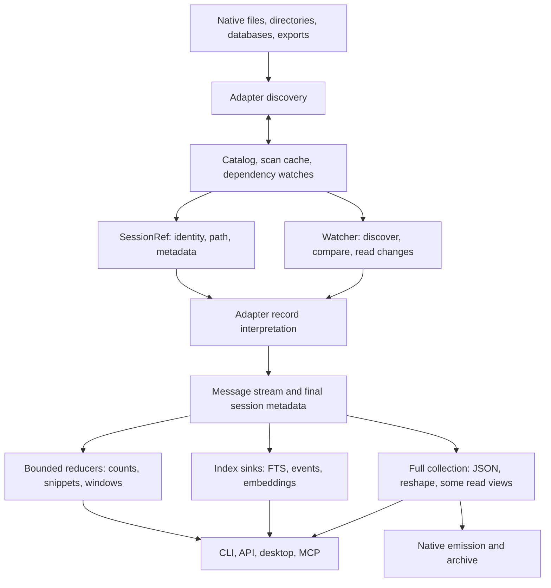

# Store performance: the system we are optimizing

Source audit: `c0f0044`, 2026-10-12. This is the working model and tracker for the next
performance pass. Measurements in `PERF.md` remain historical observations; their causal
explanations are not all supported by the implementation. Paths below are relative to `crates/`.

## What cv does

cv discovers sessions in heterogeneous stores, interprets their native histories into a common
message IR, and serves several different products from that IR: transcript reading, structured
facts, full-text/semantic search, live following, archives, datasets, and native session reshaping.
The task log is a separate event-sourced coordination store. Native CLI, HTTP, desktop and MCP
share much, but not all, of their read implementation. Browser upload is a separate, owned-memory
ingestion path for Claude, Codex and Gemini.

The key distinction is **source traversal, interpretation, payload decoding, retention, and
output**. Calling a method `stream` bounds none of those automatically. A reader can retain the
whole source before its first callback; a sink can collect everything; a bounded output chunker
can decode a whole field first. Each bound must hold across the composed path.

## Existing foundations to retain

- Discovery already parallelizes adapters and many per-file scans (`cv-core/src/lib.rs`).
  Warm ordinary listings use the catalog and scoped freshness probes; they need no body parse.
- The common API is `Adapter::stream` plus `MessageSink`. `parse` is collection over that API.
  `ParseOptions` separates full extras, format-complete carriers, lazy text spans and offsets.
- Claude/Codex have lazy source spans and resumable stream state. Codex has a useful direct path
  for giant tool outputs; most unchanged index jobs are skipped.
- FTS already combines text, event and affordance extraction in one pass, uses one writer,
  streams body documents through a bounded channel, and publishes resume marks after commit.
  Its scheduler already admits at most 2 GiB of estimated **source file bytes**.
- OpenCode, Goose and Hermes use per-session row iteration and the stores' existing indexes.
  Fixture query plans also support Devin's chain lookups and OpenClaw's event sequence query.
  Do not replace these with speculative PRAGMA tuning.
- Text `show --last N` already uses one lazy pass and a bounded deque. API message pages are
  lazy windows; event queries and `has:` counts have useful catalog fast paths.

## Reader inventory

| Store / format | Current traversal and retained state | Main unresolved cost |
|---|---|---|
| Claude JSONL | Parallel cached discovery; native stream; lazy content; checkpoints | Discovery parses all records; lazy records still build content Values before extracting spans; extras/fork side reads |
| Codex JSONL | mmap line scan; selective records; giant output spans; checkpoints | Repeated JSON scans; verify giant shortcut metadata/inherited-history equivalence |
| Codex legacy JSON / zstd | Separate whole-document/decompression paths | No general incremental marks; audit heap and semantic parity separately |
| Gemini legacy JSON | mmap, vector of borrowed raw messages, one owned record at a time | Giant single records; discovery collects whole sessions; escaped wrapper metadata falls back |
| Gemini JSONL | Replays all records into order + owned body map | Entire retained history payload; `$set`/rewind changes old logical messages |
| Qwen modern JSONL | Line stream, call/spawn state; keeps reading after sink stops for metadata | Discovery uses CollectSink merely to count; no text spans |
| Kimi | Context stream + pending usage message, rotated prefix dedup | Full wire sidecar text and tool outputs; dependency cache misses; mutable trailing usage |
| Kimi Code | One LLM step buffered; sidecar output references | Full Value discovery scans; step can be large; state/wire dependency mismatch |
| Grok | History stream + pending reasoning | Whole updates sidecar; uncached discovery; enrichment can revise old messages |
| Cline/Roo legacy | mmap raw history items, one record at a time | Full discovery/UI sidecar trees; no lazy text |
| Cline SDK | Whole wrapper document before emission | Primary source-size heap, unlike legacy reader |
| Continue | mmap raw history items; tool-answer dedup | Full Value discovery count, sometimes twice; mutable snapshots |
| OpenCode files | Ordered message descriptors, parts per message | Reads message metadata twice; dependency set includes parts |
| OpenCode SQLite | Indexed rows / parts per session | Discovery count scans; WAL and per-session invalidation |
| Cursor SQLite | Key/value session blobs and bubbles | Prefix LIKE scan; composed sessions/blobs; global/workspace dependencies |
| Devin SQLite | Session forest, node metadata and selected chain, then rows | Structural prepass over all branches; bodies already streamed |
| Hermes SQLite | Indexed message rows + generation dedup/trailing user texts | Pathological trailing prompts; shared DB invalidation |
| Goose SQLite | Indexed message rows | Preserve efficient query shape; measure before changing |
| OpenClaw JSONL / SQLite | Flat stream, or whole event bodies for tree navigation | Tree selection needs structure, not every body; registry side tables rescanned per session |
| Zed SQLite | Decode complete compressed thread blob | Full decode in discovery and stream; blob representation limits direct seeking |
| LM Studio | Raw-turn mmap stream | Discovery builds whole document tree |
| ChatGPT / Claude account exports | Whole archive String + owned raw conversation copies, then target parse | Archive reread for every session; repeated prefix parsing; ChatGPT branch selection |
| OpenSession | Whole JSON document/Session then replay | Can traverse message array while retaining metadata |

Registry: `cv-core/src/harness/mod.rs`; implementations under `cv-core/src/harness/`.
Directory entry sizes and whole database sizes are **not** per-session transcript byte counts.
Compressed, encoded, scanned, decoded and emitted bytes must be labeled separately.

## Consumer inventory

| Operation | Actual work | Optimization boundary |
|---|---|---|
| Warm ls/stats | Catalog probe, metadata rows, sort/filter | Preserve cheap path; measure discovery separately |
| Full discovery | Scans + cache persistence + catalog replacement/watch construction | Metadata reducers instead of collect-to-count; dependency-aware caching |
| Text windows / last N | Lazy range or deque, selected messages materialized | Already useful bounds; giant selected output is still output-sized |
| JSON show / MCP show | Full parse, then window | Keep selected messages and final metadata, decode selected content only |
| Affordance view | Full parse, then classify | Stream rows, preserve session/transcript/side-store ordering and extras |
| Doctor | Full-fidelity messages streamed, attribution state | Largest decoded record/extras dominate; decoded-length reducer may help |
| Query text predicate | Ranked search plus live snippets, then discard all but IDs | Index-only matching IDs; no source reads |
| Other rich predicates | Lazy whole-session collection for unknown facts | Small streaming fact reducers; preserve tri-state semantics |
| FTS | Chunked text, event vector, counts, checkpoint state | Bound escaped decoding, inline payloads, queued bytes and event retention |
| Semantic indexing | Second discovery, full rebuild of capped session heads | Reuse discovery and unchanged vectors; only after measuring importance |
| API pagination | Each page starts source traversal at zero; head reads whole source | Verified anchors or cache; head need not block first page rendering |
| Watch | Discovery, full parse/count of changed session; old prefix parse on first append | Reuse safe stable cursors; logical edits must invalidate old output |
| Archive | Whole parse/serialize/compare even unchanged; watch reparses again | Skip unchanged dependencies; catalog compaction check currently scans twice per update |
| Dataset | One session's lazy message vector, writer resolves output | Escaped chunk bound; streaming filters where semantics allow |
| Pack/tools/token stats | Repeated passes or retained intermediate event/usage vectors | Fuse consumers and fold smaller state, preserve dedup and ordering |
| Reshape/emit | Full IR or raw records, often several owned copies and verification rereads | Full output is required; simultaneous full copies generally are not |
| Task coordination | Replay full append-only task log under CAS for writes | Separate workload; snapshot/tail only if measured task volume warrants it |

Key sources: `cv/src/cmd/view.rs`, `cv-core/src/{api,affordance,watch,lazy,stream}.rs`,
`cv-search/src/{fts,semantic}.rs`, `cv/src/cmd/{query,archive,pack,compose}.rs`.

## Correctness boundaries before reuse

1. Physical append does not imply logical append. Gemini replacement/rewind and OpenClaw leaf
   changes can replace an old visible suffix; Kimi usage, Kimi Code unfinished steps and Grok
   reasoning can revise the last pending message. Checkpoint only finalized output/state.
2. Identity includes dependencies: SQLite WAL, directory children, side metadata, rotation
   manifests and sidecar output. Existing freshness policies disagree about these dependencies.
   Catalog DB watches currently omit WAL; FTS/events stat the primary path and may use size-only
   freshness for JSONL, unlike stricter affordance counts.
3. Current resume marks sample the first 4 KiB and the 4 KiB preceding the mark. This is not a
   proof that the entire prefix is unchanged. A same-size rewrite elsewhere can escape detection.
   Unconditional detection of arbitrary prefix edits requires reading that prefix or a trusted
   writer/filesystem change signal; do not promise both zero prefix reads and such detection.
4. Lazy/full equivalence must compare **resolved content** and metadata. The existing stream dump
   serializes span descriptors, not their resolved text. Span layout changes are not output changes.
5. Existing format bugs must be isolated and tested as correctness changes. Examples to refute:
   Codex's giant-output shortcut drops metadata preserved by its ordinary branch; Gemini's native
   wrapper omits metadata fields and rejects escaped borrowed strings.
6. Exact final metadata can require EOF, even when a window needs only early messages. Separate
   payload retention from metadata traversal rather than silently returning incomplete metadata.

## Engineering direction

Optimize the composition, in this order:

1. **Consumer demand:** stop collecting payloads that a view discards; separate index matches from
   snippet generation. Use existing sinks and APIs rather than another command family.
2. **Payload lifetime:** genuinely bounded decoding for escaped spans, typed borrowed hot records,
   metadata-only discovery, raw source ranges for replay bodies. Preserve full/complete modes.
3. **Source/dependency identity:** consolidate invalidation and make format-specific stable append
   boundaries explicit before adding more resume implementations.
4. **Repeated work:** share passes, archive references, parsed metadata and verified positions where
   lifetime/invalidation makes reuse sound. Do not create a new persistent index without evidence.
5. **Concurrency:** once per-operation working sets are known, charge actual conservative working
   cost; bound in-flight payloads and writer queues. Parallelize independent work without multiplying
   unbounded allocations. File-backed resident pages and private heap need different interpretation.

No promised multiplier applies to every path. Exact first-run counts over an unindexed fleet
require reading their records unless the harness supplies authoritative metadata. A 300 ms listing
budget cannot justify pretending exact counts can be recovered without those reads.

## Measurement and active work

Every change needs a narrow behavioral counterexample or measured cost, followed by composed-path
verification. The initial suite will distinguish direct adapter discard/count, discovery, derived
views, windows, full output, incremental index/watch, and writer costs. Measure tiny records, giant
escaped/unescaped text, tool arguments, many records, replay controls and database WAL changes.

Record wall/CPU, decoded or traversed bytes, messages, peak live allocations, RSS and (on macOS)
footprint. Allocation instrumentation and output hashing are separate runs from throughput timing.
Use explicit-root adapters and frozen scratch sources; never mutate the real stores. Cold/warm
means which cache is cold, not an unsupported claim that the OS page cache was evicted.

Historical baseline confirmation: a release direct lazy count on the frozen 313.8 MB Gemini
recording emitted 199 messages at best-of-three 0.944 s (332 MB/s). The process also performed
three whole-file read baselines and reached 1.77 GB RSS / 1.45 GB footprint; those process peaks
are **not isolated adapter heap**. The forthcoming allocation probe must attribute the lifetime.

Tracker (keep unfinished work visible; measurements determine later ordering):

- [x] Source map: readers, consumers, caches, index, follow/archive, write paths and gates.
- [x] Correct the handoff's assumptions about existing streaming, parallelism and admission.
- [ ] Independent allocation/throughput/equivalence probes and valid scale fixtures.
- [ ] Streaming affordance and full-fidelity JSON-window consumers.
- [ ] Index-only text matching and deferred snippets.
- [ ] Bounded escaped-string chunk decoding, with and without mmap.
- [ ] Gemini metadata/discovery, lazy records and replay payload retention.
- [ ] Claude typed borrowed hot records and metadata scan; Codex fast-path semantic parity.
- [ ] SQLite/dependency freshness, including WAL and sidecar-only changes.
- [ ] Remaining document readers/discovery: SDK, exports, Continue, LM Studio, OpenSession.
- [ ] Remaining sidecar/step/tree retention: Kimi, Kimi Code, Grok, OpenClaw, Devin, Zed.
- [ ] Format-safe append reuse beyond Claude/Codex; watcher and archive amplification.
- [ ] Reassess index admission/events/queues after reader and consumer measurements.
- [ ] API pagination, query facts, pack/tools/stats, semantic rebuilds: prioritize by measurements.
- [ ] Whole-fleet parity, integration measurements, complete CI gates, integrate and publish branch.

The full gate roster is `.github/workflows/ci.yml`, including release parse budget, manual build,
search without default features, dist plan, wasm-pack, the separate desktop workspace and web
selftest. `PERF-HANDOFF.md`'s inline gate list omits several of these.
