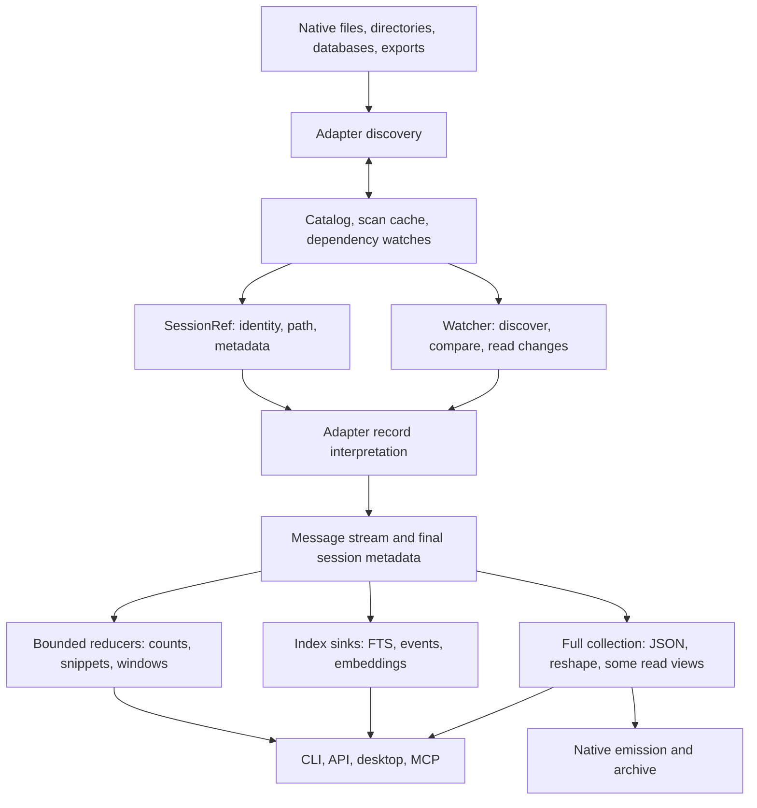

# Store performance: the system we are optimizing

Source audit: `c0f0044`, 2026-10-12; updated through the first pass and the ongoing `perf/excellence-pass`.
This is the working model and tracker for the performance pass. Measurements in `PERF.md` remain historical observations; their causal
explanations are not all supported by the implementation. Paths below are relative to `crates/`.

## What cv does

cv discovers sessions in heterogeneous stores, interprets their native histories into a common
message IR, and serves several different products from that IR: transcript reading, structured
facts, full-text/semantic search, live following, archives, datasets, and native session reshaping.
The task log is a separate event-sourced coordination store. Native CLI, HTTP, desktop and MCP
share much, but not all, of their read implementation. Browser upload is a separate, owned-memory
ingestion path for Claude, Codex and Gemini.

The key distinction is **source traversal, interpretation, payload decoding, retention, and
output**. Calling a method `stream` bounds none of those automatically. A reader can retain the
whole source before its first callback; a sink can collect everything; a bounded output chunker
can decode a whole field first. Each bound must hold across the composed path.

## Existing foundations to retain

- Discovery already parallelizes adapters and many per-file scans (`cv-core/src/lib.rs`).
  Warm ordinary listings use the catalog and scoped freshness probes; they need no body parse.
- The common API is `Adapter::stream` plus `MessageSink`. `parse` is collection over that API.
  `ParseOptions` separates full extras, format-complete carriers, lazy text spans and offsets.
- Claude/Codex have lazy source spans and resumable stream state. Codex has a useful direct path
  for giant tool outputs; most unchanged index jobs are skipped.
- FTS already combines text, event and affordance extraction in one pass, uses one writer,
  streams body documents through a bounded channel, and publishes resume marks after commit.
  Its scheduler already admits at most 2 GiB of estimated **source file bytes**.
- OpenCode, Goose and Hermes use per-session row iteration and the stores' existing indexes.
  Fixture query plans also support Devin's chain lookups and OpenClaw's event sequence query.
  Do not replace these with speculative PRAGMA tuning.
- Text `show --last N` already uses one lazy pass and a bounded deque. API message pages are
  lazy windows; event queries and `has:` counts have useful catalog fast paths.

## Reader inventory

| Store / format | Current traversal and retained state | Main unresolved cost |
|---|---|---|
| Claude JSONL | Parallel metadata discovery; mmap typed borrowed conversational records including rich reads; large lazy tool inputs use Json source ranges; checkpoints | Demanded full arguments/details and uncommon fallback records remain owned; portable transport retains one line |
| Codex JSONL | mmap line scan and bounded event-authority prepass; giant output spans through shared dispatch; checkpoints | Repeated JSON scans; buffered/zstd input still retains the largest raw line |
| Codex legacy JSON / zstd | Separate whole-document/decompression paths | No general incremental marks; audit heap and semantic parity separately |
| Gemini legacy JSON | mmap, validated raw records, lazy text spans; metadata discovery | Full modes, composite tool results, thoughts and rich extras still own payloads |
| Gemini JSONL | Native mmap replay retains order + raw body ranges; buffered fallback without mmap | Per-record navigation; `$set`/rewind changes old logical messages; non-mmap history remains owned |
| Qwen modern JSONL | Line stream, call/spawn state; keeps reading after sink stops for metadata | Discovery counts without collecting; direct project JSONL resumes finalized records; record text remains owned |
| Kimi | Context stream + pending usage message, rotated prefix dedup | Wire sidecar uses raw ranges and lazy output spans; structural lookup state and mutable trailing usage remain |
| Kimi Code | One LLM step buffered; source-projected inventory; sidecar output references | Step and structured carriers can be large; mutable state/wire semantics |
| Grok | History stream + pending reasoning; metadata-projected discovery and sidecars | One history record and retained tool metadata; enrichment can revise old messages |
| Cline/Roo legacy | Shared selected-record source views, lazy text/arguments and bounded workspace extraction | Rich metadata, encoded arguments and selected composite output remain |
| Cline SDK | Shared source views, raw records and Anthropic block dispatch; large arguments use Json ranges | Selected rich fields and compatibility edge cases; giant full-output parity remains separate |
| Continue | Native/positioned typed header and selected-record source views; lazy payloads and tool-answer dedup | JSON-encoded arguments, selected composites, answer-ID state and mutable snapshots remain |
| OpenCode files | Ordered message descriptors, parts per message | Reads message metadata twice; dependency set includes parts |
| OpenCode SQLite | Indexed rows / parts per session | Discovery count scans; WAL and per-session invalidation |
| Cursor SQLite | Indexed IDE composer ranges; CLI/ACP snapshot replay of reachable protobuf/JSON blobs | Selected message scalars and rich fields; shared private text backing activation in progress |
| Devin SQLite | Compact structural forest projection, then selected full metadata per emitted row | Necessary navigation state grows with nodes; strict metadata projection has a measured CPU cost |
| Hermes SQLite | Indexed rows; prompt suppression uses the shared portable exact string set | Initial SQL spill had significant CPU/temp-I/O cost; final cached exact-set CPU proof pending |
| Goose SQLite | Indexed message rows | Preserve efficient query shape; measure before changing |
| OpenClaw JSONL / SQLite | SQLite row cursors, compact tree navigation and selected payload replay | Tree metadata grows with events; selected row blobs remain owned; extra validation costs CPU |
| Zed SQLite | Metadata-only ordered rows and incremental blobs under one snapshot; stream decodes once into owned spill, then validated message replay | Decoder/one message/known metadata; decoded file pages and temporary I/O; WITHOUT ROWID fallback retains one native cell |
| LM Studio | Schema-selected document/turn views, selected lazy text spans and incremental variants; mapped or positioned sources | Bounded discovery title prefixes; Harmony decoding and arbitrary demanded output/metadata remain owned |
| ChatGPT / Claude account exports | Bounded metadata cache and positioned source views; selected-conversation replay | Branch descriptors, joined text, selected owned output and sender/empty-archive compatibility edges |
| OpenSession | Shared source validation/views and per-message IR projection | Selected authoritative rich fields remain owned; giant serialization proof separate from count/discovery |

Registry: `cv-core/src/harness/mod.rs`; implementations under `cv-core/src/harness/`.
Directory entry sizes and whole database sizes are **not** per-session transcript byte counts.
Compressed, encoded, scanned, decoded and emitted bytes must be labeled separately.

## Consumer inventory

| Operation | Actual work | Optimization boundary |
|---|---|---|
| Warm ls/stats | Catalog probe, metadata rows, sort/filter | Preserve cheap path; measure discovery separately |
| Full discovery | Scans + cache persistence + catalog replacement/watch construction | Metadata reducers instead of collect-to-count; dependency-aware caching |
| Text windows / last N | Lazy range or deque, selected messages materialized | Already useful bounds; giant selected output is still output-sized |
| JSON show / MCP show | CLI show/export stages resolved frames and envelopes in bounded spill storage; EOF metadata retained. MCP collects selected windows | CLI Last retains lazy tail descriptors; owned adapter extras and redaction trees remain; MCP selected payloads |
| Affordance view | Lazy full-extras stream into classified rows; bounded text summaries | Rich extras, side stores and result rows; escaped validation still traverses the whole field |
| Doctor | Lazy-extra stream; resolved text lengths and JSON writer counts | Attribution state, adapter rich/fallback parsing and structured arguments |
| Query text predicate | Exact index-only matching IDs; cheap tri-state evaluation before parse | Mixed predicates still parse when cheap facts cannot decide |
| Other rich predicates | Predicate-sized streamed tool/model facts and shared source probes | Distinct unresolved relative paths retained until final cwd; compaction uses its existing separate boundary |
| FTS | Chunked text, bounded event spool and byte-capacity permits held through Tantivy document consumption; counts/checkpoints and one catalog connection per sweep | Writer arenas coexist with admitted documents; giant escaped-body composition proof pending |
| Semantic indexing | Shares discovery inventory; source/model identity enables unchanged-vector reuse and deferred model load; atomic streamed save | Fallible lazy text projections and final end-to-end cost proof; vector store still grows with session count |
| API pagination | Bounded source-verified page checkpoints and head metadata cache; no messages cached | Safe continuation formats only; source/dependency changes and oversized state fall back |
| Watch | Verified checkpoints and bounded EOF metadata reused across tail polls | Strict source identity and dependencies; replay-only formats retain fallback parsing |
| Archive | Verified suffix read; bounded message spool and guarded canonical prefix copy; checked streaming payload output | Complete replacement artifact still writes O(output bytes); metadata width remains owned |
| Dataset | Streamed selection and bounded output staging; late predicates retain source descriptors in private spools | Bounded slice decoding reduces matched-query spool CPU; demanded owned producer fields remain |
| Pack/tools/token stats | Tool histograms fold per-message event scratch; pack excerpts use a ring; ordered usage rows reuse a bounded dependency-validated cache | Cold ledger publication, exact dedup I/O and model roster growth; tiny native sources bypass caching |
| Reshape/emit | Full IR or raw records, often several owned copies and verification rereads | Full output is required; simultaneous full copies generally are not |
| Task coordination | Replay full append-only task log under CAS for writes | Separate workload; snapshot/tail only if measured task volume warrants it |

Key sources: `cv/src/cmd/view.rs`, `cv-core/src/{api,affordance,watch,lazy,stream}.rs`,
`cv-search/src/{fts,semantic}.rs`, `cv/src/cmd/{query,archive,pack,compose}.rs`.

## Correctness boundaries before reuse

1. Physical append does not imply logical append. Gemini replacement/rewind and OpenClaw leaf
   changes can replace an old visible suffix; Kimi usage, Kimi Code unfinished steps and Grok
   reasoning can revise the last pending message. Checkpoint only finalized output/state.
2. Identity includes dependencies: SQLite WAL, directory children, side metadata, rotation
   manifests and sidecar output. Existing freshness policies disagree about these dependencies.
   Catalog DB watches include WAL appearance, modification and disappearance. Counts, events and
   each search index now keep separate canonical dependency metadata baselines, tied to the primary
   tuple. SQL output and stamps publish atomically; FTS invalidates its old baseline before changes
   and publishes a revalidated baseline after commit. Operation-local probes share file stats.
   Known adapter-local sidecars, directory members and WAL files are covered. Consumers capture
   conditional Claude fork siblings and resolved external output paths before reading them, including
   absent files. Complete read sets survive prefix checkpoints and are revalidated at publication.
   Version-1 dependency baselines reread once through normal refresh without an index rebuild.
3. Current resume marks sample the first 4 KiB and the 4 KiB preceding the mark. This is not a
   proof that the entire prefix is unchanged. FTS now requires growth before using a mark, so
   same-size rewrites take a whole pass; inode replacement also rejects reuse. A rewrite followed by
   growth can still escape the samples, and a primary rewrite restoring size/mtime can evade freshness.
   Unconditional detection of arbitrary prefix edits requires reading that prefix or a trusted
   writer/filesystem change signal; do not promise both zero prefix reads and such detection.
4. Lazy/full equivalence must compare **resolved content** and metadata. The existing stream dump
   serializes span descriptors, not their resolved text. Span layout changes are not output changes.
5. Existing format bugs must be isolated and tested as correctness changes. Fixed separately:
   Codex's giant-output shortcut dropped metadata preserved by its ordinary branch; Gemini's native
   wrapper omitted metadata fields and rejected escaped borrowed strings.
6. Exact final metadata can require EOF, even when a window needs only early messages. Separate
   payload retention from metadata traversal rather than silently returning incomplete metadata.

## Engineering direction

Optimize the composition, in this order:

1. **Consumer demand:** stop collecting payloads that a view discards; separate index matches from
   snippet generation. Use existing sinks and APIs rather than another command family.
2. **Payload lifetime:** genuinely bounded decoding for escaped spans, typed borrowed hot records,
   metadata-only discovery, raw source ranges for replay bodies. Preserve full/complete modes.
3. **Source/dependency identity:** consolidate invalidation and make format-specific stable append
   boundaries explicit before adding more resume implementations.
4. **Repeated work:** share passes, archive references, parsed metadata and verified positions where
   lifetime/invalidation makes reuse sound. Do not create a new persistent index without evidence.
5. **Concurrency:** once per-operation working sets are known, charge actual conservative working
   cost; bound in-flight payloads and writer queues. Parallelize independent work without multiplying
   unbounded allocations. File-backed resident pages and private heap need different interpretation.

No promised multiplier applies to every path. Exact first-run counts over an unindexed fleet
require reading their records unless the harness supplies authoritative metadata. A 300 ms listing
budget cannot justify pretending exact counts can be recovered without those reads.

## Measurement and active work

Every change needs a narrow behavioral counterexample or measured cost, followed by composed-path
verification. The initial suite will distinguish direct adapter discard/count, discovery, derived
views, windows, full output, incremental index/watch, and writer costs. Measure tiny records, giant
escaped/unescaped text, tool arguments, many records, replay controls and database WAL changes.

Record wall/CPU, decoded or traversed bytes, messages, peak live allocations, RSS and (on macOS)
footprint. Allocation instrumentation and output hashing are separate runs from throughput timing.
Use explicit-root adapters and frozen scratch sources; never mutate the real stores. Cold/warm
means which cache is cold, not an unsupported claim that the OS page cache was evicted.

Historical baseline confirmation: a release direct lazy count on the frozen 313.8 MB Gemini
recording emitted 199 messages at best-of-three 0.944 s (332 MB/s). The process also performed
three whole-file read baselines and reached 1.77 GB RSS / 1.45 GB footprint; those process peaks
are **not isolated adapter heap**.

The isolated `store_probe` baseline attributes Gemini's direct lazy count to 841,082,713 bytes
of peak live Rust allocations (847 MB process footprint). The corresponding Codex read has
25.7 MB live Rust allocations and 47.5 MB footprint despite 761 MB RSS: most resident pages are
file-backed. These measurements distinguish private allocation from mapped input.

The probe separates direct adapter operations from production affordance reads. Its window
operation demonstrates retention shape;
production JSON show additionally counts, serializes selected messages for budgets and handles
continuation. The probe window is not an end-to-end show benchmark. Separate actual CLI tests
compare full JSON output with the lazy-extra window implementation, including EOF metadata. Hash runs resolve spans and canonicalize
message and metadata maps; they are separate from timing and allocation runs. The heap feature
counts requested Rust allocations, excluding SQLite/native allocation and allocator fragmentation.

Completed Cursor discovery query check: with 20,000 unrelated bubble rows and three composers,
SQLite VM steps fell from 80,043 to 52 and full-scan steps to zero. The binary prefix range keeps
the former row order and has a fallback for tables without rowids.

The frozen fleet comparison covers 5,960 references (5,959 primary paths, 95.92 GB) in three
modes: 17,880 baseline/candidate pairs. Claude and Gemini match in every mode; Codex bulk/full
match, and its 955 changed lazy results exactly match the baseline ordinary bulk parser. These
are corrected giant-path metadata omissions, not unexplained content drift. A 43-reference
complete-mode subset also matches. The frozen 35,116 source/companion files remained unchanged;
live edits occurring after the freeze are excluded from the comparison.

The giant Codex gate found a hidden full-Value allocation in event-authority detection before the
mapped stream. Detection now projects only discriminants from strictly validated raw records and
reuses the mapping. Tool-only histories therefore stay bounded even when no natural-language
record allows an early exit. Buffered/zstd traversal still retains a largest-line buffer.

Event publication now spills ordered rows above a 256 KiB charged-memory budget to an owned
private temporary file, then reads that file once inside the existing SQL transaction. Corrupt,
missing or extra rows roll back both output and its dependency baseline. Failed publication clears
the resume mark and is reported by indexing; successful independent FTS/count work remains. An
FTS-only pass retains event checkpoint state without extracting rows, preserving later append reuse.

| Isolated publication measurement | Previous path | Candidate |
|---|---:|---:|
| 20,000 event rows: peak live Rust allocation | 7,211,499 B | 358,005 B |
| 200,000 event rows: peak live Rust allocation | 58,878,796 B | 358,007 B |
| 200,000 event rows: clean median wall time | 1.224 s | 1.207 s |
| 1,000 sessions, 16 rows + counts each: clean median wall time | 2.865 s | 0.368 s |
| Same 1,000-session writer stage: user + system CPU | 2.33 s | 0.31 s |

The event probe uses valid Claude JSONL with small tool inputs and distinct targets, including SQL
publication. Spooling writes and reads 2,417,780 B for 20,000 rows and 24,577,780 B for 200,000 rows,
once in each direction. The largest decoded record/target is still a separate bound. Native SQLite
allocation and mapped input are excluded from Rust heap instrumentation.

The `cv-core` example `catalog_writer_probe legacy|writer SESSIONS SOURCE` isolates publication
from parsing and Tantivy. With fresh scratch catalogs, three clean runs per mode produced identical
16,000 event rows, 1,000 count rows, 2,000 baselines and a 2,052,096 B catalog. Reusing one connection
amortizes schema initialization, prepared statements and close/checkpoint work; it preserves separate
per-consumer transactions and never holds a write lock across source reads. Native peak footprint
rose from 3.75 MB to 5.36 MB in this probe because the connection/page cache lives longer. These
stage timings do not claim the same multiplier for full indexing: a later fleet sample was waiting
on Tantivy merges after parsing had finished.

A giant `ToolUse.input` exposed another composed bound: compact JSON was serialized into a whole
String, copied into the chunk buffer, then copied into a single oversized Tantivy document. FTS
now streams Value's same compact serialization into UTF-8-safe documents capped at twice
`CHUNK_BYTES` (8 MiB in production). Canonical bytes, source insertion order and previews are
preserved. Giant-argument document boundaries change, so term conjunctions still obey the existing
per-document search semantics; this unreleased index version already requires a first-run rebuild.

The ignored `fts::tests::tool_input_fts_demand_probe` accepts frozen scratch
`CV_FTS_INPUT_PROBE`/`CV_FTS_INPUT_BYTES`, emits and drops real documents from `index_session`, and
verifies the concatenated canonical body hash plus event/count publication. It excludes Tantivy
tokenization, writer queues, commits and merging. With 100 MB of plain input, the old maximum body
document was 100,000,092 B; the candidate stays at the test configuration's 4,096 B cap. Process
footprint fell from 503,857,920 B to 203,571,752 B; RSS fell from 614,481,920 B to 314,343,424 B.
These debug-stage process measurements include mapped/native memory. Owned JSON input and the
tee clone remain proportional to input size; this is not a universal index heap bound.

The `check-heap-budget.py --only events` gate covers ordered extraction through SQL
publication at 20,000/200,000 fixed-size records, compares every persisted row with the retained
collector, and verifies source stamps, spool I/O and normal cleanup. Live Rust peaks are
352,006/352,009 B versus 7,073,127/57,619,016 B for the collector. Its fixed 1 MiB ceiling and
256 KiB growth allowance exclude giant individual inputs and native SQLite memory. Since
`100509c`, `.github/workflows/ci.yml` invokes it separately alongside the other heap
campaigns; it is still a separately selected driver campaign rather than part of the default
stores/chunks invocation.

Zed's incremental two-pass reader at `100509c` established bounded native memory but cost
2.2–2.6× the original reader's clean streaming CPU on 64 MiB low-compressibility histories.
Profiles attributed most execution to repeated zstd decoding and JSON parsing, with SQLite
around 2% of sampled execution. The decoded-spill follow-up (`d0093be`, integrated as `5ae0eda`)
preserves full validation before callbacks, authoritative duplicate-last message selection and
the same SQLite snapshot, while decompressing only once. Discovery retains its existing one-pass
reader.

Three rotated clean subprocess triples measured original / two-pass / spill CPU medians of
0.408 / 1.047 / 0.382 s plain and 0.552 / 1.191 / 0.639 s escaped. Wall medians were
0.418 / 1.062 / 0.397 s and 0.559 / 1.195 / 0.652 s. These are synthetic 64 MiB discard operations
under shared load 34–38, with uncontrolled OS cache, separate from allocator and hash runs.
Escaped CPU remains about 16% above the original; the large intermediate regression is removed.

At 16/64 MiB, requested Rust peak stays flat at about 6.67 MB; native footprint is 14.5 → 14.5 MB
plain and 14.1 → 15.2 MB escaped. RSS grows 38.1 → 88.5 MB / 38.8 → 93.4 MB because decoded
file pages are mapped. Each operation writes the full decoded source once: 16.8 → 67.2 MB plain
or 17.8 → 71.4 MB escaped, then scans it for validation and replay. Physical I/O depends on OS
cache. Owned temporary directories are empty after measured exits; Unix files are unlinked
while owned descriptors remain live. All four fixtures match exact preserved-order resolved
message and metadata digests, with 128/512 callbacks. The source-sized native-cell fallback and
largest demanded record remain separate limits. Detailed measurement definitions are in
`PERF.md`; these results do not claim combined final gates or whole-fleet throughput.

The production FTS sweep now keeps byte-capacity permits through Tantivy document consumption
(`c804b19`, integrated as `762ebda`), instead of releasing them on queue receipt. A debug
allocator-instrumented mixed sweep uses four 100 MB decoded plain Claude arguments, 32 small
sessions, actual 4 MiB chunks and a 64 MiB reservation budget. Peak requested Rust heap above
baseline is 228,994,263 B versus 861,238,323 B in an otherwise identical unbounded control;
peak charged document capacity is 65,786,618 B versus 800,037,416 B. Writer arenas and extraction
state coexist with those reservations, so this is not a 64 MiB total-process bound. The single
samples exclude mmap, C/SQLite, stacks and allocator overhead; they make no throughput claim.
Scoped fatal-writer, waiter wakeup, drop/commit release and unchanged-sweep checks pass. A
separate composed sweep now verifies four 25/100 MB plain/escaped fixtures, each exposed as four
logical giant sessions plus 32 small sessions (144 logical sessions total). Independent canonical
body bytes/hashes, per-session search hits, events/count freshness, actual tokenization, commit
and compact, and a strict unchanged second sweep all match; source hashes are unchanged. The
production chunk setting is 4 MiB with an 8 MiB body buffer cap, while the largest charged
compact document is approximately 16 MiB: 4 MiB is not an actual document capacity bound. In
plain25/escaped25/plain100/escaped100 order, peak additional live Rust heap is
201.76/163.03/218.39/162.87 MiB and charged queue capacity is 63.69/48.00/62.74/48.00 MiB,
all below the 64 MiB admission budget. These separate samples include debug instrumentation and
body hashing; they establish composition and allocation behavior, not CPU or wall throughput.

Focused SQLite scale evidence removes payload retention without promising constant navigation
state. Devin's compact forest projection reduces requested Rust heap from 8.22/32.52 MB to
0.269/0.313 MB on 8/32 MB metadata fixtures. At 100 MB/1 GB with 800/8,000 nodes, it uses
0.379/2.293 MB: retained structural rows legitimately grow. Hermes prompt-only trailing rows
fall from 8.13/32.14 MB to a flat 1.258 MB through exact spill keys. At 1 GB, native process
footprints are 8.67 MB Devin / 8.45 MB Hermes; all callbacks and scratch-file cleanup match.
Twenty-four separate lazy/complete preserved-order hash processes across six 1/8/32 MB fixtures
match the old readers. The initial Hermes SQL spill writes approximately 1 GB of key data plus
B-tree overhead at that scale; physical disk I/O was not measured. Its clean 32 MB paired median
CPU rises about 4.9× (user 0.0256 → 0.0535 s; system 0.0181 → 0.161 s), so the shared portable
exact-set replacement remains active. Devin's subsequent single-pass projection (`f825ff6`)
reduces its initial CPU regression to about 1.25× on the same 32 MB control: user 0.01194 →
0.01644 s, system 0.01176 → 0.01312 s; paired wall 0.02760 → 0.03236 s under uncontrolled load.
Cursor inline composer Values and OpenCode many-part logical messages remain unbounded cases.

Cold portable document sources now use the shared positioned view rather than a whole encoded
source buffer. On the frozen 16/64 MiB plain/escaped count/discovery fixtures, all 32 cases retain
exact expected message/session counts. Peak live requested Rust heap, **including stage baseline**,
is flat across source sizes:

| Portable format | Count plain / escaped (B) | Discovery plain / escaped (B) |
|---|---:|---:|
| Cline SDK | 264,030 / 329,552 | 264,772 / 330,289 |
| OpenSession | 263,604 / 329,127 | 263,760 / 329,282 |
| ChatGPT export | 329,317 / 394,847 | 329,484 / 395,013 |
| Claude export | 329,311 / 394,841 | 329,477 / 395,006 |

These are no-mmap allocation probes through the document source activation; they exclude C,
allocator overhead and process footprint and make no timing claim. Small raw serialization
oracles pass in both configurations; giant full-output/hash composition and the Claude sender
count/empty-archive error corrections remain separate pending checks.

Token statistics have a separate retention counterexample. On 16k/64k native usage calls,
current aggregation peaks at 6,743,774/26,955,998 B for duplicated Claude response blocks and
2,654,678/10,557,782 B for unkeyed Codex calls. Counts, totals and duplicates match expectations;
these allocator measurements make no CPU claim. The ordered usage spool/shared portable exact set is integrated (`0016240` + `6a496d3`).
The four fixtures now peak at 816,122 B Claude / 244,348 B Codex with exact report parity;
completed batches are limited by configured worker count and dedup keys spill. An independent
old-compute oracle checks raw report and float bits with duplicate IDs, different/late models,
failed sources and Rayon 1/2/4 workers. Final CPU evidence is pending the 64 KiB key append cache;
output model-row cardinality, worker allowances and the largest individual key/model remain
legitimate memory terms.

Semantic reuse (`630b361`, integrated as `29af9c0`) shares the discovery inventory and stores
per-row source/dependency snapshots with vectors, plus a global projection version and resolved
model artifact identity. Unchanged sweeps avoid adapter parsing, model load and saving; vectors
compact in place and atomic buffered output avoids a second serialized vector buffer. Legacy
rows rebuild once. Ten scoped refresh/store/model tests and eight corpus tests pass without
network/model downloads; there is no semantic throughput or RSS proof. Exact discovery-reference
hints and query projection checks are a follow-up (`daa0183`); fallible lazy Text projection
remains active so failed text reads cannot silently embed empty strings.

API continuation/head changes (`0769d1a` + `cb844b4`) reduce callback work on the controlled
20,000-message fixture: 100 successive pages of 200 messages emit 20,099 callbacks instead of
1,010,099; five head requests emit 20,000 instead of 100,000. This is a callback-work result,
not a wall-time or whole-source-byte bound.

Watch/archive reuse (`e120208`, `8cc975f`, `432a3bd`, `b211452`) shares the existing adapter
checkpoints, before-read snapshots and dynamic read sets. Strict size+mtime equality additionally
requires the captured primary identity/ctime; growth uses the existing inode and sampled-byte
immutable-prefix contract. Replacement, truncation, dependency changes, interpretation-version
changes and missing guards decline reuse. A timestamp-restored edit followed by growth remains
outside the sampled append contract. Whole fallback preserves full messages and EOF metadata.

Optional checkpoint state is capped at 64 KiB, EOF metadata at 16 KiB; oversized state degrades
to replay. Version-1 cursor positions remain unchanged, with at most eight 64 KiB optional reader
states per issued cursor. A verified unchanged pending poll can intentionally stop after its
selected messages while using prior complete metadata/counts. Demanded polling errors propagate
through `try_poll_bounded`; the legacy bool poll remains best effort and leaves failures retryable.

Archive source state lives separately under `archive-source/`, capped at 1 MiB. Reuse also checks
the archived artifact's size/mtime/inode/ctime on Unix, or a streamed content hash elsewhere, so
user modification/deletion forces repair. Append replaces the suffix after `checkpoint.messages`,
including Codex's held EOF assistant whose usage may arrive later. `cv watch` observes references
directly and lets the archive perform its sole consumer read. Private owned temporary files and
bounded file comparison replace whole serialized JSON/comparison buffers; failed catalog
publication does not advance the source stamp and retry repairs missing catalog output.

The focused 8,192-message Claude fixture plus four messages interprets 699 messages / 243,650
logical primary suffix bytes instead of 8,196 / 2,865,380 on append. Four cold unchanged archive
polls interpret zero messages, reading a roughly 2 KB state file plus metadata probes on Unix. A
one-message pending poll interprets two callbacks rather than the whole 8,192-message source,
with exact EOF metadata/count. Bounded archive history (`7f40ac6`) spools serialized messages in
shared private storage (1 MiB memory cap), then copies the guarded canonical stable prefix without
loading or parsing the prior archive. The same append copies 3,446,394 stable JSON bytes, spools
286,289 suffix message bytes and writes 3,767,141 final JSON bytes. These are logical byte costs;
large spools spill to temporary storage and physical I/O depends on the OS cache. Complete output
still requires O(archive bytes) publication, preserving the existing atomic replacement contract. Full serialized output matches the original parser for Claude/Codex
fixtures, native/legacy Qwen and Gemini/OpenClaw/LM Studio/Cline/Roo cases. Narrow tests cover
cursor partial consumption, held EOF usage, artifact repair, source invalidation and publication
failure/retry. The later current-source oracle establishes exact materialized Claude parity with
existing `lazy_extra`; watch now uses that mode to avoid owning discarded giant arguments. The
prior assertion that full extras required another mode was unproven and is corrected here.

Lane-summary projection (`5ffbd10`) has eight scoped tests; it skips irrelevant bodies.

LM Studio selected-record projection replaces the document's turn descriptor vector and each
whole-turn Value with fixed schema rosters and chronological source cursors. The original derived
envelope rules remain: duplicate known keys and wrong typed fields reject, positional struct arrays
work, and each raw turn resets its Value scalar/depth budget before invalid turns are skipped.
Unselected versions and internal steps are validated without owning their payloads; complete-mode
variants are emitted individually. Ordinary lazy text/thinking stays in spans; Harmony keeps its
existing owned decoder. Exact raw-order message and metadata hashes match the old native parser
for sample, Harmony and a 16 MiB escaped fixture in lazy/full/complete modes.

The diagnostic heap builds (debug candidate; no timing claim) discard two callbacks from generated
16/64 MiB escaped bodies. Native peak requested Rust heap above setup falls from
25,168,379/100,665,851 bytes to 197,997/197,997; positioned readers use 393,852/393,852.
A tiny selected version beside one 16/64 MiB escaped unused version takes 2,003/2,003 native bytes
versus the old 33,556,049/134,219,345. These bounds exclude demanded owned output, Harmony decoding,
source mappings and native allocations. Eighteen scoped LM Studio tests cover both configurations,
including envelope rejection, variant output, escaped spans, decoder-boundary markers and mutation.

The isolated opt-in archive probe (`79a1e8d`, feature `probe-heap`) records only the requested Rust
heap during the operation, excluding fixture generation and report serialization. On controlled
20,002 / 200,002-message Claude histories, full archive peak falls from 32.5 / 306.3 MB to
1,125,572 / 1,125,584 bytes. Verified append peaks are 352,466 / 216,630 bytes versus the prior
28.3 / 250.3 MB; suffix callbacks are 1,030 / 69, stable-prefix copy is 5.23 / 55.56 MB and final
artifact write is 5.52 / 55.58 MB. Cold unchanged polls use about 12.7 KB peak with zero callbacks,
spool bytes or prefix/output writes. Debug elapsed full operations are 0.52 / 5.08 s and appends
0.034 / 0.033 s; these controlled values are not fleet throughput claims.

Checked complete-message JSON output (`3a9b15c`, consuming `1e96a86` and `58f42dd`) eliminates
selected payload materialization as well. Real Claude Edit argument fixtures of 25 / 100 MB archive
at 200,762 / 200,770 bytes peak versus the original 58.3 / 233.3 MB. Complete pretty archive hashes
match the saved original full-parse output. Watch with no selected messages drops the same inputs
at 15,376 / 15,385 bytes. Nine archive tests cover derived serializer field/indentation parity,
Unicode and escaped frame delimiters, relocated prefix ranges, first-empty-user labels, held EOF
usage and failed source/catalog publication. Failed demanded source reads leave the artifact,
catalog and source stamp unchanged. Artifact identity is checked before and after prefix copying;
missing legacy prefix ranges degrade to a whole checked read. Owned metadata width and producers
which still emit owned selected payloads remain separate limits. First-user label extraction also
scans that user's text to preserve the existing whitespace/label semantics.

Tracker (keep unfinished work visible; measurements determine later ordering):

- [x] Source map: readers, consumers, caches, index, follow/archive, write paths and gates.
- [x] Correct the handoff's assumptions about existing streaming, parallelism and admission.
- [x] Independent allocation/throughput/equivalence probes and initial valid scale fixtures.
- [x] Streaming affordance and full-fidelity JSON-window consumers.
- [x] Index-only text matching and deferred snippets.
- [x] Bounded escaped-string chunk decoding, with and without mmap; serde windows replace the slower initial decoder.
- [x] Process-isolated heap gates for growing histories and giant Claude/Codex/Gemini fields, plus escaped span decoding; negative baseline proof.
- [ ] Extend scale fixtures and heap gates to the remaining store formats.
- [x] Gemini metadata discovery, strict raw validation, lazy text and mmap replay payload ranges.
- [x] Claude typed borrowed hot records and mmap lazy lines; Codex giant-path metadata parity.
- [x] Claude metadata discovery and fork-head projections, including giant first records.
- [x] Claude conversational lazy-extra projections and bounded notification classification; raw serialized metadata order checked.
- [x] Fallible Json demands across consumers and native Claude large lazy argument activation; giant composed allocation/parity proof.
- [ ] Other structured-input producers, demanded details and uncommon Claude fallback record allocations.
- [x] Per-consumer SQLite/WAL/known-sidecar freshness; atomic SQL publication; scan interpretation migration; inode resume guard.
- [x] Consumer-recorded dependency read sets for conditional fork inference and adopted external outputs.
- [x] Continue and LM Studio metadata-only discovery, including explicit-root isolation.
- [x] Native SDK, exports and OpenSession source-backed readers; bounded export metadata cache.
- [x] Shared positioned portable document views: 32 frozen count/discovery scale cases retain flat live Rust heap.
- [x] LM Studio selected records and variants use schema projections in native/portable readers; lazy ordinary text and thinking retain source spans.
- [x] Continue selected-record projections with native/portable typed acceptance and source-mutation checks.
- [ ] Portable giant full-output/compatibility completion; encoded arguments and selected composite payloads.
- [x] OpenClaw SQLite row/tree replay and registry filtering without whole body collections.
- [x] Kimi wire output ranges and Zed per-message blob replay.
- [x] Grok metadata/sidecar projection, Kimi Code inventory projection and Zed incremental SQLite blobs.
- [x] Devin compact forest metadata and Hermes exact-key prompt spill, with measured native/Rust bounds and output parity.
- [ ] Hermes shared portable exact-set CPU proof; Kimi Code logical-step/selected payloads, Cursor inline composers and OpenCode many-part records.
- [x] Native Qwen finalized-record checkpoints with composed count/event/FTS parity; replay formats decline reuse.
- [x] Verified watcher/archive continuation, unchanged artifact skips, bounded pending polls and single consumer reads.
- [x] Bounded archive history/prefix/output retention with exact pretty JSON and explicit staged I/O.
- [ ] Continue safe append checkpoints to the remaining formats; directory and portable producers are active lanes.
- [x] Bound event extraction/publication retention and reuse the serial catalog writer connection; preserve rollback and append coverage.
- [x] Byte-capacity document admission held through Tantivy consumption, including release/error behavior and mixed-sweep negative control.
- [x] Composed giant plain/escaped canonical index-body parity and live-heap proof at production chunk settings.
- [ ] Transaction batching, final Tantivy merge/query costs and remaining search source activation.
- [x] Stream predicate-sized rich query facts; cross-harness oracle and shared source probes.
- [x] Stream tool histograms and enforce semantic body/label caps, including tool input serialization.
- [x] Bounded verified API page continuations and head metadata cache, including external dependencies and oversized-state fallback.
- [x] Lane summaries project relevant messages without resolving unrelated bodies.
- [x] Ordered usage staging/shared exact dedup and semantic source/model reuse implementations; scoped ordering/identity oracles.
- [x] Checked lazy Text demands in JSON output, archive and search; failures propagate before publication.
- [x] Dataset filter/output staging preserves late selection and byte fidelity with bounded history retention.
- [x] Matched-query dataset spool CPU: bounded slice decoding preserves exact output and flat heap.
- [x] Ordered usage-row reuse: clean large/tiny CPU controls, exact totals and bounded warm heap.
- [ ] Final Hermes cached-spill CPU and full semantic end-to-end evidence.
- [x] Matched release controls for streamed native escaped output; adaptive validation and canonical short-escape bypass preserve exact output.
- [ ] Remaining portable cold-admission costs and composed adapter CPU, including escaped doctor and metadata traversal.
- [x] Stream whole CLI JSON show/export through bounded staging; source-backed selected payloads avoid whole output copies.
- [x] Exact session-ranked search limits and pre-limit CLI/HTTP filters, including tied scores and current metadata.
- [x] Measure exact search collector stored-document costs; project stored IDs without decoding unrelated metadata, preserving existing indexes.
- [x] Single-pass selected escaped materialization and decoded lengths; rollback preserves malformed raw fallback.
- [x] Frozen Claude/Codex/Gemini fleet parity: 5,960 references in lazy/bulk/full modes; representative complete-mode checks.
- [x] First implementation integrated; complete CI gates and final detector fidelity checks passed. Remaining workloads stay listed above.

Validation of the implementation through `17a9cd1`: 910 workspace tests, the release corpus parse
budget, live-heap gates in both configurations, fmt/clippy, workspace/no-default/wasm builds,
package verification, manual build/names, dist plan, five desktop tests, nine corpus-tool tests and
55 web selftests passed. Final detector checks add 43 lazy sessions, 30 Codex bulk/full reads and
78 synthetic before/after pairs, all exact. These do not claim a new full-fleet index timing or
universal heap bounds for the unfinished paths.

The full gate roster is `.github/workflows/ci.yml`, including release parse budget, manual build,
search without default features, dist plan, wasm-pack, the separate desktop workspace and web
selftest. `PERF-HANDOFF.md`'s inline gate list omits several of these.

Post-reboot integration adds the completed source projections, checked search reads, bounded archive
writer and positional exact-set I/O. Focused native checks pass for IR JSON output (6), Continue
(16), exact-set spill (5), usage statistics (7) and Claude subagents (2). These are composition
checks, not a second full-repository gate run or a release.

The isolated usage gate now covers both mapped and buffered readers at 16,000/64,000 calls.
Requested Rust heap is flat at 881,993 bytes for native Claude and 244,509 for native Codex;
portable values are 862,007 and 235,180. Independent provider totals, duplicate counts, model
buckets and temporary-file cleanup pass in all eight cases. These fixtures hold the model roster
and per-record metadata small; they do not bound arbitrary output cardinality or native memory.
The diagnostic binaries use the development profile; no throughput inference follows from these
allocation measurements. Earlier seconds-scale escaped-output probe reports had an unspecified
build profile and are superseded by the matched release comparison below.

The production semantic projection check passes at 100 MB decoded payload: arguments, plain text
and escaped text use 136,982 / 134,813 / 163,539 bytes of additional requested Rust heap. The
escaped source occupies 600 MB. The test executes the native adapter, body/label projection and
atomic vector save with a fake embedder; unchanged refresh rejects any parse, embed or save call.
It excludes real model allocations and model throughput. CI runs this isolated check and the
native/portable usage-history gate explicitly.

## Structured tool arguments: migrated consumers, activated Claude producer

The motivating counterexample remains a producer control: a 25/100 MB owned ToolUse input costs
25/100 MB even with a discard sink. `Block::ToolUse.input` now uses the complete owned/source
`Json` abstraction instead of requiring a Value. Doctor, events/affordances, query/tool reducers,
search body generation, rendering, mutation and their callers have migrated to explicit fallible
demands. Typed field views, canonical length, bounded prefixes and canonical writers avoid whole
input materialization when that is not requested. Selected full output and mutation explicitly
resolve the complete value.

Direct native `Json::source` probes include construction and strict validation, then length or
streamed canonical output. Plain 25/100 MB inputs use 1,908 B peak Rust allocation above baseline
for length; escaped 16/64 MiB sources use 230,532 B, flat at both sizes. Separate writer/hash runs
use 1,893 B / 230,517 B respectively and match independent Python canonical lengths and hashes.
These establish the primitive's bounded payload working set, not adapter or end-to-end index
bounds. The positioned-range portable bridge (`3c89ac5`) has now passed the same direct
construction/length/writer campaign: peak above-baseline Rust heap is 328,535 B for plain
25/100 MB length probes and 295,761 B for escaped 16/64 MiB probes, flat across each pair.
Writer hashes and 28 bounded-prefix oracles match the independent expected output; retaining a
64 KiB prefix peaks at 394,214 B plain / 361,440 B escaped. This establishes portable live-heap
bounds for the primitive too. Cumulative allocation traffic still grows with escaped payload
size. Five alternating allocator-instrumented release pairs also expose a material cold
portable CPU cost: for the plain 100 MB range, median user CPU rises from 0.0387 s in the old
resident backend to 0.8116 s for length / 0.8260 s for write; for the escaped 64 MiB range,
0.4030 / 0.3914 s rises to 1.5815 / 1.5728 s. These include strict constructor validation,
exclude hashing, and compare the old resident foundation with the positioned-range bridge.
They are instrumented primitive-stage measurements, not clean adapter throughput. Hot validated
ranges bypass that admission work. This first bridge cost is intermediate: the subsequent grammar
follow-up (`1e6c2db`, integrated as `3703fdd`) changes five paired instrumented plain 100 MB
length/write user medians from 0.9701/0.9519 s to 0.1353/0.1377 s in its own same-run control,
about seven times lower. Escaped 64 MiB medians improve from 1.7839/1.8261 s to 1.5699/1.5613 s.
Maximum retained-prefix heap remains 394,214 B and 36 output/prefix checks match. Cold admission
is still above the earlier resident control; escaped cursor optimization and composed portable
reader proof remain active. These controls share allocator instrumentation, not clean throughput.

Native Claude producer activation is integrated. Arguments with at most 4,096 encoded bytes
remain owned; larger inputs use source ranges in lazy and lazy-extra modes. Full/bulk/complete
and arbitrary byte helpers retain their owned behavior. The composed native activation campaign,
repeated after source-identity follow-up `35bc1f5`, checks 25/100 MB decoded arguments in plain and escape-expanded sources. Peak above-baseline
live requested Rust heap is 1,654–1,660 B for discard/count, 3,508–3,511 B for collect,
4,118–4,151 B for events and 3,561–3,600 B for affordance reads. Doctor peaks at 5,518 B plain
and 171,521–171,523 B escaped; the final 100 MB repetition confirms discard, doctor and events.
Old rich discard grows with the owned value: 25/100 MB plain and 58.6/234.2 MB escaped. All
36 initial and 12 final fidelity comparisons match: resolved messages and metadata, count and
affordance output, doctor JSON and joined event SQL rows against full-owned output. A frozen
189.76 MB session with 20,483 messages also matches its old lazy-extra/full hashes, and all five
sources remain unchanged. These counters exclude mmap pages, C/SQLite allocations, allocator
overhead, stacks and process RSS/footprint; there is no timing, portable-adapter or FTS queue
bound claim. Full demanded arguments remain output-sized. Other native producers remain separate
work.

Separate clean release native CPU trials compare the owned producer and optimized source
producer with the same diagnostic revision: three alternating pairs per case, no allocator or
hashing. For 100 MB plain arguments, median user+system CPU falls from 0.083553 to 0.056104 s
for discard (33%) and 0.137284 to 0.079401 s for doctor (42%). For 600 MB physically encoded /
100 MB decoded escape-expanded arguments, discard falls from 3.768304 to 2.761361 s (27%),
while doctor rises from 3.754226 to 3.917641 s (4.35%, slower in all three pairs). Outputs match
in all trials. Ambient load rises from 85 to 134, so these paired CPU observations establish
the remaining doctor tradeoff without a wall-time budget or whole-fleet throughput claim.

Its wire contract stays an actual JSON value. Owned/full/deserialized input remains supported;
selected output and mutation can explicitly materialize. Bounded consumers request typed fields,
canonical length or canonical text chunks. Canonical means serde_json Value serialization with
preserve_order: first key insertion position, last duplicate value, original array order and
normalized scalar formatting. Neither sorted keys nor raw minification is equivalent. Missing or
changed source is an error, distinct from a missing key; it must prevent freshness publication.
`Adapter::try_stream`, fallible callback sinks and fallible consumer finalizers now carry source
and extraction errors through publication boundaries. Failed event passes cannot become valid
after their error is drained; query errors cannot become negative matches. No null placeholders,
partial Values or second parallel message protocol.

The shared source walker reuses document navigation and bounded string decoding. Immediate
object key/range state may grow with structural complexity; arrays should stream. Source-buffer
limits in portable adapters and full selected output remain separate. Producers only opt in after
doctor, events, query, search, rendering and mutable consumers have explicit demands and pass
raw serialized output, classifier, token-count and search-body oracles. This is a deliberate Rust
API evolution, not an IR JSON schema change.

CLI JSON composition now shares archive's serde-derived Session envelope and pretty frame injection.
The normal show/export path serializes lazy selected messages directly into bounded private staging;
compact budget counts use a counting writer, and no output reaches stdout until source traversal,
EOF metadata and final envelope serialization succeed. Last windows retain only their lazy IR tail
and resolve it after EOF. Shared counted-stream classifiers can still demand source fields outside
the selected output window. Adapters that already own
large messages/extras and cross-field redaction still impose their existing retention costs.

The isolated `staged_json_selected_payload_heap` gate (`cv` binary tests, `probe-heap`, ignored,
`--test-threads=1`) emits 60,001,189 bytes from four selected 15 MB source-backed escaped
argument messages with budgeting enabled. Staged composition and sink copy peak at 1,378,749
requested live Rust bytes above baseline; the old selected-tree + pretty String path peaks at
111,114,689 bytes. Source generation precedes allocation measurement; file-backed pages and
allocator/native overhead are excluded. Exact output bytes are covered separately by old
materialized oracles for plain and OpenSession documents, windows, budgets and late EOF metadata.

Post-reboot matched release measurements (optimization level 3, thin LTO) separate output-demand
CPU from construction/validation, hashing and heap instrumentation. On 32 MiB encoded argument
bodies, three alternating runs reduce median CPU from 0.252 to 0.00798 s for newline escapes,
0.280 to 0.100 s for quotes, and 0.281 to 0.0114 s for backslashes. Unicode escapes stay near
parity (0.0750 versus 0.0766 s). Checked text writing improves 7–13% on the corresponding
short-escape cases. Ten large output groups match baseline and materialized hashes and lengths;
native and portable 16/64 MiB heap controls stay flat. These are primitive output-demand costs,
not whole-adapter or whole-fleet throughput.

Dataset deferred-record replay now parses ordinary records from a bounded 64 KiB slice, retaining
a buffered fallback for oversized records. The matched 48,000-record, 45.9 MB source experiment
reduces matched-query CPU from 0.775718 to 0.333713 s (57%); rejected-query CPU stays near parity
(0.183512/0.184421 s). Output is exactly 40,968,015 bytes with unchanged SHA-256. At 12,000 and
48,000 records, matched-query peak Rust heap stays 1,249,147 bytes, rejected-query 380,636 bytes.
This measures spool decoding; decoded-argument lifetime is addressed by the shared arena below.

LM Studio discovery now uses the same checked source document views as its selected reader.
The portable whole-file read previously retained 16.8/67.1 MB for 16/64 MiB named plain sessions;
it now retains about 263 KB for plain and 329 KB for escaped sessions. Continue and LM Studio
count/discovery pass 32 native/portable plain/escaped scale cases with four fixed records,
a 2 MiB absolute cap and 256 KiB growth allowance. CI runs this selected-docs gate. Nineteen
LM Studio tests pass in each configuration, including whole-Value metadata oracles, malformed
unknown fields, duplicate keys, Unicode title prefixes and empty array text parts. Harmony,
arbitrarily large metadata and full demanded output are separate. Clean discovery CPU controls and the remaining portable regression are recorded below.

The integrated CLI JSON heap gate also passes after the decoder changes: 60,001,189 emitted
bytes (including the final newline) use 1,057,238 bytes of peak requested Rust heap, versus 111,114,689 for the materialized
control. The diagnostic reports the materialized control length without that final newline. Independent
exact-window oracles cover output fidelity.

Cursor's installed IDE uses numeric modes; the adapter now preserves both the interpreted name
and original value, including unknown enums. A genuine newer CLI capture exposed a separate
blobs/meta store. Native CLI/ACP support and a scrubbed 2026.10.01-e373342 capture are integrated.
This is distinct from the IDE SQLite path; the capture contains 10 messages, 5 logical turns and
three linked tool call/result pairs. Archive/ACP/lineage edge cases have separate synthetic tests.
Optional ACP metadata and DB/WAL changes participate in discovery and consumer freshness; the
reader records conditional sidecar reads before opening them. All 24 Cursor tests pass on the
integrated source. Selected message scalar retention remains an active performance target.
### Encoded argument backing (2026-10-12, intermediate)

Continue's lazy producer now decodes JSON-encoded argument strings above 4 KiB into private
ByteSource backing and strictly validates the decoded object/array independently. Partial,
invalid and scalar arguments retain their original string; blank arguments remain `{}`. Child
ranges and dataset transport retain backing ownership and the original captured transcript
identity. Demands check original provenance before and after callbacks, including failing callbacks.
Private backing is separately identity checked, mode 0600, closed between demands, and removed
when its last owner drops; ordinary ByteStage spills remain unlinked.

Native allocation runs at 16/64 MiB plain arguments show discard and doctor fixed at 198,854
additional requested bytes; staged ChatML output stays 2,298,501 bytes. Three thousand 8 KiB
arguments pass immediate no-query dataset rendering with FD limit 64: 1,307,768 bytes peak versus 5,214,256
for collection, with identical 24,804,015 output bytes/SHA256. Source/decoded registry metadata
and file count still grow per argument: this intermediate implementation does not bound arbitrary
history retention. A shared decoded arena per captured original source is the next implementation
step. These are debug allocation measurements, not clean throughput claims. Evidence is private
under `/Users/ember/dev/cv-worktrees/encoded-arguments-evidence`.

### Shared encoded argument arena (2026-10-12)

The intermediate per-argument backing above is superseded: every original JsonSource capture now
owns one lazy, private unlinked append arena. Published ranges never change; failed appends leave
unreachable bytes rather than truncating accepted prefixes. All descriptors share arena ownership
and original provenance, and the transport registry retains one backing entry per capture. The
append callback exposes only Write, not seeking/truncation. Unix spills remain mode 0600 and
unlinked, eliminating the intermediate named-file crash residue and per-argument descriptor/file
count. Metadata identity comparisons ignore the operation-local arena state.

The actual deferred dataset path is selected with `--query model:present`; only the final assistant
turn declares that model. With 3,000/12,000 fixed 8 KiB encoded arguments and FD limit 64, the
per-argument backing retains 2,609,127/6,840,335 additional requested bytes; the shared arena retains
1,199,521/1,199,533 bytes. Both publish exactly 24,804,015/99,216,015 ChatML bytes with matching
SHA256. This comparison uses the same frozen inputs, query and assertions that a record was
written. The earlier no-query measurements exercise immediate rendering, not deferred registry
retention. A `msgs>=1` exploratory miss used the probe's default zero SessionRef count and is not
an accepted-output oracle.

The arena contains 24,618,000/98,472,000 decoded bytes for these workloads, plus one FD and a
constant number of source/backing descriptors. Disk still grows with decoded arguments, including
unreachable failed append ranges; there is no persistent cache. Continue's separate answered-tool
ID set and canonical object-width bookkeeping are independent retention limits. Full owned modes
retain their established behavior. Native plain 16/64 MiB doctor stays 199,078 requested bytes;
this is a debug allocation bound, not a clean CPU speedup. Scoped native/portable regressions cover
strict Value acceptance, scalar/partial/blank fallback, duplicate keys, normalization, ownership
across later appends/transport, original mutation during a failing callback, failed append prefix
preservation, and minimum-message staging before/after its flush threshold.

Portable actual deferred late-model-query scale matches the native output exactly: 3,000/12,000
arguments retain 1,354,839/1,354,851 requested bytes under FD limit 64. Portable plain 16/64 MiB
discard stays 395,305 bytes. Native/portable 16 MiB plain and escaped complete-message and
metadata digests match the established owned bulk parser. The portable accepted-output probes
use the same late-model inputs/query as the native arena probes; generic serialization/hash
oracles deliberately materialize values and are separate from allocation runs.

CI now runs `check-heap-budget.py --only encoded-arguments`: independently generated Continue
sessions place the queried model only on the final turn. At 3,000/12,000 calls, composed deferred
export retains 1,199,885/1,199,888 native and 1,355,203/1,355,206 portable Rust bytes. Both outputs
match independent incremental Python ChatML hashes and lengths (24,804,015/99,216,015 bytes).
The gate caps heap at 2 MiB with 256 KiB growth allowance; generation is outside the measured
child. These debug allocation probes make no throughput claim. Root composition checks also
pass 29 JSON/transport/output tests, 14 dataset tests and the native core library lint gate.

Exact FTS session ranking now projects the first stored field (ID) through Tantivy's document
reader, falling back to the full document when field order differs. Body text was already not
stored: an indexed 8 MiB body occupies only 22 stored bytes in the control. On an optimized
200-query run over 32,000 matching chunks/500 sessions, user CPU falls from 7.01 to 3.23 seconds;
retired instructions fall from 85.68 to 39.62 billion. Candidate scores/IDs/chunk addresses match
on every query. Both warm runs report zero block-input operations and the same process footprint;
this demonstrates reduced decoding CPU, not reduced disk I/O, heap or whole-fleet latency. No
schema migration is needed. Scoped composition tests cover unusual stored field ordering and
bounded winners; lane tests also cover filters, ties, deletions, membership and snippets.

LM Studio's title follow-up stops decoded-prefix work only after whole source validation, keeps
source identity checks after intentional stops, and avoids a redundant UTF-8 pass for existing
Rust strings. Forty-eight baseline/candidate native/portable SessionRef hash/length results match
an independent oracle. In three alternating clean release pairs at 64 MiB, native first-user
plain discovery improves 0.036374 to 0.026149 seconds; escaped stays near parity
(0.184956/0.191024). Named native scans incur about 7/23 ms extra CPU (plain/escaped).
The initial portable bounded reader regressed 4–6 times against the old whole-file scanner.
The composed follow-up now fuses strict Value string validation with source admission and reuses
a bounded cache of 1,024 long-string endpoints in positioned views. At 64 MiB, named escaped
discovery falls 0.869 to 0.261 seconds, first-user 1.196 to 0.260, unused-body 1.069 to 0.262
(70–78% less CPU). Against the old whole-file scanner, final escaped cases still cost 28–40%
more CPU (about 56–73 ms); plain cases add about 4–16 ms. The four-record 16/64 MiB
controls retain exactly 263,147 bytes plain and 263,144 escaped in both sizes, with constant
allocation count and traffic. Twelve independent metadata oracles and composed eight range /
31 JSON and transport tests pass. This is a measured memory/CPU tradeoff, not a universal speed
claim. CPU runs exclude allocation instrumentation and hashing; other agent work remained active
on the host.

Integrated Cursor composition also passes the six corpus gates (golden summaries, doctor, query
facts and secret/path checks), four offline scrub-codec tests and the explicit-root probe build.

Warm token statistics now replay versioned ordered usage projections after complete source and
conditional-dependency validation. Rows retain response identity, parent precedence, EOF fallback
model and original cost bits; the fold still follows original source order. Corrupt rows discard
the entire partial fold and restart from sources. SQLite chunks are capped at 64 KiB, source
payload at 16 MiB, total logical payload at 256 MiB and retained source count at 65,536. These
are payload budgets, not total SQLite/WAL disk bounds. Atomic source savepoints batch commits
every 64 sources or 16 MiB; worker-chunk read snapshots release WAL pins. Indexed eviction and
transactional budget counters avoid a growing full-cache scan per source.

In three alternating clean release controls, 64,000 rows improve from 0.267836 to 0.126928
seconds CPU warm (52.6% less); first publication costs 0.327402 seconds (22.2% more). A
7,000-small-file control exposed counterproductive caching, so native Claude/Codex files below
64 KiB bypass lookup and publication: final warm CPU is 1.003214 versus 0.991521 seconds full
parse (1.2% difference), cold 1.131421. Both compare exact JSON totals. Separate instrumented
32,000/64,000-row runs retain exactly 843,101 bytes of peak Rust heap above baseline. Eleven
native and seven portable scoped tests cover ordering, dependency changes, corruption and budgets.
These are synthetic controlled workloads; real-fleet token-stat latency remains unmeasured.
